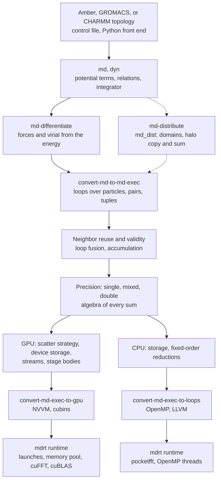
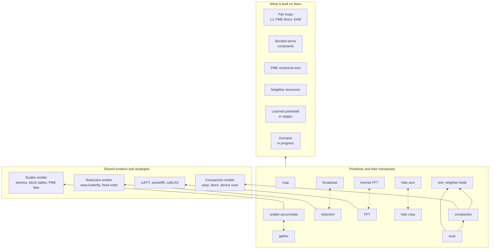

# MDIR

Run molecular dynamics on CPUs and NVIDIA GPUs from Amber, GROMACS, or
CHARMM inputs, or define your own potential in a control file.

## Quickstart

[Install MDIR](#installing) from a release or run its container, then run
these commands from the root of the source tree. Check the CPU installation
and run the supplied liquid argon example:

```sh
export PATH="$HOME/opt/mdir/bin:$PATH"   # where MDIR is installed
mdir doctor --target=cpu
mkdir argon-run
cp examples/argon/argon.toml examples/argon/argon.pdb argon-run/
mdir check argon-run/argon.toml
mdir run argon-run/argon.toml > argon-run/argon.log
```

The example runs 864 atoms for 2000 steps and writes its energy log and
`argon.dcd` trajectory in `argon-run/`. `mdir check` reports the planned
run and warnings before execution. Run `mdir doctor` to check every built
target, including the CUDA driver, visible devices, and a short GPU run.
Use `mdir doctor --target=gpu` to check just the GPU.

For your own Amber system, `mdir template minimize`, `nvt`, `npt`, and
`production` print the stages of a standard pipeline. Set their input
paths before running them; [Appendix C](docs/paper/C-usage.md) walks through
inputs, equilibration, checkpoints, and diagnosis, and
[examples/](examples/) contains complete systems.

## About MDIR

MDIR is an MLIR-based compiler stack for general-purpose molecular dynamics.
It compiles each run before it runs: the potential, the integrator, the
constraints, and the couplings are written in dialects of molecular
dynamics, differentiated, fused, given a precision, and lowered to the CPU
with OpenMP or to NVIDIA GPUs, specialized to the system at hand. The first
milestone runs all-atom systems from Amber (`prmtop`), GROMACS (`top`,
`itp`, `gro`), and CHARMM (`psf`, `crd`, `rtf`, `prm`, `str`) topologies,
the Amber and CHARMM force fields among them:
bonded terms with CMAP and Urey–Bradley angles, Lennard-Jones with the
correction for the dispersion or CHARMM's force switch, particle mesh
Ewald, SHAKE and SETTLE,
virtual sites, restraints, stochastic velocity rescaling or Langevin dynamics, and stochastic
cell rescaling, in single, mixed, or double precision. On one RTX 4090 in
mixed precision it runs the systems of the Amber GPU benchmark suite, with
the steps and output of the suite's inputs, at 1277 ns/day on JAC (23,558
atoms, 2 fs) to 83 ns/day on STMV (1,067,095 atoms, 4 fs). Section 10 of
the white paper ([docs/paper/10-performance.md](docs/paper/10-performance.md))
measures it against the first milestone's target (D114), the rate of
pmemd.cuda, with both programs under one protocol. A driver reads a control file and writes a log, a
trajectory, and checkpoints, from which a run continues exactly. The white
paper of the first milestone is in [docs/paper/](docs/paper/README.md), and
[docs/overview.md](docs/overview.md) gives the whole design in brief.

## MDIR at a glance

### A step on a GPU

The step that `mdir run` compiles for a typical all-atom system: velocity
Verlet with constraints, Lennard-Jones and particle mesh Ewald, and the
neighbor groups with a dual list. Each box is one or more fused kernels,
annotated with the primitives they are made of.

```mermaid
flowchart LR
    X["Positions"] --> V{"Neighbor structures<br/>still valid?"}
    V -- no --> B["Rebuild<br/>sort, scan, compaction"]
    V -- yes --> F
    B --> F
    subgraph F["Forces, energy, virial"]
        direction TB
        P["Pairs within the cutoff<br/>Lennard-Jones and Ewald direct sum<br/>gather, scatter-accumulate"]
        T["Tuples<br/>bonds, angles, torsions, CMAP, 1-4 pairs,<br/>excluded pairs of PME<br/>gather, scatter-accumulate"]
        subgraph K["PME reciprocal sum"]
            direction LR
            S["Spread<br/>scatter-accumulate"] --> FFT["FFT"] --> G["Influence<br/>map"] --> IFFT["Inverse FFT"] --> R["Gather"]
        end
    end
    F --> E["Energies and virial<br/>reduction"]
    F --> I["Kick, drift, constraints<br/>SHAKE, SETTLE"]
    E --> C["Thermostat and barostat"]
    C --> I
    I --> X
```



The compiled segment runs this loop for many steps. Between segments the
driver writes the log, the trajectory, and checkpoints.

### From a control file to machine code

The passes that `mdir run` applies, in order (`lib/Compiler/Compile.cpp`).
Solid edges are the pipeline of a run today. The dashed path through
`md_dist` (domains and halos) is built and tested with `mdir-opt`, but no
run takes it yet.



### The primitives and what is built on them

Every loop of a step is made of a small set of primitives, each with a
declared transpose, so that forces and their derivatives are compositions
of the same pieces. The lowerings share one emitter for each primitive
and choose among its strategies by measurement
([docs/primitives-map.md](docs/primitives-map.md)).



## Installing

The current release is [v0.1.0](docs/release-notes/v0.1.0.md); its
changes are in [CHANGELOG.md](CHANGELOG.md).

**From a release.** Download the source archive of the release from
[GitHub Releases](https://github.com/vv137/mdir/releases), build LLVM,
HDF5, and MDIR as [below](#requirements), and install:

```sh
cmake --install build --prefix $HOME/opt/mdir
```

The installed tree is `bin/mdir` with its runtime and the OpenMP runtime in
`lib/`; it does not need the build trees of MDIR or LLVM. At run time it
needs HDF5 (found through the RPATH of the build), and on a GPU the NVIDIA
driver and the CUDA toolkit's `nvvm/libdevice` and cuFFT, under `CUDA_ROOT`
or the toolkit it was built with.

**In a container.** [packaging/](packaging/README.md) builds a Docker or an
Apptainer image with LLVM, HDF5, CUDA, and MDIR:

```sh
docker build -f packaging/Dockerfile -t mdir:0.1.0 .
docker run --rm --gpus all -v "$PWD":/work mdir:0.1.0 doctor
apptainer build mdir-0.1.0.sif docker-daemon://mdir:0.1.0
apptainer run --nv mdir-0.1.0.sif doctor
```

## Documents

| Document | Contents |
|---|---|
| [docs/overview.md](docs/overview.md) | An overview: why MDIR exists, its dialects, passes, lowerings, runtime, and front ends, one step, and what it guarantees, with diagrams |
| [docs/architecture.md](docs/architecture.md) | The first design (M0), and where each of its parts went |
| [docs/future-architecture-plan.md](docs/future-architecture-plan.md) | Future plan: architecture review against Saunders, Cornel, and P4IRS, with staged dependencies, MLIP semantics, and model interoperability |
| [docs/ops.md](docs/ops.md) | Types and ops for the first milestone |
| [docs/runtime.md](docs/runtime.md) | Proposal for the runtime and execution of the first milestone |
| [docs/driver.md](docs/driver.md) | The driver and its control file |
| [docs/neighbors.md](docs/neighbors.md) | How neighbor structures are built and kept valid, with measurements |
| [docs/tuples.md](docs/tuples.md) | Terms over the tuples of a topology: tuple sets, internal coordinates and their derivatives, execution, exclusions and pairs three bonds apart, CMAP |
| [docs/nonbonded.md](docs/nonbonded.md) | Parameters of pairs of types, the correction for the dispersion, and the electrostatics |
| [docs/pme.md](docs/pme.md) | Particle mesh Ewald |
| [docs/constraints.md](docs/constraints.md) | Constraints (SETTLE, SHAKE, RATTLE) and virtual sites |
| [docs/dynamics.md](docs/dynamics.md) | The removal of the motion of the center of mass, thermostats and barostat, a cell that changes, minimization, restraints, and leapfrog |
| [docs/validation.md](docs/validation.md) | How the terms, integrators, and ensembles were compared with the reference engines |
| [docs/charmm.md](docs/charmm.md) | CHARMM force fields: what CHARMM computes (measured with CHARMM 51b1), the force switch of Steinbach and Brooks, converting CHARMM files, and the validation against CHARMM |
| [docs/paper/](docs/paper/README.md) | The white paper of the first milestone, with derivations and measurements (`scripts/paper/build-pdf.sh` builds the PDF) |
| [CHANGELOG.md](CHANGELOG.md) | What changed in each release |
| [docs/release-notes/](docs/release-notes/v0.1.0.md) | Notes of each release |
| [CONTRIBUTING.md](CONTRIBUTING.md) | How to build, test, and change MDIR |
| [docs/workflow.md](docs/workflow.md) | How work is planned, reviewed, and merged: roles, draft pull requests, decision labels, shared GPUs |
| [docs/decisions.md](docs/decisions.md) | Decisions and their status |
| [docs/principles.md](docs/principles.md) | Principles of development, from the defects that taught them |
| [docs/roadmap.md](docs/roadmap.md) | What comes next: robustness, the rest of the first milestone, the white paper |
| [docs/debugging.md](docs/debugging.md) | Reports of defects (`mdir bug-report`), failures of passes and kernels, tiers of tests |
| [docs/environment.md](docs/environment.md) | The environment variables that MDIR reads: devices, compilation, debugging, tests |
| [docs/prior-art.md](docs/prior-art.md) | Earlier work and what is taken from it |

## Requirements

- A C++17 compiler
- CMake 3.20 or later
- Ninja
- LLVM and MLIR 23.1.2, built with `scripts/build-llvm.sh`
- `lit`, for the tests (`pip install lit`)
- For NVIDIA GPUs: the driver, and the CUDA toolkit for its header and its
  device math library. Versions 11.2 and 13.x are known to work.
- For checkpoints: HDF5, built with `scripts/build-hdf5.sh`
- For the Python interface (optional): Python 3.10 to 3.13, pybind11
  3.0.1, and NumPy 1.23 or later

## Building LLVM

```sh
LLVM_ROOT=$HOME/opt/llvm scripts/build-llvm.sh
```

The script clones the release, builds it with MLIR and the X86, NVPTX, and
AMDGPU targets, and installs it to `$LLVM_ROOT/23.1.2`. It then builds the
OpenMP runtime from the same source and installs it to the same place.

## Building HDF5

```sh
HDF5_ROOT=$HOME/opt/hdf5 scripts/build-hdf5.sh
```

The script installs HDF5 1.14.6 to `$HDF5_ROOT/1.14.6`. Without HDF5, MDIR
is built all the same and writes no checkpoints.

## Building MDIR

```sh
LLVM_PREFIX=$HOME/opt/llvm/23.1.2

cmake -G Ninja -S . -B build \
    -DCMAKE_BUILD_TYPE=Release \
    -DLLVM_ENABLE_ASSERTIONS=ON \
    -DMLIR_DIR=$LLVM_PREFIX/lib/cmake/mlir \
    -DLLVM_DIR=$LLVM_PREFIX/lib/cmake/llvm \
    -DLLVM_EXTERNAL_LIT=$(command -v lit) \
    -DHDF5_ROOT=$HOME/opt/hdf5/1.14.6

cmake --build build
```

If the CUDA toolkit is found, the runtime for NVIDIA GPUs is built as
`build/lib/libmdrt_cuda.so`. `-DCUDAToolkit_ROOT=<path>` names a toolkit
that is not on the search path, and `-DMDIR_ENABLE_CUDA=OFF` leaves the
runtime out.

## Python interface (preview)

The Python interface of milestone M2 is the package `mdir`. Its wheels,
for CPython 3.10–3.13 on Linux x86-64 with glibc 2.28 or later
(manylinux_2_28), install into a virtual environment and need, for a
GPU, only the NVIDIA driver; the extra `cuda` brings cuFFT and ptxas
([docs/python-package.md](docs/python-package.md)):

```sh
python -m venv mdir-env
mdir-env/bin/pip install "mdir-0.1.0-cp312-cp312-manylinux_2_28_x86_64.whl[cuda]"
mdir-env/bin/python -c "import mdir; print(mdir.__version__)"
```

The `mdir` command is not part of the wheel; it comes with the release
tarball. In a build of the tree the interface is optional and off by
default. When enabled, NumPy is required and checked at configuration:

```sh
pip install pybind11==3.0.1 'numpy>=1.23'

cmake -G Ninja -S . -B build <the options above> \
    -DMDIR_ENABLE_PYTHON=ON \
    -Dpybind11_DIR=$(python3 -m pybind11 --cmakedir)
cmake --build build

PYTHONPATH=build/python python3 -c "import mdir"
```

The package `mdir` is built in `build/python/mdir`. It loads Amber, GROMACS, and
CHARMM inputs, sets up a model, compiles it to the IR and plan that
`mdir run` would use, and runs it as a simulation that persists across
calls:

```python
sim = mdir.Simulation(mdir.compile(system, state, integrator, ensemble,
                                   execution, mdir.Schedule()))
sim.run(1000)
positions = sim.state().positions   # (N, 3) in nm, in input order
```

`sim.run(n, energy=True)` ends with a step of energy, whose energies
`sim.state().energies` holds. Reporters and checkpoints of a simulation are
not there yet, and the interface changes during M2.
`MDIR_COMPILE_CACHE_DIR=<dir>` keeps the host code of compiled programs in
`<dir>` across processes and rebuilds (`MDIR_COMPILE_CACHE=off` disables
it, `MDIR_COMPILE_CACHE_MAX_MB` bounds it, 2048 by default), and
`sim.compile_stats` reports what compiling took
([docs/compile-cache.md](docs/compile-cache.md)).
[docs/python-compile.md](docs/python-compile.md) and
[docs/python-segments.md](docs/python-segments.md) describe it.

## Testing

```sh
cmake --build build --target check-mdir
```

The tests need `mlir-opt`, `mlir-runner`, and `FileCheck` from the LLVM
installation. Some tests run generated code and compare its results with
reference values. A build with `MDIR_ENABLE_PYTHON=ON` adds the tests of
the Python interface.

The suite runs its tests in parallel, but at most sixteen of the tests that
need a GPU (`REQUIRES: cuda`) run at once, on the device that
`CUDA_VISIBLE_DEVICES` selects; an empty value hides the GPU and skips
them. `-Dgpu_workers=N` in `LIT_OPTS` changes that number; `-Dgpu_workers=1`
runs them one at a time. Each test lowers its programs with the cores over
that number of threads (`MDIR_COMPILE_THREADS`; `-Dcompile_threads=N`
changes it). The tests share the host objects they compile through the
compile cache in `build/test/compile-cache`; `-Dcompile_cache=off` runs
the suite without it. The same holds for the sanitized suite (`scripts/build-sanitized.sh`)
and the suite of a release (`scripts/release/publish.sh`). On a machine
that others share, hold a lock of the device around the whole suite, as
[docs/workflow.md](docs/workflow.md) says, so that no other suite or timing
run uses the device at the same time.

## Tools

`mdir-opt` parses, verifies, transforms, and prints MDIR modules.

```sh
build/bin/mdir-opt test/Dialect/MD/ops.mlir
```

| Pass | Effect |
|---|---|
| `--md-check-exchange` | Proves the exchange contracts of pair kernels. |
| `--md-expand-truncation` | Expands truncation attributes into kernels. |
| `--md-differentiate` | Replaces `md.evaluate` with calls to generated derivative functions. |
| `--md-inline` | Inlines potentials, functions, and programs into the code that calls them. |
| `--convert-md-to-md-exec` | Converts `md` and `dyn` ops to loops over particles and pairs. |
| `--md-exec-reuse-neighbors` | Makes a neighbor structure that is built in a loop a value that the loop carries and refreshes. |
| `--md-exec-expose-validity` | Makes the test of validity of a neighbor structure a loop over particles, which `--md-exec-fuse-loops` fuses with the loop that writes the positions. |
| `--md-exec-fuse-loops` | Fuses loops over the pairs of one neighbor structure, and loops over the particles of one set. Run `--cse` after it. |
| `--md-exec-simplify-distance` | Rewrites pair kernels in powers of the squared distance. Changes rounding. Run `--canonicalize --cse` after it. |
| `--md-exec-assign-precision` | Assigns `f32` or `f64` to fields and kernels. Options: `mode=single`, `mixed`, or `double`, and a type per role. Run it last before the lowering. |
| `--md-exec-assign-storage` | Gives every field a buffer and converts the loops to the storage form, in which they update buffers where they are. With `memory=device` the buffers are on a GPU. |
| `--convert-md-exec-to-loops` | Converts the loops in the storage form to `scf` loops over `memref`s. |
| `--convert-md-exec-to-gpu` | Converts the loops in the storage form, with buffers on a device, to kernels of the upstream `gpu` dialect. |

The table names the passes of the semantic levels; `mdir emit FILE
--stage=pipeline` prints the whole pipeline that a run takes.

After the last pass the module holds only upstream dialects, so `mlir-opt`
lowers it to LLVM and `mlir-runner` runs it:

```sh
build/bin/mdir-opt input.mlir \
    --md-check-exchange --md-differentiate --md-expand-truncation \
    --md-inline --convert-md-to-md-exec="skin=0.3 width=96" \
    --md-exec-reuse-neighbors --md-exec-expose-validity \
    --md-exec-fuse-loops --cse \
    --md-exec-assign-precision="mode=mixed" \
    --md-exec-assign-storage --convert-md-exec-to-loops \
  | mlir-opt --convert-scf-to-openmp --canonicalize \
      --convert-scf-to-cf --convert-math-to-llvm --convert-math-to-libm \
      --convert-vector-to-llvm --expand-strided-metadata \
      --finalize-memref-to-llvm --convert-arith-to-llvm \
      --convert-func-to-llvm --convert-cf-to-llvm \
      --convert-openmp-to-llvm --reconcile-unrealized-casts \
  | mlir-runner -e main --entry-point-result=void \
      --shared-libs=build/lib/libmdrt.so,$LLVM_PREFIX/lib/libomp.so,$LLVM_PREFIX/lib/libmlir_c_runner_utils.so
```

Without `--convert-scf-to-openmp --canonicalize` and
`--convert-openmp-to-llvm`, the loops run sequentially and `libomp.so` is
not needed. `test/Integration` holds complete programs.

For a GPU, the last two passes of `mdir-opt` and the passes of `mlir-opt`
are others, and the runtime for GPUs is loaded:

```sh
export CUDA_ROOT=/usr/local/cuda

build/bin/mdir-opt input.mlir \
    ... \
    --md-exec-assign-precision="mode=mixed" \
    --md-exec-assign-storage="memory=device" --convert-md-exec-to-gpu \
  | mlir-opt --gpu-lower-to-nvvm-pipeline="cubin-format=isa" \
      --reconcile-unrealized-casts \
  | mlir-runner -e main --entry-point-result=void \
      --shared-libs=build/lib/libmdrt.so,build/lib/libmdrt_cuda.so,$LLVM_PREFIX/lib/libmlir_c_runner_utils.so
```

The kernels are embedded as PTX text, which the driver compiles when the
program starts.

## Running a simulation

`mdir run` reads a control file, compiles the run, and executes it.

```sh
build/bin/mdir run examples/argon/argon.toml
```

```text
MDIR: 864 particles, 2000 steps of 0.005 ps
MDIR: compiled in 0.33 s
INFO:      STEP           TIME      TOTAL_ENE  POTENTIAL_ENE    KINETIC_ENE    TEMPERATURE         VIRIAL       PRESSURE
INFO:         0         0.0000      -834.1316     -1304.8874       470.7558       183.0000     -4920.3575     -2161.8410
INFO:       100         0.5000      -834.1466     -1087.9806       253.8339        98.6980      -300.5656       112.6241
...
INFO:      2000        10.0000      -834.1467     -1083.2389       249.0922        96.8538       -70.6513       232.3875
MDIR: ran in 0.33 s, 0.17 ms per step, 2611.0 ns per day
MDIR: neighbor structures were built 113 times, every 17.9 steps on average
MDIR: the total energy changed by 1.813e-05 of its value
```

The control file is a TOML file, in Å, kcal/mol, and ps. `[execution]`
selects the target, `cpu` or `gpu`, the number of threads, and the
precision. `mdir template md` prints a control file with every keyword.
See [docs/driver.md](docs/driver.md).

| Command | Does |
|---|---|
| `mdir run <control file> [--continue [--no-append]] [--max-walltime=<time>]` | Compiles the run and executes it; `--continue` goes on from its checkpoint until it is complete, and a run stops at a checkpoint on SIGTERM or at the wall time; a run that is not continued keeps the outputs of an earlier one as `#<name>.<n>#` with the exit status 75 ([docs/driver.md](docs/driver.md), Section 2.7) |
| `mdir emit <control file> [--stage=module\|lowered\|pipeline]` | Prints the program of the run, as it is built or as it is executed, or the passes between |
| `mdir check <control file> [--json]` | Reads the input and reports the system, planned run, output paths and intervals, and preflight warnings; `--json` gives a structured report |
| `mdir template md\|amber` | Prints a control file with every keyword, for terms in the control file or for an Amber topology |
| `mdir template minimize\|nvt\|npt\|production` | Prints one stage of the standard pipeline, with checkpoints connecting the stages |
| `mdir checkpoint <file> [<file>]` | Describes a checkpoint, or compares the states of two |
| `mdir version` | Prints the version, the commit, and what the build supports |
| `mdir bug-report <control file> [--run]` | Collects what a report of a defect needs ([docs/debugging.md](docs/debugging.md)) |

Before running a control file, inspect its ensemble, duration, PME,
constraints, target, precision, and outputs:

```sh
mdir check production.toml
mdir check production.toml --json > preflight.json
```

The check warns about existing output files, a fixed neighbor-rebuild
interval, and missing energy reports or checkpoints. It leaves files
untouched. Warnings keep exit status 0; invalid input returns 1, including
in JSON mode. It checks the control file and coordinates without compiling
or loading an input checkpoint; it does not test the device or guarantee
that a run will compile. See [the preflight reference](docs/driver.md#14-preflight).

`mdir-opt` runs the passes of MDIR on IR, as `mlir-opt` does, for
development.

## Examples

| Example | System | Shows |
|---|---|---|
| [examples/ala3](examples/ala3) | Tri-alanine with ff19SB in OPC water, 4,905 particles | A whole protocol from a topology of tleap: minimization, heating at constant volume, equilibration at constant pressure with restraints, and 1 ns of production, with PME, SETTLE, SHAKE, and the virtual sites of OPC |
| [examples/ubiquitin](examples/ubiquitin) | Ubiquitin (1UBQ) with ff19SB in OPC water, 26,031 particles | A tutorial from the PDB file: tleap, minimization with restraints, heating, equilibration at constant pressure, and 10 ns of production with the groups and the dual list |
| [examples/popc-bilayer](examples/popc-bilayer) | A bilayer of 126 POPC lipids of Lipid21 in TIP3P water, 31,680 atoms | A tutorial from nothing: PACKMOL-Memgen, PACKMOL, and tleap, minimization from the close contacts of the packing, relaxation, and 30 ns at semi-isotropic constant pressure, with the area per lipid from the frames |
| [examples/argon](examples/argon) | Liquid argon, 864 atoms | A run from a PDB file with the terms in the control file, and the same system as a module written by hand |

```sh
examples/ala3/run.sh ala3-run build/bin/mdir   # the four stages, in ala3-run
```

`mdir template amber` prints a control file for a run from an Amber
topology with every keyword it takes, and `mdir template md` one for a run
with the terms in the control file.

To start from the standard pipeline with your own Amber system:

```sh
mdir template minimize > 1-min.toml
mdir template nvt > 2-nvt.toml
mdir template npt > 3-npt.toml
mdir template production > 4-md.toml
```

Edit `system.prmtop` and `system.inpcrd`, the restraint selection, the run
lengths, and `[execution]` in these files. They use the settings of
`examples/ala3`: restrained minimization, 50 ps at constant volume,
100 ps at constant pressure with weaker restraints, and 1 ns of production
without restraints. They require HDF5 checkpoints and select a GPU in
mixed precision; set `target = "CPU"` to use the host. Then run the files
in order with `mdir run --continue FILE`. Each stage takes the previous
stage's checkpoint; the same commands continue interrupted stages and
skip completed ones. [The driver guide](docs/driver.md#13-standard-pipeline-templates)
lists the stage settings and outputs.

`examples/argon/argon.toml` is liquid argon at constant energy: 864 atoms,
2000 steps of 5 fs with velocity Verlet. `examples/argon/argon.mlir` is the
same system as a module that is written by hand, which
`examples/argon/run.sh` compiles and runs with the tools, pass by pass:

```sh
export MDIR_BUILD=build LLVM_PREFIX=$HOME/opt/llvm/23.1.2   # both are needed
examples/argon/run.sh examples/argon/argon.mlir             # double precision
examples/argon/run.sh examples/argon/argon.mlir mixed 16    # mixed, 16 threads
CUDA_ROOT=/usr/local/cuda \
    examples/argon/run.sh examples/argon/argon.mlir mixed gpu
```

It prints the time, the potential, kinetic, and total energy, and the
temperature every 100 steps, and at the end the relative change of the
total energy, which is about 2e-5.

## License

MIT. See [LICENSE](LICENSE).
