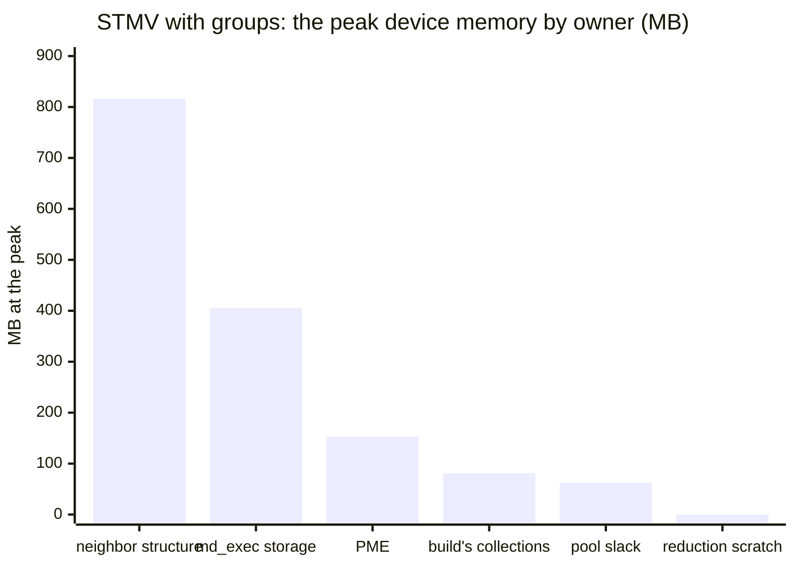
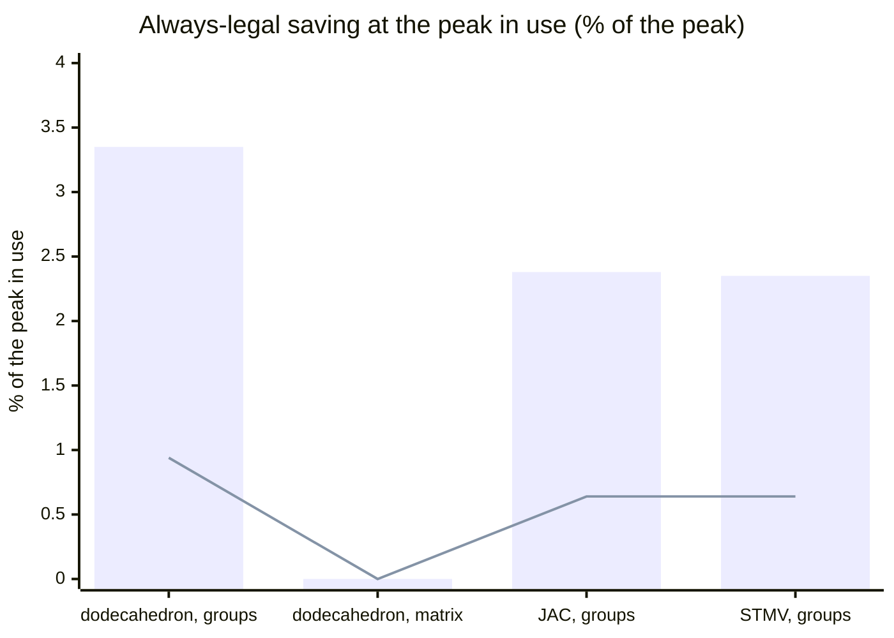

# D[md-alg-canonical]

Recorded at its merge.

**The always-legal transformations of the `md_alg` layer find almost nothing on the programs of `main`. No fold has an input it could fold, no collection is dead, and no collection is computed twice. Reuse by lifetime applies only in the groups build, where it saves 9.3 MB, 0.64% of STMV's peak. The maintainer therefore ruled to add no code (2026-11-14) and to record this census, with a breakdown of the peak device memory by owner. In use, the largest always-legal saving measured is the placement of the groups build's second phase after the release of its first: 34.2 MB, 2.35% of STMV's peak and 2.4% of JAC's. It is a change to the build's host code (`GroupsBuild.cpp`), not an `md_alg` transformation. The largest owner, the runtime's lists of the groups (56% at STMV), has no reuse by lifetime: all four of its lists are live at every step.** Issue #876, part of #866 (item 4) and #558; P2 of #877.

The maintainer's principle (2026-11-14): optimization does the
transformations that are always legal first. Semantic ones, such as
eliding a sort or anything else that changes an order, come after the IR
carries what its consumers require. #869 (PR #873) answered the first
experiment in the negative. This decision answers the always-legal
question of #876. The design that the PR proposed first is described at
the end, with the ruling.

## 1. The census at the slot

The IR is that of the slot `md-alg-transform-collections`: `mdir emit
--stage=lowered`, with the pipeline cut after that pass (D409). The
programs are:
- the rhombic dodecahedron of `test/Driver/md-alg-passes-gpu.test` with
  the groups and with the matrix;
- JAC NVE with the groups;
- STMV NPT (4 fs) with the groups, from the Amber suite.

In each, the `md_alg` ops at the slot are those of the neighbor builds:
- the groups build's three `grid_plan`s, two `sort_by_key`s, one scan,
  the accessors (`bin_span`, `bin_item`), and the four `append`s;
- the spatial order's `sort_by_key`;
- the matrix sort's scan, `scatter_to_bins`, and `sort_bins`;
- the ragged accessors in kernels.

The matrix program has one `grid_plan`, one `sort_by_key`, one scan,
one scatter, and one `sort_bins`.

| Candidate (#876) | What was looked for | Fires | Why not |
|---|---|---|---|
| A scan or a sort of zero items | a count or a `bins` that is a constant 0 | none of 4 programs | each count is a `memref.dim` of a buffer, or a value computed from the box (`grid_plan`'s counts) |
| A `grid_plan` with constant extents | constant edge lengths, width, or volume | none | the extents are `vector.extract`s of the box, an argument of the build; under NPT the box changes at every step |
| An accessor of a constant bin | a constant `from`, `to`, place, or row of `bin_span`, `bin_item`, `ragged_row`, `ragged_entry` | none | the only constants that reach an `md_alg` op are `entry_size` (4) and `column` of the ragged accessors, and the launch sizes (128, 1) of the execution group |
| A side output nobody reads | a buffer of `writes` or `adds` without a reader | none | the first sort writes the wrapped positions, which the second sort's key region reads. Its counters of the sizes are copied to the host. The second sort writes the places, which the boxes and the lists read |
| A dead collection (an op whose written buffers are not read and do not escape, by D409's rules) | — | none | every collection is read after its producer, or escapes. The spatial order's order and the matrix scatter's output are arguments of their functions |
| A collection computed twice (the same op, operands, and attributes, with no write in between) | — | none | no two collection ops of a function have the same operands. The three `grid_plan`s of the groups build differ in their operands and bounds |
| Reuse of an allocation by lifetime | two buffers of one function whose lifetimes do not overlap | **the groups build only** | the matrix build, the matrix sort, and the spatial order use every buffer from the beginning of the function to its end |

The scan used a short script on the printed IR. It lists every operand
of an `md_alg` op that an `arith.constant` defines.

### The reuse pairs of the groups build

`GroupsBuild::emit` allocates all sixteen buffers of the build where
the function begins. The first phase is the counting sort of the
particles by column and z-bin, and the chunks of the columns. It frees
its seven buffers before the second phase uses any of its own. The
second phase is the counting sort of the places by cell of the search
grid, the boxes, and the lists. Two buffers live through both phases:
the wrapped positions (n × 3 f32) and the counters of the sizes (5 i32).

A pair is a buffer of the first phase and one of the second, of the same
element type and rank. They share one allocation of the larger size.
The sizes are the runtime's blocks, from the allocation trace of Section 2:

| First phase (freed) | Second phase | Dodecahedron | JAC | STMV |
|---|---|---:|---:|---:|
| `key` (n) | `gkey` (places) | 4,836 / 6,336 | 94,232 / 118,080 | 4,268,380 / 5,335,744 |
| `keyCount` (keys) | `gcount` (cells) | 9,664 / 400 | 188,356 / 5,324 | 8,535,000 / 256,000 |
| `keyStart` (keys + 1) | `gstart` (cells + 1) | 9,668 / 404 | 188,360 / 5,328 | 8,535,004 / 256,004 |
| `keyCursor` (keys) | `gcursor` (cells) | 9,664 / 400 | 188,356 / 5,324 | 8,535,000 / 256,000 |
| `sorted` (n) | `gplace` (n) | 4,836 / 4,836 | 94,232 / 94,232 | 4,268,380 / 4,268,380 |
| **Saved (bytes)** | | **10,876** | **204,440** | **9,304,764** |
| of the peak in use | | 0.94% | 0.64% | 0.64% |

The largest buffer of the second phase has no partner of its type: the
places, n × 4 f32 rows of the capacity (21.3 MB at STMV), against the
first phase's i32 buffers. Neither does the boxes buffer. Only `sorted`
and `gplace` have the same size value. The others share only through a
maximum of two run-time sizes.

## 2. The peak device memory, by owner

### How it was measured

- **The run.** `mdir run` of 200 steps with `MDIR_DEVICE_MEMORY=2`, on
  one RTX 5090. `[output] energy_interval` was set to 0. Each control
  file was otherwise that of the test (the dodecahedron) or the Amber
  suite (JAC, STMV). The runtime's summary gives the peaks:

  | Program | Peak in use | With the pool |
  |---|---:|---:|
  | the dodecahedron, groups | 1.1 MiB | 1.1 MiB |
  | the dodecahedron, matrix | 3.1 MiB | 3.1 MiB |
  | JAC, groups | 30.3 MiB | 31.4 MiB |
  | STMV, groups | 1,388.4 MiB | 1,448.2 MiB |

- **The trace.** To attribute each block, a local build of the base, not
  committed, also wrote a trace from `mgpuMemAlloc`, `mgpuMemFree`, and
  the runtime's own releases (`releaseReplaced`, and the release of an
  activation). Each line held:
  - the number of launches so far;
  - the pointer and the size;
  - the runtime's tag (`groups: entries`, `matrix: rows`, ...);
  - the return address, which names the site in the compiled code.

  A replay of the trace gives the same peaks as the runtime, to the byte
  (1,455,830,804 bytes in use at STMV; 1,518,503,948 with the pool). The
  replay of the pool takes a freed block for the next request of its size
  alone, as `mgpuMemAlloc` does.
- **The owners.** The blocks at the peak in use are attributed by rule:
  - **the neighbor structure of the runtime**: a block with a runtime
    tag (`groups:`, `matrix:`);
  - **the build's collections**: a block at the peak that is released
    before the run ends. In all four programs these are exactly the
    temporaries of the neighbor build that holds the peak. The order of
    their sites matches the order of the `gpu.alloc`s of the build's
    function at the slot, one for one;
  - **PME**: the blocks that compiled code allocates at the launch that
    allocates the real grid. These are the grid, the complex grid, the
    influence function, the positions in f32, the reciprocal forces, and
    a buffer of the spreading;
  - **the scratch of reductions**: the blocks of the partial sums, 1,024
    f64 (8,192 bytes) and 1,024 × 3 f64 (24,576 bytes);
  - **the storage of `md_exec`**: every other block of compiled code. These are the
    fields and parameters that `md-exec-assign-storage` and
    `convert-md-exec-to-gpu` allocate before the loop over steps and
    keep to its end;
  - **the pool's slack**: the peak with the pool minus the peak in use.

  No block is from the store of the tuples (`tuples:`) at any peak.

### Where the peak is

In every groups program the peak in use is inside the first build of
the groups. The four lists (entries, masks, inner entries, inner masks)
are allocated by then. So are all sixteen buffers of the build, and the
scratch of its first scan. In the matrix program it is inside the
matrix build.

| Owner (bytes at the peak in use) | Dodecahedron, groups | Dodecahedron, matrix | JAC, groups | STMV, groups |
|---|---:|---:|---:|---:|
| neighbor structure (runtime) | 294,108 (25.5%) | 2,476,032 (76.0%) | 18,129,864 (57.1%) | 816,279,720 (56.1%) |
| storage of `md_exec` | 315,044 (27.3%) | 290,864 (8.9%) | 7,357,568 (23.2%) | 405,153,800 (27.8%) |
| PME | 376,948 (32.7%) | 376,948 (11.6%) | 4,356,568 (13.7%) | 152,947,548 (10.5%) |
| the build's collections | 94,132 (8.2%) | 38,800 (1.2%) | 1,796,480 (5.7%) | 81,343,240 (5.6%) |
| scratch of reductions | 73,728 (6.4%) | 73,728 (2.3%) | 106,496 (0.3%) | 106,496 (0.0%) |
| **peak in use** | **1,153,960** | **3,256,372** | **31,746,976** | **1,455,830,804** |
| the pool's slack | 36,644 | 12,492 | 1,184,932 | 62,673,144 |
| **peak with the pool** | **1,190,604** | **3,268,864** | **32,931,908** | **1,518,503,948** |

### What reuse by lifetime could save, by owner

"Always legal" here means:
- a change of where a buffer is allocated or released;
- or one allocation for buffers whose uses do not overlap in the host's
  order on one stream.

No kernel, order, or value changes.

| Owner | Always-legal reuse by lifetime | Saved at the peak (STMV / JAC) | Layer |
|---|---|---:|---|
| neighbor structure (runtime) | none: the four lists are read or written at every step (the pruning of D284 writes the inner lists from the outer ones), and the build writes them | 0 | — |
| storage of `md_exec` | within a step, between buffers whose uses do not overlap in the step's order. Across steps, none: every one is allocated before the loop and kept to its end, and the loop carries 13 buffers as its arguments | not estimated: it needs the liveness of each buffer within the loop body, which neither the trace nor D409 gives. At most the owner's 405.2 MB / 7.4 MB | `md-exec-assign-storage`, where the storage is chosen |
| PME | none within the reciprocal sum: the real grid is live from the spreading through the forward FFT, and again from the backward FFT through the gathering. The complex grid is live between the two FFTs | 0 | — |
| the build's collections | the second phase allocated after the first is released (a placement), or one block for both phases | 34,154,852 (2.35%) / 754,108 (2.38%) in use | the groups build's host code (`GroupsBuild::emit`), or a host placement step at the `md_alg` slot |
| | the same restricted to pairs of one type (Section 1) | 9,304,764 (0.64%) / 204,440 (0.64%) | the `md_alg` slot |
| scratch of reductions | one block for the partial sums of reductions that do not overlap | at most 81,920 / 81,920 | the reductions' lowering (`fixed-order-reductions`) |
| the pool's slack | a freed block given to a request of a different size. The slack at the peak is mostly the setup's buffers of the device tuples (D257, ten sets of five blocks, each block a size of its own) and two blocks of the per-step buffers. A request takes a freed block only of its own size, so these stay in the pool for the whole run | at most 62,673,144 (4.1% of the peak with the pool) / 1,184,932 (3.6%), with an allocator that splits blocks | the runtime's pool (`mdrt_cuda.c`) |

**The placement of the build's second phase**, simulated on the trace:
- **In use.** Each build's allocations of the second phase are moved to
  just after the last release of its first phase. The saving at the peak
  in use:
  - the dodecahedron: 38,712 bytes (3.35%);
  - JAC: 754,108 (2.38%);
  - STMV: 34,154,852 (2.35%).

  The peak stays inside the build. It is the larger of the two phases
  plus what lives through both: 34.1 MB and 34.4 MB at STMV.
- **With the pool.** The placement alone saves less: 4.8 KB, 94 KB, and
  4.27 MB. The pool keeps the freed blocks of the first phase, and the
  second phase's blocks are of other sizes, except `gplace`. One block
  for both phases, of the larger phase's bytes, saves 21.5 KB, 0.53 MB,
  and 23.8 MB with the pool (1.6% at STMV).

The matrix program has no such saving. The matrix build uses each of its
eight buffers from its first launch to its last.

The bars are the placement of the build's second phase. The line is the
reuse within the `md_alg` collections alone (Section 1).

## 3. The conclusion

- **The largest saving in use** is the groups build's placement of its
  second phase after its first. It is 2.35% of the peak at STMV (34.2
  MB), 2.4% at JAC, and 3.4% on the dodecahedron, nothing with the
  matrix.
  - **Layer.** The build's host code: `GroupsBuild::emit` allocates
    everything where it begins, and it is the place that knows the two
    phases. A general host placement step at the `md_alg` slot would
    reach the same buffers through D409's lifetimes. To keep the saving
    with the pool, the two phases take one block, or the pool takes
    blocks of other sizes.
- **The largest bound with the pool** is the pool's slack: up to 62.7
  MB, 4.1% of STMV's footprint. It needs an allocator that serves a
  request from a larger freed block and splits it (`mdrt_cuda.c`).
- **Not measured.** The storage of `md_exec`, 28% of STMV's peak, may
  hold more. It would take a liveness analysis of the buffers within
  the step, at `md-exec-assign-storage`.
- **No saving by reuse.** The neighbor structure of the runtime and
  PME, two thirds of the peak, have no reuse by lifetime.
- **The `md_alg` layer**, with only the builds in it (#877, P2), holds
  the smallest of these savings: 0.64% at STMV, by pairs of one type.

## 4. The design proposed first, and the ruling

The draft of the PR proposed four transformations in the slot. The
first three read D409's analysis:
- the removal of a dead collection;
- the merging of an op that recomputes what an earlier one wrote into
  the same buffers, with no write between them;
- one allocation for two collections whose lifetimes do not overlap: the
  larger size, with each buffer a `memref.reinterpret_cast` to its own
  size.

The last was blocked by:
- an async token not waited for;
- any call that changes the stream (`mdrtSideBegin`, `mdrtSideEnd`,
  `mdrtSideJoin`, `mdrtUseStream`, `mdrtRestoreStream`);
- an escape;
- a type that differs.

The maintainer's review (2026-11-14) found that the census answered the
question. Passes that fire nowhere, and a reuse that saves 0.64%, would
be code kept only for maintenance, as with #873. The maintainer asked for
the census and the breakdown of the peak instead. No code changed, so
no device code changed, and the sanitizer tier was not run.
