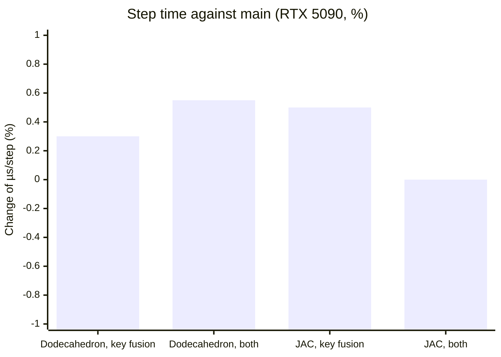
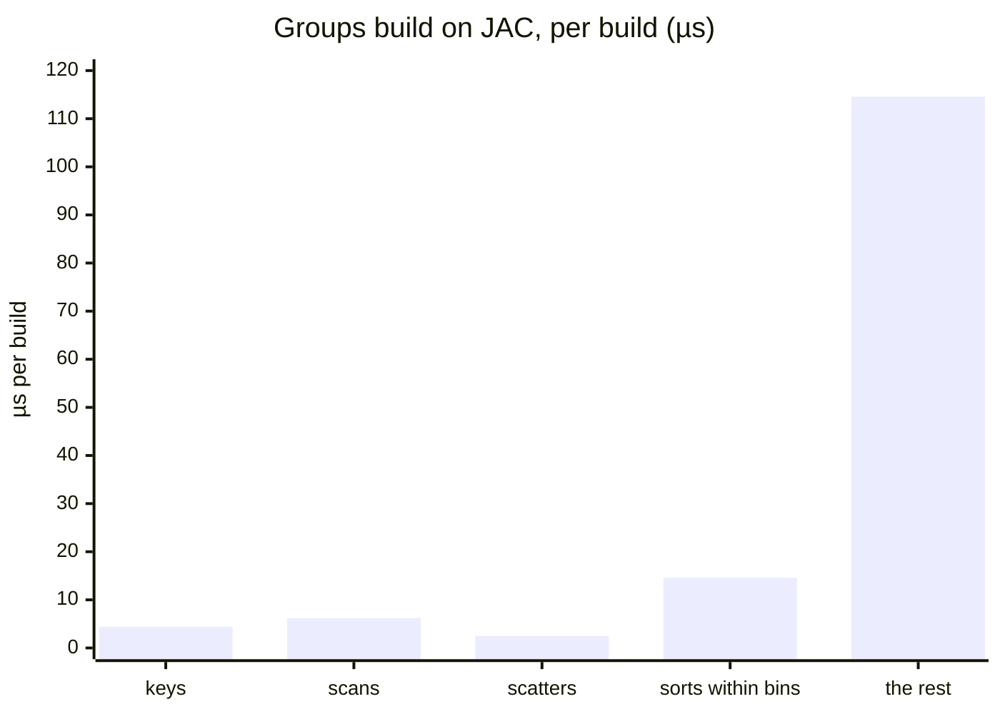

# D[md-alg-groups-transforms]

Recorded at its merge.

**The first experiment of collection-level transformations on the groups build (#869) has a negative result, and the maintainer ruled to keep the result and not the code (2026-11-14, on #873). The experiment tried three transformations: key fusion (the scatter of a counting sort computes each key again from the key region, in place of a store and a load), the removal of the key buffer, and the elision of a sort found redundant. Key fusion and the removal of the key buffer give the same output to the bit, but they make the step 0.3 to 0.6% slower on an RTX 5090. Sort elision is blocked on both real sorts by the order their readers observe, and the sorts within bins take at most 1.5% of a step with groups. None of the three is merged. The slot `md-alg-transform-collections` stays empty, and the PTX is that of the base. What is merged is the measurement, the reasons that block elision, and a device contract test of `md_alg.bin_members`, whose SIMT lowering had not run on a device. The transformations, the analysis's verdict on the keys, and their tests are in commit a8ab5427 of the pull request, for a later attempt to start from.** Issue #869, part of #866 and #558.

Prior systems judge fusion and the removal of intermediate buffers on the
collection-level form [[Steuwer2017]](../references.md#steuwer2017).
Fusing a producer into its consumer saves memory traffic but can
duplicate computation, so a fusion needs a measured gain as well as its
legality [[Henriksen2017]](../references.md#henriksen2017) (the
maintainer's item 5 on #866). This experiment measured that gain on the
groups build's path `sort_by_key → scan → scatter → sort_bins`, with
each transformation behind a pass option and legal by the shared
analysis of D409.

## The groups build's counting sorts

The groups build has two counting sorts (`md_alg.sort_by_key`, `order
stable`, `sort insertion`, with a key region). Sort 1 orders the
particles by column and z-bin. Its region loads `x[i]` (three f64),
wraps it, writes `wrapped[i]`, and adds to `sizes[4]` for a position
without a bin. Sort 2 orders the places by cell of the search grid. Its
region loads `sizes[0]`, `order[q]`, and `wrapped[order[q]]`, and writes
`xp[q]`. The SIMT lowering of each sort runs four steps:

1. the kernel of the keys, which computes each key, stores `keys[i]`, and
   adds 1 to `counts[key]` atomically;
2. the scan;
3. the scatter, which loads `keys[i]` and takes the next slot of its bin
   from `cursor[key]` atomically;
4. the insertion sort of each bin by the item.

The key has two readers, the count and the scatter. The scan, a global
barrier, separates them, so no consumer can stream the key. It is either
stored and loaded, as `main` does, or computed again by the scatter.

## What was tried (a8ab5427)

- **Key fusion, `recompute-keys`.** The scatter runs a copy of the key
  region without its side outputs: the slot writes, and the additions to
  counters, which would otherwise count twice. The kernel of the keys
  stores no key. It applies where the region is *recomputable*. That
  means the op has a key region, and no reader of the keys stands inside
  it (`stable_rank` reads them). The region also reads no buffer, by its
  root, among its side outputs or the op's own buffers, and takes no value
  from an addition. The keys must also be unread after the op.
- **The removal of the key buffer, `drop-key-buffers`.** For a sort that
  recomputes its keys, the operand `keys` goes, with its allocation and
  releases. The allocation's only uses must be the op, followed views,
  and releases, and its async token must be unused.
- **Sort elision, `elide-sorts`.** A sort whose D409 verdict is
  redundant goes.

In the programs of `main`, the first two apply to the three counting
sorts with a key region: the groups build's two and the matrix's spatial
order.

**The output was the same.** A test built the groups in four cells with
the orthorhombic and the triclinic build, each three ways (no option, key
fusion, both options). It compared checksums of the order, the shifts,
the counts, the lists, and the five sizes. The lists were compared per
block by owner and ordinal, since `md_alg.append` leaves the block
numbers free. All three ways gave the same checksums.

**The code changed where expected.** On the nine programs of D409, key
fusion changed exactly two kernels of each such sort: the kernel of the
keys, which lost its store, and the scatter, which held the region in
place of a load. The host's code changed only in those launches'
arguments. The removal of the buffer changed no kernel; it removed the
host's allocations and frees. The registers on sm_120 (JAC with groups),
with no spills in any of these kernels:

| Kernel | `main` | key fusion |
|---|---:|---:|
| Sort 1, the kernel of the keys | 36 | 34 |
| Sort 1, the scatter | 10 | 28 |
| Sort 2, the kernel of the keys | 22 | 18 |
| Sort 2, the scatter | 10 | 14 |

Seven mutations were each caught by the tests of a8ab5427. Its full suite
had 993 tests: 955 passed, 38 unsupported, none failed. Its sanitizer tier
had 28 passed and 2 unsupported, with memcheck clean on the transformed
build.

## Measurement

The device was an RTX 5090 throughout, in two jobs. In each job, `main`,
key fusion, and both options ran in turns, for two rounds. The
dodecahedron ran for 200,000 steps and JAC for 100,000. Each run had 100
rate intervals. The rate is the mean after a trim of 30% of the start,
and it moved by at most 0.35% between trims of 10% and 50%. The SM clock
under load reached 2,902 to 2,917 MHz, and the temperature was at most
56 °C.

| System | Job | `main` (µs/step) | key fusion | both options |
|---|---|---:|---:|---:|
| Dodecahedron with groups (1,209 particles) | A | 57.6 | 57.8 (+0.3%) | 57.9 (+0.5%) |
| | B | 57.8 | 58.0 (+0.3%) | 58.1 (+0.6%) |
| JAC NVE with groups (23,558 particles) | A | 104.2 | 104.7 (+0.5%) | 104.3 (+0.1%) |
| | B | 104.4 | 105.0 (+0.6%) | 104.3 (−0.1%) |

The kernels were timed under the CUDA trace of Nsight Systems, in two
profiles, and the table gives the mean per build. Key fusion made the
build 0.5% slower on the dodecahedron (220.7 to 221.8 µs) and 1.9%
slower on JAC (142.3 to 145.0 µs). The scatter of sort 1, which loads
three f64 coordinates and wraps them in place of one i32 load, went from
0.89 to 2.00 µs and from 1.03 to 2.91 µs. The kernels of the keys took the
same time without their store. The removal of the buffer saves $4n$ bytes
for sort 1 and 4 bytes for each place of the capacity for sort 2.

## Why sort elision is blocked

Both of the groups' orders are read by `md_alg.bin_item`, which requires
the full layout (D409), and each reader observes the order:

- sort 1: a chunk is 64 consecutive places of a column. Where a bin of
  two or more particles lies across the boundary of a chunk, the order
  within the bin decides which group a particle joins;
- sort 2: the search takes the places of a run of cells 32 at a time
  into a queue. That order fixes the order of the entries that
  `md_alg.append` writes, and the loop over pairs sums the entries in
  that order.

Neither reader fits `md_alg.bin_members`, whose region runs once for an
item and combines its values. The first takes a slice of places across
bins, and the second gathers across a warp into a queue. A visit of
either would have to state `stable`. The spatial order writes its order
into an argument, and the matrix sort's order is read by index. No sort
of `main` is redundant.

**The bound** on what elision could save. The time of the sorts within
bins, and of the scans and scatters they follow, is given as a share of
the build and of the step, from the same profiles:

| System | Builds a step | Build (µs) | Sorts within bins (µs) | With the scans and scatters (µs) | Sorts, share of the build | Sorts, share of the step | All, share of the step |
|---|---:|---:|---:|---:|---:|---:|---:|
| Dodecahedron with groups | 0.085 | 220.7 | 9.1 | 16.4 | 4.1% | 1.3% | 2.4% |
| JAC NVE with groups | 0.108 | 142.3 | 14.6 | 23.3 | 10.2% | 1.5% | 2.4% |

The loop over groups adds forces with float atomics in the default mode
(D84), so a groups run is not bitwise reproducible from run to run.
That fact bears on which order the lists need, not on the identical
compiled output that D406 targets.

## Follow-up

The keys of the groups' two sorts have lifetimes that do not overlap, so
one allocation could hold both. That reuse of a dead allocation is a
choice of materialization, which applies whether or not the keys are
recomputed (#866, item 4).

## What is merged

`test/Integration/md-alg-members-contract-gpu.test` is the device
contract test of `md_alg.bin_members`. Its SIMT lowering runs a thread a
bin, and the counter and the slots are written by threads at once. The
test compares that lowering with the serial one, to the bit, on the
visits of `md-alg-members.test`:

- unordered, with four integer combiners, a slot of each item, and a
  counter;
- stable, with a sum of floats compared by its bits;
- every bin at once.

The cases are no items, one, 20 in 7 bins, 129 in 129, 1,025 in 1,000,
3,000 in 50, all 3,000 in one bin, 5,000 in 3, and 40,000 in 4,000. The
values of the case of 20 items are those that `md-alg-members.test`
works out. It runs under compute-sanitizer (memcheck and racecheck) in
the sanitizer tier. No code changes, and the lowered programs stay those
of the base.
