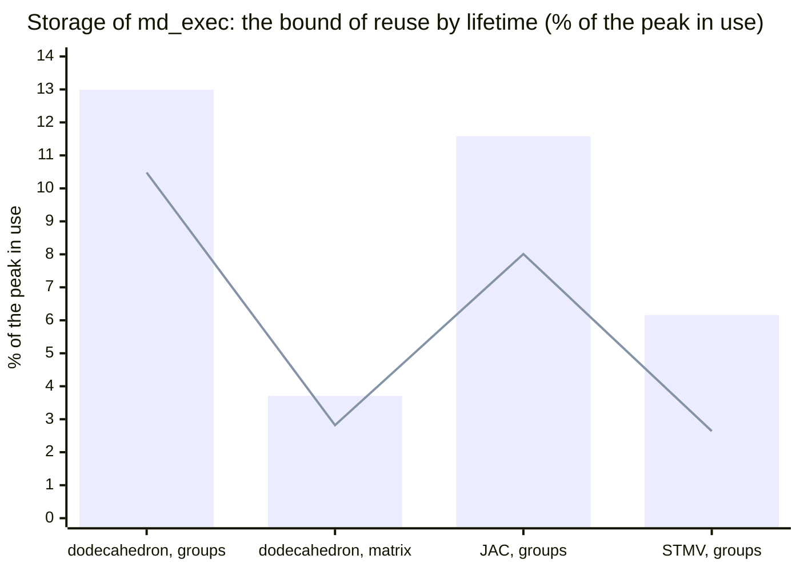

# D[md-exec-storage-liveness]

Recorded at its merge.

**Reuse by lifetime finds almost nothing to share in the storage of `md_exec`. The census covers four programs: the dodecahedron with the groups and with the matrix, JAC with the groups, and STMV with the groups. In each, every buffer that the loop over steps touches is live through the whole step, with one exception: the reference positions of the neighbor lists, which are dead only from the decision to rebuild to the copy that ends the rebuild. The only buffers of the storage that are not live everywhere in the step are the ones the loop never touches. These are the setup's copies and intermediates, kept to the end of the run: 38.4 MB at STMV, 2.64% of its peak in use. Sharing allocations saves no more than releasing these buffers before the loop: the first fit by size reaches the lower bound, the most bytes live at one point of the step. At the program's peak, which is at every build of the lists in the loop, 89.6 MB of the storage is not live (6.16%). The extra 51.2 MB is the two reference positions, which could share only with the build's own collections, an owner of another layer. The census is therefore the result, and no transformation is added. An analysis, `StorageLiveness`, and a test pass that prints it, `--test-md-exec-print-storage-liveness`, are added; neither enters a pipeline, and the lowered programs are those of `main`.** Issue #880, after the census of #879 and #876.

## 1. The rule

The analysis (`include/mdir/Dialect/MDExec/StorageLiveness.h`,
`lib/Dialect/MDExec/StorageLiveness.cpp`) runs on the host function as
`convert-md-exec-to-gpu` leaves it, at the slot of
`md-alg-transform-collections`, which is the IR of #879's census:
- The buffers of the storage are the `gpu.alloc`s in the function's body
  before its loop over steps. That loop is the loop of the body that
  launches the most kernels and calls the most functions of the module.
- Every kernel is a `gpu.launch` whose body names the buffers it reads and
  writes.
- The host's order of the launches is the order of the code.

The analysis is a backward dataflow of liveness over the host's control
flow, with buffers in place of the variables of register allocation
[[Chaitin1982]](../references.md#chaitin1982). It has three parts:
- **Aliases.** Each memref value maps to the buffers it may view:
  - a view (`memref.cast`, `memref.memory_space_cast`, `memref.subview`,
    `memref.reinterpret_cast`, the reshapes) views the buffers of its
    source;
  - an argument or a result of a loop, or a result of a branch, views
    those of every value that flows into it, so the loop's carried
    buffers, swapped by its yield, each view both;
  - the memref result of any other op, an external function among them,
    views all its memref operands.
- **Points and effects.** Each op of the host's code is a point. A launch,
  or any other op with regions that is not control flow, is one point
  with the effects of every op in its body. An effect reads a buffer,
  writes it, or touches it in a way the analysis cannot tell. A call to a
  function of the module takes the callee's effects on its arguments. A
  call to an external function may read and write each buffer it is given,
  during the call. A raw pointer of a buffer in the host's code pins the
  buffer, which is then live everywhere; so does a return of it or a token
  never waited for. An asynchronous op uses its buffers again at every
  wait that its token reaches. An op on a side stream (between
  `mdrtSideBegin` and `mdrtSideEnd`) uses them again at the next
  `mdrtSideJoin`.
- **Kills.** A kill is a write of the whole buffer by an op that reads
  none of it. Only a view that keeps the whole extent (the buffer, a cast,
  a change of memory space) can kill, and only when it views exactly one
  buffer. A write through a subview, through a value of the loop that
  views two buffers, or in one branch of an `scf.if` is not a kill where
  the branches join. There are two modes:
  - `kills=proven`: only a fill (`gpu.memset`) or a copy into the buffer
    (`gpu.memcpy`), or a call whose callee writes it only so.
  - `kills=stores` (the default): also a launch, or a call, that writes the
    buffer and reads none of it. That the kernel writes every element is
    assumed, not proven, so the bound of this mode is an upper bound.

A buffer is live at a point if a use is reachable from it without a kill.
The loop's back edge, the branches, and the exit to the code after the
loop are edges of the flow, so "carried by the loop" and "read after the
loop" follow from the dataflow and need no special case. A buffer is
occupied at a point if it is live into it, live out of it, or touched
there. Two buffers interfere if one point occupies both. The test pass
prints, for each buffer:
- the points of the step where it is occupied;
- its first and last access in the step;
- whether it is carried, read after the loop, released, unused, or pinned;
- the buffers it interferes with, in the step and in the whole function.

With `at=<function>`, it also prints the buffers live at each call to
that function.

## 2. The census

### How it was measured

- **The IR.** For each control file of #879 (200 steps), `mdir emit
  --stage=module` and the pipeline of `mdir emit --stage=pipeline`, cut
  before `convert-md-alg-to-gpu`, give the IR at the slot. The pass runs
  on it in both modes, with `at` set to the build of the lists.
- **The sizes.** The sizes of the buffers come from #879's allocation
  traces of the same programs (`mdir run`, 200 steps,
  `MDIR_DEVICE_MEMORY=2`, RTX 5090; a local build of the base that is not
  committed). The trace's blocks that compiled code allocates from a site
  that allocates once, and never frees, are matched in order to the
  buffers of the analysis that are not released. Each match is checked by
  size:
  - a size that is a dimension of an argument of the function
    (`arg0.dim0`, the particles) must agree wherever it occurs;
  - a constant size must agree exactly;
  - an unknown one must divide.

  The runtime does not allocate a request of zero bytes, and the lowering
  removes an allocation that nothing uses, so a buffer may match no block.
  These are the two tables of a kind that no program has, and one unused
  buffer of STMV's PME (Section 4).
- **The owners.** Each block takes its owner by #879's rules: PME is the
  blocks allocated at the launch of the real grid, the scratch of
  reductions is the blocks of 8,192 and 24,576 bytes, and the storage of
  `md_exec` is every other block of compiled code at the peak.
- **The bounds.** For the storage of `md_exec`:
  - **Shared in the step.** The first fit by size, largest first, over
    the interference in the step. A class takes the size of its largest
    buffer.
  - **The most live at one point of the step.** The lower bound of any
    sharing.
  - **Live at the builds in the step.** In the trace, the program's peak
    in use is reached at every build of the lists in the loop: 30 times on
    the dodecahedron (both programs), 12 on JAC, and 31 on STMV. Of the
    builds of the setup, only one reaches it, on the dodecahedron with the
    matrix, where the storage live is the same as at the build in the step
    (169,964 bytes).

### The bound, by program

Bytes, and in parentheses the share of the program's peak in use (#879):

| | Dodecahedron, groups | Dodecahedron, matrix | JAC, groups | STMV, groups |
|---|---:|---:|---:|---:|
| peak in use (#879) | 1,153,960 | 3,256,372 | 31,746,976 | 1,455,830,804 |
| storage of `md_exec` (#879) | 315,044 (27.30%) | 290,864 (8.93%) | 7,357,568 (23.18%) | 405,153,800 (27.83%) |
| its buffers | 25 | 25 | 44 | 49 |
| shared in the step, first fit | 194,144 | 198,980 | 4,813,304 | 366,738,380 |
| the most live at one point of the step | 194,144 | 198,980 | 4,813,304 | 366,738,380 |
| **saved by sharing in the step** | **120,900 (10.48%)** | **91,884 (2.82%)** | **2,544,264 (8.01%)** | **38,415,420 (2.64%)** |
| of which: buffers the loop never touches | 120,900 | 91,884 | 2,544,264 | 38,415,420 |
| live at a build in the step, `stores` | 165,128 | 169,964 | 3,682,520 | 315,517,820 |
| live at a build in the step, `proven` | 165,128 | 169,964 | 4,247,912 | 341,128,100 |
| **not live at the peak, `stores`** | **149,916 (12.99%)** | **120,900 (3.71%)** | **3,675,048 (11.58%)** | **89,635,980 (6.16%)** |
| not live at the peak, `proven` | 149,916 (12.99%) | 120,900 (3.71%) | 3,109,656 (9.80%) | 64,025,700 (4.40%) |

Both modes give the same step bounds. In every program the first fit
reaches the lower bound, and the saving equals the bytes of the buffers
that the loop never touches. Sharing over the whole function, with the
setup's uses as well, saves less: 62,868, 33,852, 1,130,784 (942,320
proven), and 38,415,420 bytes.

The bars are the storage that is not live at the peak, with
`kills=stores`. The line is the saving by sharing in the step, which is
the buffers that the loop never touches.

## 3. Which buffers, and why

The storage falls into three parts in every program.

**Live through the whole step.** These are most of the storage: 315.5 MB
of STMV's 405.2 MB.
- **The 13 buffers carried by the loop's arguments.** At STMV these are
  twelve n × 3 buffers in f64 and f32 and one n × f64, which the yield
  passes from one step to the next.
- **Buffers that a step reads before it overwrites them.** Among them
  are the parameters of every term (the f64 constants of the bonds,
  angles, dihedrals, and the other tuple sets, the tables of the pairs),
  which the loop reads and never writes. Another is an n × i32 buffer that
  is copied out to the host after the loop.
- **The flags of the device** (four bytes each).

A step reads each of these before it writes it, so no other buffer can
take its room at any point of the step.

**Buffers the loop never touches.** The setup uses them, and nothing in
the loop or after it reads them, so they are dead through the loop. At
STMV there are six (38,415,420 bytes):

| Buffer at the slot | Type | Bytes | What |
|---|---|---:|---|
| `%memref_54` | n × f64 | 8,536,760 | the copy of an input field (argument 2) before the spatial order, written again by the setup |
| `%memref_55` | n × f32 | 4,268,380 | the copy of an input field (argument 3) before the spatial order |
| `%memref_126` | n × i32 | 4,268,380 | the order of the particles (argument 36), given to the spatial order and to the device's tuples |
| `%memref_155` | n × i32 | 4,268,380 | the permutation of the spatial order |
| `%memref_362` | n × f64 | 8,536,760 | a per-particle buffer that kernels of the setup write and read |
| `%memref_409` | n × f64 | 8,536,760 | another one |

JAC and the dodecahedron have the same kinds: the copies of the inputs
before the spatial order, the order and its permutation, and per-particle
scratch of the setup. JAC adds three n × 3 f64 buffers of the setup
(565,392 bytes each).

**The reference positions of the lists.** These are n × 3 f64, two in
the programs with a pruned list (STMV, JAC) and one on the dodecahedron.
Each step compares the positions with them to decide whether to rebuild.
- **The outer list's reference** (`%memref_311` at STMV) is dead from that
  decision to the copy of the positions into it that ends the rebuild.
  The copy is a `gpu.memcpy`, a proven kill.
- **The pruned list's reference** (`%memref_317`) is rewritten by a kernel
  of the rebuild. It is dead there only under `kills=stores`.

Both are dead at the build, which is where the peak is, but only on the
branch that rebuilds. On the other branch they are live. At STMV they are
the 51.2 MB (25.6 MB proven) between the bound of the step and the bound
at the peak.

**Outside this owner.** With `kills=stores`, three of PME's buffers are
dead at the build too: the real grid, the spline weights of the
particles, and a small table of the convolution (73.8 MB at STMV). The
complex grid is not: the forward FFT, an external function, writes it,
and that is not a kill. A buffer dead at the build can share only with
what lives there: the build's collections (81.3 MB at STMV, #879) and the
runtime's lists. Neither belongs to the storage of `md_exec`.

## 4. The check against #879's trace

At all four programs, the buffers matched to the never-freed blocks of
the trace sum to #879's totals, to the byte:
- the storage of `md_exec`: 315,044, 290,864, 7,357,568, and 405,153,800;
- STMV's PME: 152,947,548;
- STMV's scratch of reductions: 106,496.

At STMV every block of the 63 matches a buffer whose type gives its size:
- n = 1,067,095 from the positions (25,610,280 bytes);
- each tuple set's count from its parameters.

The topology's own counts confirm the counts of the tuple sets (Amber's
`POINTERS`):
- 92,394 bonds without hydrogens (`MBONA`), 739,152 bytes each;
- 306,012 angles (`NTHETH` + `MTHETA`), 2,448,096;
- 660,056 dihedrals (`NPHIH` + `MPHIA`), 5,280,448.

The pair table of the 20 atom types is 20 × 20 × 2 f32 (3,200 bytes).
Three buffers match no block:
- the two tables of a kind that STMV does not have (sizes from arguments
  of 0 rows);
- an unused i64 buffer of the grid's size in PME, which the lowering
  removes.

## 5. The conclusion

- **No transformation.** Sharing allocations by lifetime gains nothing
  that releasing does not. Every buffer the step touches is live through
  the step, except the two reference positions on one branch. So the
  bound by sharing in the step is exactly the buffers the loop never
  touches: 2.64% of STMV's peak, 8.0% of JAC's, and 2.8% to 10.5% on the
  dodecahedron. Following #880, no transformation code is added.
- **The largest saving in this owner is a release, not a reuse.** The
  buffers that the loop never touches could be released after their last
  use in the setup. That saves their bytes at the peak in use: 38.4 MB at
  STMV, about as much as #879's placement of the groups build's second
  phase (34.2 MB).
  - **Layer.** `md-exec-assign-storage`, where these buffers are given
    their storage. The proof is this analysis with `kills=proven`: the
    buffer is touched in no point of the loop and is not live after it.
  - **The pool.** The runtime's pool keeps a freed block for a request of
    its own size. The freed n × i32 blocks match requests that the groups
    build makes in the loop (`key`, `sorted`: 4,268,380 bytes at STMV), so
    part of the saving survives in the peak with the pool.

  This PR does not do it.
- **Reuse at the peak needs another owner.** The storage dead at the build
  (89.6 MB at STMV, with PME's grids another 73.8 MB) could share only
  with the build's collections. That is a sharing across layers, on one
  branch, which neither this owner nor the `md_alg` slot can decide
  alone.

## 6. Validation

- **Tests.** `test/Dialect/MDExec/storage-liveness.mlir` runs the pass in
  both modes. Each function is a realistic bug that the rule must catch:
  - a buffer read after the loop must interfere with one used after its
    last use in the step;
  - a buffer carried by the loop must be live through the whole step;
  - a buffer that a step reads before it overwrites it must be live from
    the back edge to its read;
  - an asynchronous launch whose token is waited for later must keep its
    buffer live until the wait;
  - a launch on a side stream must keep its buffer live until the join;
  - a buffer read through a view must interfere with one that lives
    between its write and that read. Each view has its own function:
    `memref.subview`, `memref.cast`, `memref.reinterpret_cast`,
    `memref.memory_space_cast`, and a subview made in the kernel's body;
  - a write through a subview, a write in one branch, and a store that
    `kills=proven` does not prove must not end a life;
  - a raw pointer in the host's code must pin its buffer;
  - a callee that writes its argument whole must kill it at the call, and
    one that reads it must use it there.
- **Mutations.** Two mutations of the analysis were run locally and not
  committed.
  - **Views not followed.** Ignoring views in the aliases makes the test
    fail at `@view_subview`: A's life ends at its write (`step(1)`), and A
    no longer interferes with B, in all five functions of views.
  - **Completions ignored.** Ignoring the waits of tokens makes it fail at
    `@memset`, whose fills are asynchronous, and `@async` loses its
    interference.
- **No program changes.** On six programs, `mdir emit --stage=lowered`
  with `MDIR_GPU_BINARY=ptx`, `MDIR_COMPILE_CACHE=off`, and
  `MDIR_SKIN_CACHE=off` is the same, to the byte, as that of `main`
  (D406's method). The programs are the four of the census, FactorIX NVE
  with the groups, and JAC NVE with the matrix.
