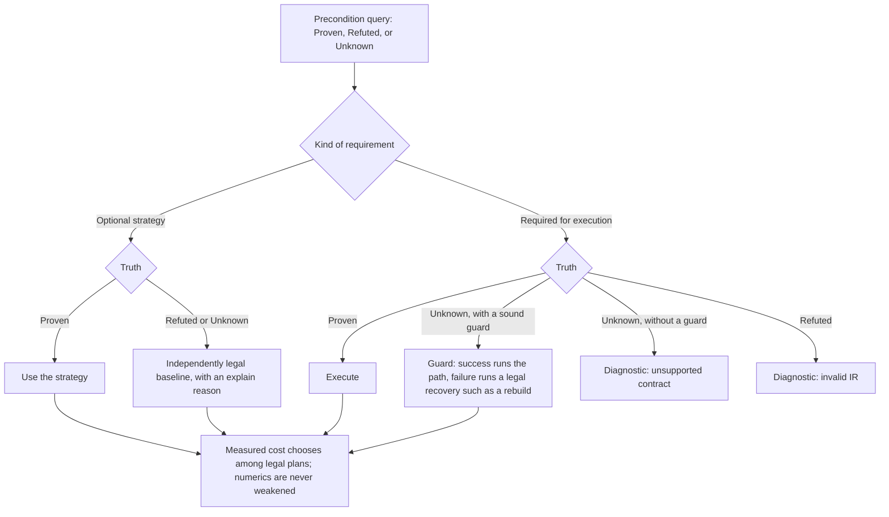

# Verified execution contracts

Status: design for #574. The operations and checks described as future work
below are not implemented by this document. This contract joins the work of
#565, #566, #567, #571, #572, and #573; each remains a separate decision and
implementation PR.

## 1. Purpose and layers

Any computation may be expressed in semantic IR. Execution and optimization
require proof of the properties on which they rely. A verifier establishes
what is meaningful; a lowering establishes what is legal on its target. The
same property has one definition even when several passes consume it.

| Layer | States | Obligation before passing to the next layer |
|---|---|---|
| `md` and `dyn` | Sets, fields, relations, energy, derivatives, and the evolution of state | Verify semantic types and the relationships of values; retain facts needed by later execution |
| `md_exec` and `md_dist` | Access domains, ownership, effects, accumulation, ordering, transfers, and validity | Verify that each read, write, exchange, and schedule is legal for its stated domain and state |
| Physical plan | Buffers and lifetimes, tiles, threads, streams, halos, transfers, and target capabilities | Choose only among legal plans, check target preconditions, and discharge or preserve every remaining obligation before code generation |

An optimization may request a stronger fact than ordinary execution needs.
Failure to prove that fact does not make an otherwise valid program invalid.
The distinction between a valid program with an unavailable optimization and
an invalid execution is part of every check's contract.

## 2. Four facts, one place each

| Fact | Representation | Consumers and planned implementation |
|---|---|---|
| Provenance | Invariant meaning in a type or static attribute; changing state in an SSA value and explicit operand | The set of a storage buffer (#565), irreps and component layout of a distributed field (#571), and the layout epoch of a domain |
| Effects | One summary per execution op, checked against its body | Reads, writes, affected rows, accumulation algebra, and order for fusion, D87 streams, and distributed scheduling (#566) |
| Validity | A check of the state on which a proposed execution relies | Neighbor reach and images (#572), the D80 skin test, `md_dist.covered` (#546), copy readiness and buffer lifetime (#567), and definite initialization (#573) |
| Witness | An SSA result of a check, consumed by an op or branch that requires the fact | A proof of coverage or partition that is valid only for the positions, cell, ownership epoch, and relation from which it was made |

The witness convention is a design rule, not a new operation in this PR. A
witness names its producer, the property proved, and all state operands on
which the property depends. It cannot be silently reused after positions,
cell, ownership, halo, or relation state changes. A verifier checks that its
consumer uses the matching state and that the witness dominates that use.
Passing a witness through a function or loop requires its state operands to
be passed with it and checked on every path. No type alone proves a runtime
fact about current positions or cell.

An invariant such as a particle set remains in the type even when a buffer
is reused. A changing fact such as whether a neighbor list covers the
current positions is represented by values and operands. Putting an epoch
or a current position into a type would make the type assert a fact that can
expire during execution.

## 3. Outcomes of a precondition check

A query distinguishes `Proven`, `Refuted`, and `Unknown`. Its use depends on
whether the requirement is optional or required for execution. A runtime
guard is a separate action, available only when it soundly establishes the
required fact and its failing branch has a legal recovery. Every choice is
made before an effect that depends on it.

| Requirement and result | Action |
|---|---|
| Optional strategy, proved | Use the strategy. |
| Optional strategy, refuted or unknown | Use an independently legal baseline and emit an `explain` reason. |
| Required execution condition, proved | Execute the path. |
| Required execution condition, unknown with a sound guard and legal recovery | Execute the path only when the guard succeeds; use the recovery otherwise. |
| Required execution condition, unknown without such a guard | Diagnose an unsupported contract; do not execute the path. |
| Required execution condition, refuted | Diagnose invalid IR; do not execute the path. |

Three failure categories must remain distinct. **Invalid IR** includes
contradictory types, mismatched entities, invalid evidence, and a
demonstrated read of an uninitialized value; the verifier refuses it with a
diagnostic. **Unavailable strategy** means an optional strategy's
requirements are false or unknown; an independently legal baseline may
still run. **Unresolved required contract** means no implementation, guard,
or accepted external contract establishes safe execution; report that
limitation as an unsupported contract, not as a user-input error. A path
with unresolved required conditions is never executed. `Unknown` never
means true, zero, initialized, fresh, or independent.

For example, `pair_for` must not traverse a neighbor list whose coverage
is unresolved. #572 may prove coverage across a boundary or guard and
rebuild before traversal; otherwise the contract is unsupported. Serial
traversal of the same unproved list is not a legal fallback. A known
mismatch between a buffer's particle set and its consumer is invalid IR.

A runtime predicate returns a Boolean; its definition dominating an access
does not establish that it is true. Likewise, an available asynchronous
event does not establish that its operation completed. A scoped fact must
come from the successful guard path or another checked producer.

This classification concerns compiler IR. Existing user inputs retain their
behavior. `mdir check` diagnoses input defects; a new execution contract
does not turn such inputs into newly refused runs.

## 4. Existing cases under the contract

| Case | Fact and current evidence | Outcome and next obligation |
|---|---|---|
| Neighbor validity (D80) | The last built positions and cell are explicit state; the displacement and cell test is evaluated at refresh | A runtime guard rebuilds when the list is no longer valid. Coverage through function and loop boundaries is still #572 |
| Ordered reduction (D171, D301) | The algebra says `fixed_order`, `any_order`, or exact reorderability | Only legal accumulation strategies enter the chooser; the fixed-order path is the conservative choice when a reordering is not allowed |
| Owner-computes (D290, `md-dist-owner-computes`) | The relation and transfer form establish its ownership conditions | The pass uses the fast form only after those conditions are checked; otherwise it retains the original distributed form |
| Partitioned centers (D317, D328) | Direct results of `partition_centers` carry relation and layout provenance | The matching relation can use the disjoint interior and boundary filters; a stale or unrelated filter is not proof |
| Halo coverage (#546) | `md_dist.covered` is a collective runtime predicate for fixed cells in the in-process executor, with separate fresh coordinate payloads | #38 will consume the predicate in a reuse-or-migrate branch; the predicate is not a scoped witness. The current verifier refuses a halo whose source it cannot establish |
| Device strategy (#444, #433, #558) | Algebra, target capabilities, and strategy preconditions determine legality | Measurement selects among legal strategies; an unavailable optimization gets a reason and legal fallback |

These examples do not all have a first-class witness today. Their present
checks remain in place until a later PR moves each consumer to shared code.
Such a move is a behavior-preserving refactor, not permission to enable a
new strategy.

## 5. Effects, dependencies, and lifetimes

The proposed loop effect summary (#566) states the buffers and row domains
read and written, the accumulation operation and its algebra, and any
ordering constraint. A verifier compares it with the body. Fusion, stream
assignment, and distributed scheduling consume the same summary; they may
still impose different preconditions on a proposed schedule. A summary is
not an assertion that two loops are independent: independence is derived
from their summaries, aliases, and state dependencies.

The proposed async contract (#567) gives a copy a token. A read of its
destination, a write of its source or destination, and a free or reuse of
either buffer require the corresponding completion dependency. Merely
holding the token does not establish completion; the required wait or
dependency does. Completion does not establish that the data remains ready
after another write. The same rule applies to
halo transfers of #481. The first implementation retains today's waits;
moving waits is a separate, measured change.

The proposed definite-write analysis (#573) derives from the effects of
#566 whether every read of an `md_exec.empty` field follows a full write on
every control-flow path. A centers-restricted write, partial tuple scatter,
or write on only one branch does not prove initialization of the whole set.

## 6. Numerical and external contracts

Numerical requirements are represented separately from memory and
structural requirements, but all are prerequisites of a legal execution
plan. A cost model never weakens them. For example, a race-free atomic
sum is not legal where a fixed reduction order is required.
`fixed_order` and `any_order` (D171, D301), exact integer accumulation
(D70), precision modes, `fast_math` (D90), and approximation accuracy state
distinct guarantees. A mathematical transpose or equal real-valued formula
does not imply bitwise equal floating-point results. Deterministic mode
requires its stated order and bitwise results, including after a refactor.

A verifier cannot infer the VJP, equivariance, or approximation error of an
external model from its type. #569 records these as declarations with
independent property tests. A declaration does not replace the execution
checks on buffers, state, and transfers that carry its values.

This design claims conditional verification of supported contract instances
under named rules and recorded assumptions, not a universal proof. Its
trusted base includes the predicate rules and their numerical
implementations, registered effect and derivative models, transformation
preservation arguments, accepted external contracts, runtime and backend
implementations, and the upstream toolchain. Property tests check evidence
but do not turn an external mathematical assertion into a static theorem.

## 7. Implementation sequence and acceptance

This PR specifies the contract and changes no compiler or runtime behavior.
#565 can proceed alongside it. Before implementing #566, #567, #572, or
#573, this design is reviewed; #571 uses it to preserve representation in
distributed fields before ML3's design. Each implementation PR records its
own decision and updates this document and its topic documentation.

A shared checker must be used by both the chooser and the lowering instead
of copying the same precondition into two passes. It diagnoses invalid IR
and unsupported required contracts, guards only when the guard and recovery
are legal, and emits an `explain` reason for an unavailable optional
strategy. Legality precedes measured cost.
For a behavior-preserving migration, `mdir emit --stage=lowered` and the
PTX are byte-identical against the same base, and deterministic outputs are
bitwise identical. A new strategy or delayed wait requires its own measured
PR and must satisfy the no-loss rule of #444.
