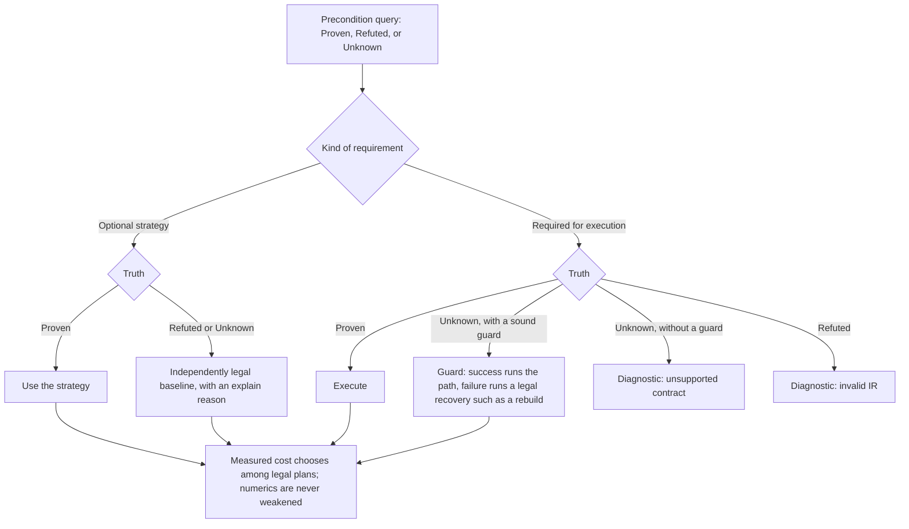
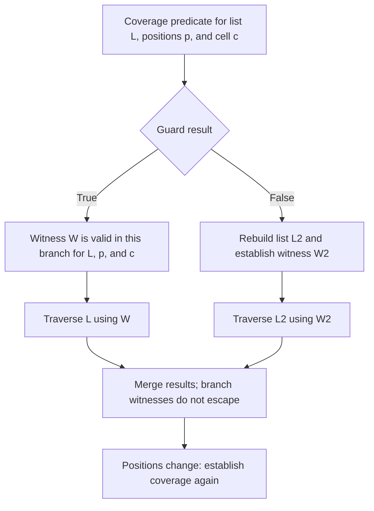
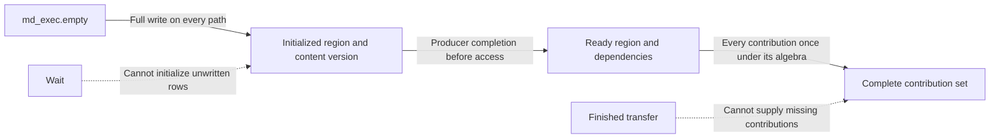

# Verified execution contracts

Status: design for #574. The operations and checks described as future work
below are not implemented by this document. This contract joins the work of
#565, #566, #567, #571, #572, and #573; each remains a separate decision and
implementation PR.

## 1. Purpose and layers

Any computation may be expressed in semantic IR. Execution and optimization
require proof of the properties on which they rely. A verifier establishes
what is meaningful; a lowering establishes what is legal on its target. The
same property has one definition even when several passes consume it.

| Layer | States | Obligation before passing to the next layer |
|---|---|---|
| `md` and `dyn` | Sets, fields, relations, energy, derivatives, and the evolution of state | Verify semantic types and the relationships of values; retain facts needed by later execution |
| `md_exec` and `md_dist` | Access domains, ownership, effects, accumulation, ordering, transfers, and validity | Verify that each read, write, exchange, and schedule is legal for its stated domain and state |
| Physical plan | Buffers and lifetimes, tiles, threads, streams, halos, transfers, and target capabilities | Choose only among legal plans, check target preconditions, and discharge or preserve every remaining obligation before code generation |

An optimization may request a stronger fact than ordinary execution needs.
Failure to prove that fact does not make an otherwise valid program invalid.
The distinction between a valid program with an unavailable optimization and
an invalid execution is part of every check's contract.



## 2. Four facts, one place each

| Fact | Representation | Consumers and planned implementation |
|---|---|---|
| Provenance | Invariant meaning in a type or static attribute; changing state in an SSA value and explicit operand | The set of a storage buffer (#565), irreps and component layout of a distributed field (#571), and the layout epoch of a domain |
| Effects | One summary per execution op, checked against its body | Reads, writes, affected rows, accumulation algebra, and order for fusion, D87 streams, and distributed scheduling (#566) |
| Validity | A check of the state on which a proposed execution relies | Neighbor reach and images (#572), the D80 skin test, `md_dist.covered` (D332, #546), copy readiness and buffer lifetime (#567), and definite initialization (#573) |
| Witness | An SSA result of a check, consumed by an op or branch that requires the fact | A proof of coverage or partition that is valid only for the positions, cell, ownership epoch, and relation from which it was made |

The witness convention is a design rule, not a new operation in this PR. A
witness names its producer, the property proved, and all state operands on
which the property depends. It cannot be silently reused after positions,
cell, ownership, halo, or relation state changes. A verifier checks that its
consumer uses the matching state and that the witness dominates that use.
Passing a witness through a function or loop requires its state operands to
be passed with it and checked on every path. No type alone proves a runtime
fact about current positions or cell.

An invariant such as a particle set remains in the type even when a buffer
is reused. A changing fact such as whether a neighbor list covers the
current positions is represented by values and operands. Putting an epoch
or a current position into a type would make the type assert a fact that can
expire during execution.

## 3. Outcomes of a precondition check

A query distinguishes `Proven`, `Refuted`, and `Unknown`. Its use depends on
whether the requirement is optional or required for execution. A runtime
guard is a separate action, available only when it soundly establishes the
required fact and its failing branch has a legal recovery. Every choice is
made before an effect that depends on it.

| Requirement and result | Action |
|---|---|
| Optional strategy, proved | Use the strategy. |
| Optional strategy, refuted or unknown | Use an independently legal baseline and emit an `explain` reason. |
| Required execution condition, proved | Execute the path. |
| Required execution condition, unknown with a sound guard and legal recovery | Execute the path only when the guard succeeds; use the recovery otherwise. |
| Required execution condition, unknown without such a guard | Diagnose an unsupported contract; do not execute the path. |
| Required execution condition, refuted | Diagnose invalid IR; do not execute the path. |

Three failure categories must remain distinct. **Invalid IR** includes
contradictory types, mismatched entities, invalid evidence, and a
demonstrated read of an uninitialized value; the verifier refuses it with a
diagnostic. **Unavailable strategy** means an optional strategy's
requirements are false or unknown; an independently legal baseline may
still run. **Unresolved required contract** means no implementation, guard,
or accepted external contract establishes safe execution; report that
limitation as an unsupported contract, not as a user-input error. A path
with unresolved required conditions is never executed. `Unknown` never
means true, zero, initialized, fresh, or independent.

For example, `pair_for` must not traverse a neighbor list whose coverage
is unresolved. #572 may prove coverage across a boundary or guard and
rebuild before traversal; otherwise the contract is unsupported. Serial
traversal of the same unproved list is not a legal fallback. A known
mismatch between a buffer's particle set and its consumer is invalid IR.

A runtime predicate returns a Boolean; its definition dominating an access
does not establish that it is true. Likewise, an available asynchronous
event does not establish that its operation completed. A scoped fact must
come from the successful guard path or another checked producer.

This classification concerns compiler IR. Existing user inputs retain their
behavior. `mdir check` diagnoses input defects; a new execution contract
does not turn such inputs into newly refused runs.

## 4. Existing cases under the contract

| Case | Fact and current evidence | Outcome and next obligation |
|---|---|---|
| Neighbor validity (D80) | The last built positions and cell are explicit state; the displacement and cell test is evaluated at refresh | A runtime guard rebuilds when the list is no longer valid. Coverage through function and loop boundaries is still #572 |
| Ordered reduction (D171, D301) | The algebra says `fixed_order`, `any_order`, or exact reorderability | Only legal accumulation strategies enter the chooser; the fixed-order path is the conservative choice when a reordering is not allowed |
| Owner-computes (D290, `md-dist-owner-computes`) | The relation and transfer form establish its ownership conditions | The pass uses the fast form only after those conditions are checked; otherwise it retains the original distributed form |
| Partitioned centers (D317, D328) | Direct results of `partition_centers` carry relation and layout provenance | The matching relation can use the disjoint interior and boundary filters; a stale or unrelated filter is not proof |
| Halo coverage (D332, #546) | `md_dist.covered` is a collective runtime predicate for fixed cells in the in-process executor, with separate fresh coordinate payloads | #38 will consume the predicate in a reuse-or-migrate branch; the predicate is not a scoped witness. The current verifier refuses a halo whose source it cannot establish |
| Device strategy (#444, #433, #558) | Algebra, target capabilities, and strategy preconditions determine legality | Measurement selects among legal strategies; an unavailable optimization gets a reason and legal fallback |

These examples do not all have a first-class witness today. Their present
checks remain in place until a later PR moves each consumer to shared code.
Such a move is a behavior-preserving refactor, not permission to enable a
new strategy.

## 5. Effects, dependencies, and lifetimes

The first loop effect interface (D342, #566) derives
operand, row-scope, set, and accumulation-algebra records. A missing
declaration or opaque body effect makes that record incomplete; existing
optimizations do not consume it yet. The later checked summary states the
buffers and row domains read and written, the accumulation operation and its
algebra, and any ordering constraint. A verifier compares it with the body. Fusion, stream
assignment, and distributed scheduling consume the same summary; they may
still impose different preconditions on a proposed schedule. A summary is
not an assertion that two loops are independent: independence is derived
from their summaries, aliases, and state dependencies.

The proposed async contract (#567) gives a copy a token. A read of its
destination, a write of its source or destination, and a free or reuse of
either buffer require the corresponding completion dependency. Merely
holding the token does not establish completion; the required wait or
dependency does. Completion does not establish that the data remains ready
after another write. The same rule applies to
halo transfers of #481. The first implementation retains today's waits;
moving waits is a separate, measured change.

The proposed definite-write analysis (#573) derives from the effects of
#566 whether every read of an `md_exec.empty` field follows a full write on
every control-flow path. A centers-restricted write, partial tuple scatter,
or write on only one branch does not prove initialization of the whole set.

## 6. Numerical and external contracts

Numerical requirements are represented separately from memory and
structural requirements, but all are prerequisites of a legal execution
plan. A cost model never weakens them. For example, a race-free atomic
sum is not legal where a fixed reduction order is required.
`fixed_order` and `any_order` (D171, D301), exact integer accumulation
(D70), precision modes, `fast_math` (D90), and approximation accuracy state
distinct guarantees. A mathematical transpose or equal real-valued formula
does not imply bitwise equal floating-point results. Deterministic mode
requires its stated order and bitwise results, including after a refactor.

A verifier cannot infer the VJP, equivariance, or approximation error of an
external model from its type. #569 records these as declarations with
independent property tests. A declaration does not replace the execution
checks on buffers, state, and transfers that carry its values.

This design claims conditional verification of supported contract instances
under named rules and recorded assumptions, not a universal proof. Its
trusted base includes the predicate rules and their numerical
implementations, registered effect and derivative models, transformation
preservation arguments, accepted external contracts, runtime and backend
implementations, and the upstream toolchain. Property tests check evidence
but do not turn an external mathematical assertion into a static theorem.

## 7. Implementation sequence and acceptance

This PR specifies the contract and changes no compiler or runtime behavior.
#565 can proceed alongside it. Before implementing #566, #567, #572, or
#573, this design is reviewed; #571 uses it to preserve representation in
distributed fields before ML3's design. Each implementation PR records its
own decision and updates this document and its topic documentation.

A shared checker must be used by both the chooser and the lowering instead
of copying the same precondition into two passes. It diagnoses invalid IR
and unsupported required contracts, guards only when the guard and recovery
are legal, and emits an `explain` reason for an unavailable optional
strategy. Legality precedes measured cost.
For a behavior-preserving migration, `mdir emit --stage=lowered` and the
PTX are byte-identical against the same base, and deterministic outputs are
bitwise identical. A new strategy or delayed wait requires its own measured
PR and must satisfy the no-loss rule of #444.

## 8. Contract records and subjects

This design uses one query vocabulary across dialects, not a universal
execution op. A contract for an operation or strategy has five parts:

| Part | Meaning |
|---|---|
| `requires` | Conditions for defined access, coverage, representation, order, numerics, and target support |
| `ensures` | Output versions, initialized regions, completed contributions, and events established by the operation |
| `effects` | Reads, writes, accumulation, allocation, release, asynchronous borrows, and ordered resources |
| `numerics` | Arithmetic, approximation, derivative, and reproducibility permissions |
| `trusted` | Named external assumptions, including the artifact and contract identity actually used |

A domain identifies a set and its cardinality or mapping contract; it may be
particles, tuples, edges, mesh points, or domains. A relation names its end
domains, orientation, multiplicity, image convention, and support. A candidate
neighbor structure is distinct from the exact relation it covers. Coverage
does not establish exactly-once traversal or correct weights.

Types and static attributes carry invariant set, element shape,
representation, storage space, and declared arithmetic policy. Changing
logical versions, index maps, ownership layouts, geometry, content,
allocation generations, and in-flight operations belong to SSA operands or
verified analysis state. Two buffers over the same set may use different
index maps; distinct set tags do not prove external memrefs cannot alias; a
reused address has a new allocation generation. A write through an alias
invalidates evidence about affected content even when the original handle
is unchanged. Record only the identities on which a predicate depends, but
never infer freshness from an unchanged shape or address.

## 9. Queries and scoped evidence

A pure query reports `Proven`, `Refuted`, or `Unknown`, with an explainable
reason. It receives the program point, subject identities, required
observation and numerical policy, and analysis context. `Proven` includes
its derivation and accepted external assumptions. A possible runtime guard
is a separate recipe, not a truth value. Guard insertion and rewriting are
separate actions. Budget exhaustion returns `Unknown`.

`Refuted` for an optional strategy rejects that strategy, not the baseline
program. A required safety condition that is refuted makes its execution
invalid IR. If a required condition is unknown, the compiler uses a sound
guard with legal recovery or diagnoses an unsupported contract. A cached
choice never replaces a query at the current point. Chooser and final
lowering call the same rule.

A witness establishes a named predicate for exact subject versions. For
neighbor coverage, subjects include candidate map, position and cell
versions, index map, ownership layout, cutoff, centers, and images; add
exclusions only if this coverage proposition depends on them. Checked static
rules, successful guard regions, checked constructions, verified function
postconditions, and accepted named external contracts may produce evidence.
A `verified=true` attribute or arbitrary cast cannot. A guard's success
must imply its predicate even at boundaries and with exceptional values;
failure may merely require rebuild.

The witness dominates use and binds to content that cannot change between
check and use. A retained memref handle is insufficient if an alias can
write through it. After an `if`, keep only facts established on every
incoming path for the merged subjects. A loop checks entry, zero-trip
behavior, and every backedge; an old-position witness cannot follow a new
loop-carried position by name. Function summaries state parametric
preconditions, postconditions, and effects, with every supported caller
checked. Unknown or recursive boundaries remain conservative. A rewrite
preserves subjects, derives replacement evidence, or invalidates it.



The initial implementation covers existing operations, recognized branches,
structured loops, and functions with verified summaries. It need not prove
arbitrary heap aliasing or recursive control flow. Unsupported required
cases receive a diagnostic, not an assumed proof.

## 10. Effects, initialization, and completeness

One structured effect summary (#566) describes logical resource, storage
root or slice, index footprint, access mode, accumulation algebra, and phase
or completion. Initial footprints are full domain, owned or ghost domain,
one element, tuple members, relation neighbors, intervals, and proved
partitions. Unknown footprints conservatively overlap. Projection to
MLIR's memory-effect interface must not contradict this summary. Fusion,
D87 streams, storage planning, initialization, and distributed scheduling
ask specialized questions of the same summary. Producer-consumer fusion
may be legal when concurrent independence is not; memory independence
alone does not permit duplicating an operation with observable effects.

Opaque calls have conservative effects unless a named accepted contract
supplies more. Host state, I/O, checkpoint state, and communication are
ordered resources, not merely field buffers. Three facts remain separate:

```text
Initialized(region, content version)
Ready(region, completion dependencies)
Complete(contribution set, accumulation algebra)
```



An `md_exec.empty` result (#573) is readable only where every path has
definitely written the read footprint. One branch or a possibly zero-trip
loop is insufficient. Proved disjoint writes can establish a full region;
an empty read footprint is vacuously safe. Reusing physical storage does
not retroactively initialize an earlier logical SSA value. Waiting cannot
initialize unwritten elements or supply omitted force terms. A force may
be initialized and ready while missing a contribution; half-list and
whole-list traversals also need stated multiplicity and weights before
`Complete` is established.

## 11. Async readiness, borrows, and ordered resources

The minimum condition for a read is **producer completion happens before
consumer access**, with visibility to the consumer's memory domain. Token
definition dominating a read does not establish completion. A device
dependency can order a device consumer without blocking the host; a CPU
read normally needs completed host-visible data. A transfer holds source
read and destination write borrows, including overlapping aliases, until
completion. Conflicting writes, frees, or storage reuse wait for release;
independent reads and proved disjoint slices may proceed.

Pure evidence and ownership are distinct. Several consumers may depend on
one completion if its runtime permits that, but an event is destroyed once.
D310's same-block, one-wait rule is the initial `md_dist` subset, not the
meaning of all future tokens. Halo descriptors, image mappings, and pinned
host storage remain live while their transfers borrow them. A halo's
completed coordinate payload is separate from candidate coverage (#481,
#572).

D336 (#548) provides three distinct checkpoint events: device-to-host copy
completion, writer release of staging storage, and file commit. The next
checkpoint waits for prior release and commit; stop, run end, and exit wait
for outstanding writes. #567's first implementation preserves these waits
and error-propagation points. A staging buffer is not reusable just because
its copy finished while the writer still borrows it. Moving a wait,
adopting pinned-memory copies, or adding cancellation is separate measured
work. The existing `mgpuMemcpy` path synchronizes runtime streams on
host-device copies; adding an IR token alone must not be reported as
transport overlap or as removing that synchronization.

Communication effects name communicator and sequence. Compatible collective
initiation order and participation by empty domains remain required. A
rank-local result cannot let one rank skip a collective rebuild; a branch
needs a uniform predicate or equivalent verified protocol. Dependencies
are per communicator, not one global token. Point-to-point matching,
progress, and cancellation need their own contracts. For dynamics, preserve
D326's distinction between pure counter-keyed draws and stateful bath or
logging effects: storage reordering must not change stable particle and step
keys, and a memory-effect-free evaluation is not automatically speculatable.

The planned [FFT transfer adapter](fft-device-resident.md)
(D[fft-device-resident], #580) preserves this contract with immediate scoped
completion at host boundaries. Its layout guard is separate from readiness;
neither a matching tensor shape nor an available token establishes both.
Legacy copies and D336's checkpoint events keep their existing semantics.

## 12. Numerics, derivatives, and lowering

Numerical requirements have independent dimensions: stored, compute, and
accumulation type; contraction and reassociation; reduction order and
partition; approximation error and its domain; reproducibility scope; and
derivative pairing and saved-value validity. Fixed-point accumulation is
exact only under stated quantization and overflow bounds. Fixed order does
not promise identical transcendental results across targets. An empirical
error measurement is not a certified bound.

An adjoint retains its pairing and representation through lowering: FFT
half-spectrum weights, owned versus replicated fields, and the active cell
in a cell-dependent transfer matter. External VJPs remain named trusted
contracts with property tests at matching inputs and parameters; tests do
not turn them into static theorems. Changes of periodic images or neighbor
topology follow their declared structural differentiation convention.

Each lowering records which semantic outputs, effects, and numerical
observations it preserves. It discharges an obligation, implements it with
a guard or dependency, transfers it explicitly to the next phase, or
diagnoses it where discharge is required. Successful type conversion alone
is not this argument. A pre-backend verifier refuses unresolved required
execution obligations. Compile-time witnesses may then be erased; runtime
guards, waits, visibility actions, and lifetime enforcement remain unless
separately proved redundant.

## 13. Implementation slices and explanation

The first shared implementation is a small query and diagnostic result with
adapters to an existing coverage or D87 independence check. It reuses MLIR
control-flow, dominance, dataflow, and effect interfaces where they fit the
pinned toolchain, without requiring a universal dialect or solver. A cached
analysis is allowed when its grounds can be reconstructed from the IR and
accepted contracts. Relevant pass mutations invalidate it. A persistent
plan records static dependency and policy identities; it never serializes a
runtime witness based only on an SSA name, shape, count, or buffer address.

| Slice | Owner and first boundary |
|---|---|
| Buffer set identity | #565: type and verifier, without runtime epochs in the type |
| Distributed representation | #571: component count and irreps through transfers |
| Neighbor coverage | #572: function/loop provenance and same-state consumer; D332 remains a fixed-cell predicate |
| Execution effects | #566: one checked summary for fusion, D87, and distributed scheduling |
| Definite initialization | #573: consumer of #566, including branch and zero-trip cases |
| Copy and halo readiness | #567 and #481: dependencies and borrows, preserving current waits first |
| Physical plan | #433 and #558: `mdir explain-plan`, numerical policy, target capabilities, and reasons for rejected choices |
| External stage trust | #569: declared VJP, equivariance, and representation with property tests |

Existing checks move through adapters, rather than being redefined by a
second implementation:

| Existing check | Shared query or effect | Migration owner |
|---|---|---|
| D80 neighbor skin refresh | Coverage for current positions and cell; guard false rebuilds | #572 |
| D87 stream independence | Effect and alias footprints at a program point | #566 |
| D171/D301 reduction algebra | Numerical order, exactness, and legal accumulation | #422, #433 |
| D290 owner-computes | Relation multiplicity, ownership, and transfer provenance | #566, #481 |
| D317/D328 center partition | Relation/layout identity and disjoint coverage | #572 |
| D332 `md_dist.covered` | Fixed-cell collective predicate, not a witness or fresh payload | #38, #572 |
| D336 checkpoint writer | Copy completion, staging release, and commit effects | #567 |
| #444 device chooser and lowering | Identical strategy precondition with named fallback | #433, #558 |

An explain record identifies requirement, subject provenance, proof or
guard origin, accepted assumptions, remaining obligation, and fallback
reason. It records numerical and target policy identity. Cost chooses only
among currently legal plans. The first migration retains existing accepted
programs, branches, waits, emitted lowered IR, and PTX; new overlap or
fusion strategies need separate measured decisions.

## 14. Acceptance and closure of the design

The cases below specify positive and negative evidence for the owning
implementation issues. This document adds no verifier or runtime behavior.

| ID | Case and expected result | Owner |
|---|---|---|
| C01 | Direct refresh and same-state pair use: accept without new runtime work | #572 |
| C02 | Scalar `true` or `verified` attribute as coverage: reject fake proof | #572 |
| C03 | Witness outside its guard branch or for later positions/cell: re-prove or diagnose | #572 |
| C04 | Function and loop, including zero trip: accept valid invariant, reject inadequate cutoff | #572 |
| C05 | Adequate candidates with stale coordinate halo: keep freshness unsatisfied | #481, #572 |
| C06 | Changed index map, alias write, or allocation-address reuse: invalidate dependent facts | #565, #572 |
| C07 | `empty` read after one-branch or zero-trip writer: reject | #573 |
| C08 | Proved disjoint writes covering read footprint: accept | #573 |
| C09 | Token definition dominates read without completion: reject | #567 |
| C10 | Async copy plus independent interior work: accept; overlapping free/reuse: reject | #567 |
| C11 | Copy complete while checkpoint writer borrows staging: refuse reuse until release | #567, #548 |
| C12 | Initialized, ready force missing or duplicating one term: refuse complete-force use | #566, #573 |
| C13 | Rank-local collective branch: refuse; uniform branch and empty rank: accept | #481, #38 |
| C14 | Disjoint buffers with conflicting collective, host, or stop order: refuse reorder | #566, #481 |
| C15 | Atomic sum under fixed order or exact sum without range bound: reject strategy | #422, #433 |
| C16 | Unsupported target or opaque call with unknown effects: give reason and legal fallback | #433, #566 |
| C17 | Good and bad external stage bodies: keep trust explicit and detect bad property test | #569 |
| C18 | Rewrite changes proof subject or cached plan policy: invalidate evidence and plan | #433, #572 |

Tests also exercise failed guards, boundary displacements, exceptional
values where admitted, empty relations, non-block-multiple sizes, and
supported precision modes. Behavior-preserving migrations compare lowered
IR and PTX byte-for-byte at pinned base and head, and deterministic results
bit-for-bit. They record memory, time, and compile-time overhead separately.
Each implementation PR owns focused positive and negative cases, one
final-head suite, and a sanitizer tier after that suite if it changes
device code.

#574 closes when this vocabulary, placement rule, control-flow and mutation
rules, issue ownership, and acceptance matrix are reviewed. Its closure
does not claim that #565–#573, asynchronous transport, or distributed
scheduling have been implemented.
