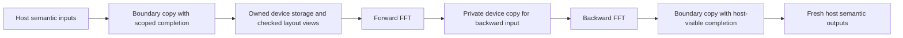

# Device-resident semantic FFT composition

Status: bounded opt-in implementation for #580, D[fft-device-resident].
The host strategy remains the default.
It follows the executable host-boundary bridge D341 (#563) and is part of
#526 and the transfer contract of #567. One session owns this path through
the reciprocal composition of #452.

## 1. Scope and selection

The `memory=device` strategy of `convert-linear-transform-values`
keeps connected semantic transforms on a device. The existing host strategy
remains the default until measurements license a different selection.
There is no new control-file key, Python API, output format, checkpoint
format, overwrite behavior, or change to the current `md.reciprocal` route.

Initially a resident component is bounded to one block: its external inputs
dominate the component, its host consumers follow it, and its execution
queue is established. Unsupported boundaries retain the independently legal
host-boundary bridge and report an explain reason. Unknown provenance never
establishes residency or readiness. Contradictory IR remains a diagnostic.

## 2. Layout and immutable values

Real grids are row-major scalars. Packed half-spectra contain adjacent real
and imaginary scalars. A native complex value may share that representation
only when its actual target layout proves the scalar size, member offset,
and complete element size match. Use a proof or a sound layout guard with
the existing explicit pack/unpack bridge as recovery. Never infer this
property from equal tensor shapes or an unchecked marker.

The first strategy always uses the layout-independent recovery: explicit
scalar packing at external semantic inputs and scalar unpacking at host
outputs. It never shares the bytes of a native complex value. Connected
transforms reuse the already packed scalar representation, so no intermediate
unpack/repack or host upload is needed. A native-complex view is future work
and still requires the layout proof above. Intermediate FFT results stay
in private device storage. Backward execution receives a
private device copy, since cuFFT may overwrite its input; another semantic
consumer continues to observe the original value.

Construct the storage graph with host allocations first, run bufferization
and ownership-based deallocation, then place its proved private storage on
the device. The current ownership pass rejects an already inserted
`gpu.dealloc`; device allocation and release therefore remain after it.
Host-facing results are materialized before leaving the component.

## 3. Transfer completion and lifetime

The current `mgpuStreamSynchronize` does not wait in the normal mode.
Host-device `mgpuMemcpy` instead calls `finish()`, which drains both runtime
streams. Removing that call without another completion mechanism is invalid.

The scoped backend copy records completion on its actual producer
queue and waits for that event before host access or storage release. Its
source read borrow and destination write borrow end only at that completion.
`mdrtCudaMemcpyScoped` records and synchronizes an event on the same
`mgpuStreamCreate()` queue that cuFFT selects. `mdrtCudaWaitScoped` also
completes that queue before device release, including unused results.
IR token availability is not completion. Recognized allocation roots,
compatible extents, exact dependencies, and the immediate wait must be
checked before selecting this implementation; a marker is a request to
check those facts, not evidence that they hold.

Other callers of `mgpuMemcpy` keep their existing implementation. The PR
must inventory them and state which dependencies remain unproved. This
adapter applies D338 and D358: checked `gpu.memcpy` tokens and blocking
`gpu.wait` completions remain in IR until the scoped adapter is selected.
Selection must prove allocation roots, extents, queue identity, and release;
the D358 check runs before lowering and cannot be bypassed by an attribute.
Asynchronous halo transport and general wait scheduling remain separate.
D336's checkpoint copy completion, staging release, file commit, waits,
and error points remain separate events.

### Selection and recovery

The value bridge marks a request for residency. Placement rederives the facts
from the post-bufferization IR: distinct same-block allocations, identity
scalar layout, constant exact extents, casts and known load/store/copy uses,
private destructive inputs, no intervening call (including nested calls),
and no release before a use. Unknown provenance, extents, alias uses, or
queue boundaries retain the host bridge with a remark. Contradictory known
extents, noncontiguous requested scalar storage, and use after release are
diagnostics. Cross-block semantic inputs are explicitly repacked rather than
sharing a packed buffer across the boundary.

Placement emits the actual `gpu.memcpy` / blocking `gpu.wait` sequence and
runs D358's `verifyTransfers` on it before replacing each checked pair with
the blocking scoped adapter. The adapter is never selected merely because
an attribute claims completion. Device-to-device inverse copies preserve the
original spectrum for repeated and host consumers. An explicit producer-queue
completion precedes the component's device deallocations.

### Legacy copy inventory

Only the checked copies constructed by this adapter change runtime entry
point. These routes still lower to `mgpuMemcpy` and keep `finish()`:

| Route | Source | Dependencies still outside this strategy |
|---|---|---|
| Field and scratch staging | `lib/Dialect/MDExec/Transforms/AssignStorage.cpp` | General storage lifetimes and stream scheduling |
| Deferred, retained, and ordinary readbacks | `lib/Conversion/MDExecToGPU/MDExecToGPU.cpp` | Readback groups and their producers across the full run |
| Neural stage buffers | `lib/Conversion/MDExecToGPU/StageBodies.cpp` | Framework and side-stream dependencies |
| Host-default semantic FFT bridge | `lib/Conversion/MDToMDExec/LinearTransformValues.cpp` | The default remains its established globally completed bridge |
| Other `gpu.memcpy` users and external runtime callers | Upstream GPU-to-LLVM lowering and the exported runtime ABI | No general migration is claimed |

Allocation pressure, pool trimming, new FFT plans, plan eviction, and explicit
debug synchronization may still drain runtime work. They are not changed or
reported as asynchronous overlap. D336 checkpoint staging and file commit
remain separate events. The resident option is a compiler-pass strategy,
not a new control-file selection or a new PME route.

## 4. Validation gates

- Positive and negative IR cases for layout, allocation provenance, aliases,
  extents, dependencies, and release. Unknown facts select only a proved
  baseline or receive the required-contract diagnostic.
- An IR composition check showing no intermediate host round trip; immutable
  backward inputs and fresh result ownership remain checked.
- Independent direct DFT on CPU/GPU, mixed/double, odd/even final extents,
  forward/backward, transpose pairing, repeated use, and composition.
- A bounded runtime dependency test where unrelated side-stream work remains
  pending after the scoped copy completes, without relying on elapsed time.
- Byte-identical lowered IR and PTX on the five Amber controls against the
  same main base, and bitwise deterministic results.
- One final suite at the rebased head; sanitizer tier afterward, including
  memcheck, racecheck, and synccheck for the moved waits.
- Measurements on the same idle device before any new default: alternated
  rounds against main, with time and peak memory. An IR token alone supports
  no overlap claim.

## 5. Initial measurement

On one idle RTX PRO 6000 Blackwell Max-Q device, three alternating rounds
of 200 forward/backward compositions on a $32^3$ real grid, after three
warmups, measured the following. The timed interval uses the runner's
`rtclock` and excludes compilation. Every round's analytic checksum was
6,553,600 with difference zero (tolerance 6.5536 mixed, 0.000131072 double).

| Precision | Main host, ms/composition | Resident, ms/composition | Peak live/pool main, MiB | Peak live/pool resident, MiB |
|---|---|---|---|---|
| Mixed | $0.115830 \pm 0.000387$ | $0.082722 \pm 0.000190$ | 0.3 / 0.3 | 0.5 / 0.5 |
| Double | $0.186477 \pm 0.001183$ | $0.121423 \pm 0.000459$ | 0.5 / 0.5 | 1.0 / 1.0 |

The spread is the sample standard deviation. Memory is the runtime's
one-decimal peak accounting, not a driver-wide peak. The bounded storage
graph trades memory for fewer host transfers. This one small composition
does not establish a full-step or PME speedup and does not change the
default. `scripts/benchmarks/fft-resident.py` emits the input and repeats
the alternating experiment; its `compare` command runs through the
scheduler's idle-device helper with one pinned device kind.
