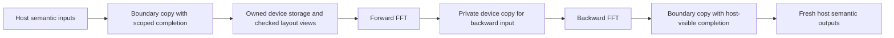

# Device-resident semantic FFT composition

Status: proposed implementation plan for #580, D[fft-device-resident].
This document records a design; the resident strategy is not implemented yet.
It follows the executable host-boundary bridge D341 (#563) and is part of
#526 and the transfer contract of #567. One session owns this path through
the reciprocal composition of #452.

## 1. Scope and selection

The planned `memory=device` strategy of `convert-linear-transform-values`
keeps connected semantic transforms on a device. The existing host strategy
remains the default until measurements license a different selection.
There is no new control-file key, Python API, output format, checkpoint
format, overwrite behavior, or change to the current `md.reciprocal` route.

Initially a resident component is bounded to one block: its external inputs
dominate the component, its host consumers follow it, and its execution
queue is established. Unsupported boundaries retain the independently legal
host-boundary bridge and report an explain reason. Unknown provenance never
establishes residency or readiness. Contradictory IR remains a diagnostic.

## 2. Layout and immutable values

Real grids are row-major scalars. Packed half-spectra contain adjacent real
and imaginary scalars. A native complex value may share that representation
only when its actual target layout proves the scalar size, member offset,
and complete element size match. Use a proof or a sound layout guard with
the existing explicit pack/unpack bridge as recovery. Never infer this
property from equal tensor shapes or an unchecked marker.

When the layouts agree, byte storage with typed `memref.view` adapters can
express packing and unpacking without extra arithmetic kernels. Intermediate
FFT results stay in that device storage. Backward execution receives a
private device copy, since cuFFT may overwrite its input; another semantic
consumer continues to observe the original value.

Construct the storage graph with host allocations first, run bufferization
and ownership-based deallocation, then place its proved private storage on
the device. The current ownership pass rejects an already inserted
`gpu.dealloc`; device allocation and release therefore remain after it.
Host-facing results are materialized before leaving the component.

## 3. Transfer completion and lifetime

The current `mgpuStreamSynchronize` does not wait in the normal mode.
Host-device `mgpuMemcpy` instead calls `finish()`, which drains both runtime
streams. Removing that call without another completion mechanism is invalid.

The planned scoped backend copy records completion on its actual producer
queue and waits for that event before host access or storage release. Its
source read borrow and destination write borrow end only at that completion.
IR token availability is not completion. Recognized allocation roots,
compatible extents, exact dependencies, and the immediate wait must be
checked before selecting this implementation; a marker is a request to
check those facts, not evidence that they hold.

Other callers of `mgpuMemcpy` keep their existing implementation. The PR
must inventory them and state which dependencies remain unproved. This
adapter applies D338 and D358: checked `gpu.memcpy` tokens and blocking
`gpu.wait` completions remain in IR until the scoped adapter is selected.
Selection must prove allocation roots, extents, queue identity, and release;
the D358 check runs before lowering and cannot be bypassed by an attribute.
Asynchronous halo transport and general wait scheduling remain separate.
D336's checkpoint copy completion, staging release, file commit, waits,
and error points remain separate events.

## 4. Validation gates

- Positive and negative IR cases for layout, allocation provenance, aliases,
  extents, dependencies, and release. Unknown facts select only a proved
  baseline or receive the required-contract diagnostic.
- An IR composition check showing no intermediate host round trip; immutable
  backward inputs and fresh result ownership remain checked.
- Independent direct DFT on CPU/GPU, mixed/double, odd/even final extents,
  forward/backward, transpose pairing, repeated use, and composition.
- A bounded runtime dependency test where unrelated side-stream work remains
  pending after the scoped copy completes, without relying on elapsed time.
- Byte-identical lowered IR and PTX on the five Amber controls against the
  same main base, and bitwise deterministic results.
- One final suite at the rebased head; sanitizer tier afterward, including
  memcheck, racecheck, and synccheck for the moved waits.
- Measurements on the same idle device before any new default: alternated
  rounds against main, with time and peak memory. An IR token alone supports
  no overlap claim.
