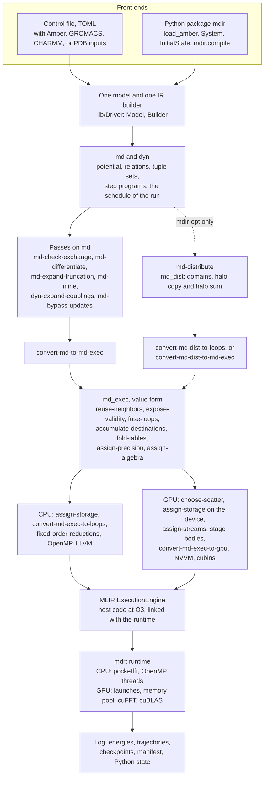
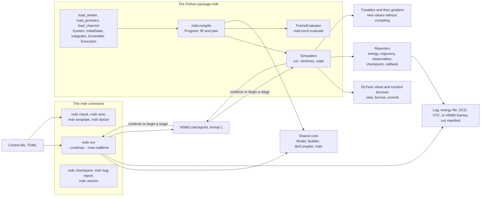
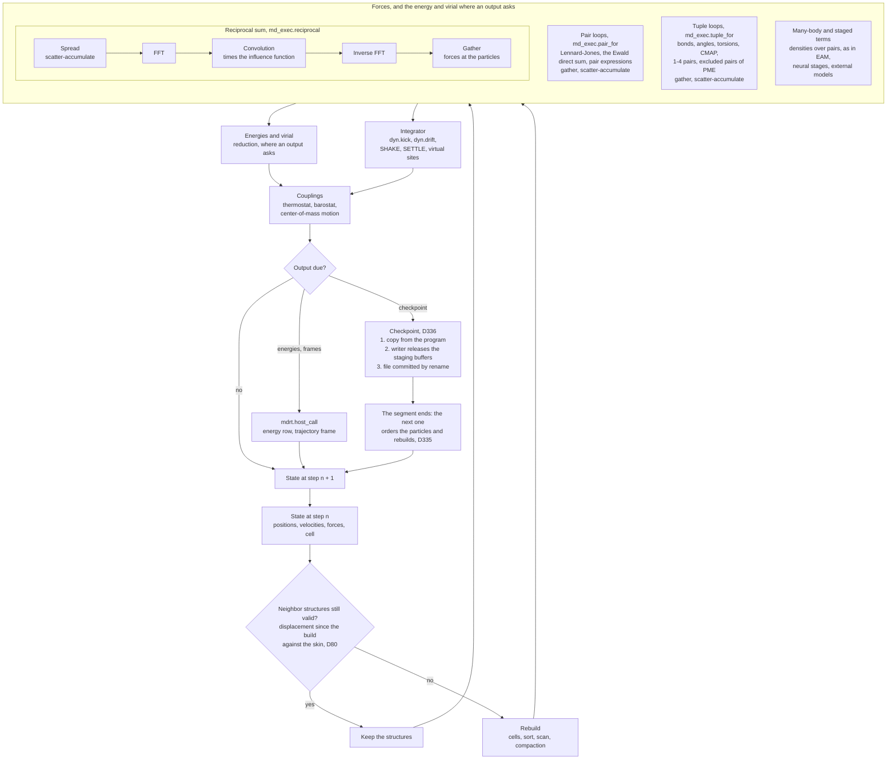
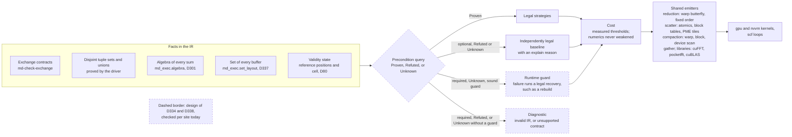

# MDIR: an overview

Status: checked against `main` on 2026-10-25 (#587). This document says
why MDIR exists, how it is built, and what it guarantees, and points to
the documents that hold the details. What is built is stated as built;
what is designed or planned is marked so. Where this overview and a
topic document differ, the topic document holds. The design record of the
first milestone, and where each of its parts went, is
[architecture.md](architecture.md).

## 1. Why MDIR

**Molecular dynamics as a compiler problem.** A conventional engine is a
fixed program that interprets a description of a system: the force field
arrives as tables, the integrator as a switch, and the GPU kernels are
written by hand for the combinations of terms that their authors foresaw.
MDIR is a compiler instead, built on MLIR
[[Lattner2021]](references.md#lattner2021). A run is written in dialects
whose objects are those of molecular dynamics: particle sets, tuple sets,
relations, fields over a set, the cell, potentials as expressions, and
programs of a time step. The forces are derived from the potential in the
IR, the loops are chosen and fused by passes, every value is given a
precision by its role, and the result is lowered to the CPU or to an
NVIDIA GPU. Compilation happens before every run, with the topology, the
parameters, and the target in hand, so the code that runs is specialized
to them: a term that the run does not have is not in its kernels, and a
structural constant of the run, such as a cutoff or the grid of particle
mesh Ewald, is a constant of the code
([white paper, Section 1](paper/01-introduction.md)).

**Learned potentials and device memory.** MDIR began because learned
potentials use too much device memory; memory is a primary result of the
learned-potential work, not a later concern
([metatomic-ml1.md](metatomic-ml1.md), Section 1). Milestone M3 (in
progress) evaluates learned potentials on one GPU in two ways: through an
optional plugin that runs an exported model of an external framework,
with MDIR's own neighbor structures giving it its pairs (D270, D273,
D277); and as *neural stages* in the IR, `md.stage` and `md.apply_stage`,
whose features are fields that the compiler sees, differentiates, and
schedules (D288, D294; [ml4-ir.md](ml4-ir.md)).

**Determinism and differentiation.** Bitwise determinism is a mode that a
run chooses (`[execution] deterministic`, D84): the same binary, hardware,
inputs, and decomposition give the same bits, with every sum in a fixed
order or in fixed point. Outside it a lowering may add in an order that
threads decide. On the CPU every reduction of a parallel loop is folded
over fixed chunks in every mode, so the result does not depend on the
number of threads (D171). Derivatives are part of the IR:
`md-differentiate` produces the forces, the virial, and derivatives with
respect to parameters from the energy. The Python package builds on this
for differentiable simulation (M2b, under way): parameters declared
tunable change without compiling (D213), the energy's derivative in them
is available at a state (D230), and a frame evaluator gives energies and
vector-Jacobian products at stored frames, with a PyTorch operation over
it (D240, [python-frames.md](python-frames.md)).

**The milestones so far** ([roadmap.md](roadmap.md)):

| Milestone | Scope | State |
|---|---|---|
| M1 | An all-atom protein in water with an Amber force field, on one node, CPU and GPU; at least the rate of pmemd.cuda on every system of the Amber suite | Done. Under one protocol, the suite's own inputs, steps, and output (D327), on one RTX 4090 in mixed precision, MDIR's rate is 111.7% to 149.5% of pmemd.cuda's with the searched reaches and 105.8% to 143.6% with the default reaches, over the nine runs of the suite; outside its steps MDIR spends 7.9 to 27.9 s of a run, pmemd.cuda 0.6 to 6.9 s ([white paper, Section 10](paper/10-performance.md)) |
| CPU baseline | The CPU target measured before host strategies are chosen (D333) | Recorded. At constant energy on JAC, a 103k-atom TIP3P box, and Cellulose, on one 16-core node, the ratio of MDIR's time per step to that of GROMACS 2026.3 (both mixed precision, GROMACS with its NVE-default list) is 12.34, 11.00, and 11.35 at one thread and 7.35, 7.79, and 7.97 at 16 threads; MDIR double against serial pmemd 26 is 6.92, 7.11, and 6.68. Only JAC and Cellulose start from matched coordinates; the TIP3P box starts from a different state across the engines, so its ratios are contextual ([white paper, Section 10.7](paper/10-performance.md#107-cpu-target-against-cpu-engines)) |
| M2a | The Python API | Done ([python.md](python.md), Section 4) |
| M2b | Differentiable simulation | Under way |
| M3 | Learned potentials on one GPU | In progress |
| M4 | Distributed execution | Under way in parallel with M3: the `md_dist` dialect, its verifier, and an in-process executor; no run of `mdir run` takes it yet |

## 2. Structure

### 2.1 From input to execution

Solid edges are the pipeline of a run today, as
`lib/Compiler/Compile.cpp` builds it; `mdir emit FILE --stage=pipeline`
prints it for a control file. The dashed path through `md_dist` is built
and tested through `mdir-opt`, and no run of `mdir run` or of a Python
simulation takes it yet.

The driver's explicit term registry (D359, D361) currently owns external,
pull, restraint, Born/surface, custom tuple/pair, triplet, model, bonded,
and nonbonded adapters. Stage A of #683 covers every kind and audits all
hook implementers.
Each build owns its adapters, and specialized roles borrow bounded inputs
and emission services (D362); model preparation data stays
private. Mesh/correction values use a narrow reference projection. Shared
array/definition/correction hooks and specialized reporting/evaluation roles
replace central kind dispatch. Field, contribution, output, and declaration
order stay explicit.
This stage preserves the generated programs. Stage B (#568 step 4, #708,
D[builder-term-ir]) starts with the shared Lennard-Jones scalar emitter:
typed `OpBuilder` fragments reach the same shared/inlined/fused sites.
The other term emitters follow. Step 5 retains parsed text only for user
expressions and `ModelTerm` at their input boundaries.
[Driver Section 2.12](driver.md#212-the-files-of-the-builder) describes the
files and roles.
The prolate near/far splitting emitter also constructs its clamped table
lookup and Horner polynomial with typed operations at the original site. Direct
Coulomb kernels now use typed operations too: cutoff and reaction field,
Gaussian Ewald, prolate series/cells, alchemical charge scaling, and the
clamped distance retain their original operation order. The direct LJPME
dispersion subtraction and its optional cutoff shift are typed fragments
at that same pair-kernel site. Soft-core Lennard-Jones distance,
root-free or switched potential, and alchemical scaling also use typed
fragments, preserving the original intermediate operations and branch order. Shielded
Coulomb kernels for excluded and within-selection pairs use typed Gaussian
or prolate operations, sharing the same typed prolate polynomial builder. The
excluded and within-selection Coulomb terms, including reaction-field
exclusions, also build their complete tuple loops, typed block arguments,
charge scaling, cutoff selection, and yields with `OpBuilder`. The LJPME
excluded-pair loop is typed as well, including its cancellation-free
small-distance Horner series and closed-form selection. Reciprocal dispersion
and Coulomb emission share a typed constructor with owned grid/configuration
data; charge scaling is a typed particle map before the same reciprocal op. The complete
primary nonbonded relation loop is also typed, including alchemical flags,
tunable-table seeds, scalar kernels, and the ordered final contribution.
`TermNonbonded.cpp` no longer writes operation text. The shared custom-expression
scalar emitter also builds typed operations from an owned `ExpressionIR`
snapshot of the parsed AST and grid geometry. Lazy definitions and caller
binding precedence are preserved without retaining borrowed hook state.

The complete topology custom-pair relation loop also uses typed operations:
overlapping group masks, particle-field arguments, all six LJ parameter
lookups, tunable constants, time/lambda/observed bindings, truncation, energy
conversion, and the yield retain their original order. Each loop owns its
configuration and expression snapshot; no hook-local state escapes.

Bare custom-pair loops also construct their regions and yields with typed
operations. Table overrides, uniform and nonuniform arithmetic/geometric/product
mixing, constants, function tables, cutoff modifiers, and ordered total-energy
addition retain the original operation order. Both topology and bare pair
kernels use owned expression snapshots and bounded configuration.

The materialization boundary rejects surviving internal connections before
any downstream cast reconciliation. Native tests cover malformed connections
and the unchanged legacy parse-error path; the corpus also rejects internal
markers in every successfully parsed module or successful lowered emission before comparison.

### 2.2 The dialects

| Dialect | Says | Main objects | State |
|---|---|---|---|
| `md` | What is computed | `md.particle_set`, `md.tuple_set`, `md.disjoint_union`; the cell; `md.potential` and `md.function`; `md.neighborhood`; sums and gathers over relations, tuples, and particles (`md.sum_relation`, `md.gather_relation`, `md.sum_tuples`, `md.map_particles`, ...); `md.reciprocal`; `md.linear_transform`; neural stages (`md.stage`, `md.apply_stage`); `md.evaluate` with requests for energy, forces, virial, and parameter derivatives | Built ([ops.md](ops.md), [tuples.md](tuples.md)) |
| `dyn` | How the state advances | `dyn.program`, `dyn.step`, `dyn.kick`, `dyn.drift`; a program states what it provides (`symplectic`, `time_reversible`, ...) and requires | Built. The couplings (thermostats, barostat, removal of the motion of the center of mass) are written by the builder as sums, host calls, and loops; making them `dyn` ops is designed (D326, [dynamics.md](dynamics.md), Section 2.2), and the ops of the thermostats, of the removal, and of the barostat exist with their expansion, which the driver does not use yet (#541, steps 2a and 2b) |
| `md_exec` | Over which set, with which access | `particle_for`, `pair_for`, `tuple_for`; neighbor builds, refreshes, and their tests; `spatial_order`, `permute`; `reciprocal`, `linear_transform`; `scatter_add`; tables; a value form and a storage form | Built ([ops.md](ops.md), [neighbors.md](neighbors.md)) |
| `md_dist` | Where it is computed | `decomposition`, `partition`, `halo`, `halo_copy` ($G$) and `halo_sum` ($G^\mathsf T$) as declared adjoints, `migrate`, `redistribute`, `covered`, `partition_centers`, loops over the rows of each domain | Built with its verifier and an in-process executor (D275, D290, D307, D310, D313, D332); not yet taken by a run ([distributed-ml2.md](distributed-ml2.md)) |
| `mdrt` | The interface to the runtime | Opaque types for cells, permutations, neighbor structures, incidences, and events; `mdrt.from_buffer`, `mdrt.to_buffer`, `mdrt.host_call`; halo start and wait events (D310) | Built ([runtime.md](runtime.md)) |

The semantic dialects carry no MPI, GPU, neighbor-list implementation,
thermostat code, or storage. `md` states how a pair kernel behaves when
its two particles are exchanged (`symmetric` or `antisymmetric`), and
`md-check-exchange` proves the contract where it rests on a proof; the
lowerings decide from it whether a pair may be computed once. A dialect
for ensembles of runs (`ensemble`), a separate dialect for learned force
fields (`mlff`), and a joint planner of distribution and execution were
part of the first design and are not built
([architecture.md](architecture.md)); neural stages in `md` took the place
of `mlff` (D288).

### 2.3 The main passes

In the order of a run (`lib/Compiler/Compile.cpp`); the white paper's
Table 3.3 describes those over `md_exec`
([Section 3.4](paper/03-design.md#34-from-sums-to-loops-and-the-passes-over-loops)).

| Stage | Passes | Effect |
|---|---|---|
| Semantic | `md-check-exchange`, `md-differentiate`, `md-expand-truncation`, `md-inline`, `dyn-expand-couplings`, `md-bypass-updates` | Proves exchange contracts; replaces `md.evaluate` with generated derivative functions; expands truncation (shift, switch) into kernels; inlines; expands the ops of the couplings of `dyn` into sums, loops, and calls of the host (D326); lets the loops over the sets of a disjoint union, such as the constraint groups, read the fields before the updates of the other sets (D83) |
| To loops | `convert-md-to-md-exec` | Neighborhoods become neighbor builds; sums over relations, tuples, and particles become `pair_for`, `tuple_for`, and `particle_for` |
| Neighbor structures | `md-exec-reuse-neighbors`, `md-exec-expose-validity`, `md-exec-rebuild-at-interval` (opt-in, D88), `md-exec-choose-neighbors` (GPU groups) | Carries a structure across steps and rebuilds it when its test of validity asks; writes the test as a loop that fusion can join |
| Loops | `md-exec-fuse-loops`, `md-exec-accumulate-destinations`, `md-exec-narrow-sums`, `md-exec-fold-tables`, `md-exec-simplify-distance` and `md-exec-approximate` (with `fast_math`) | Fuses loops, sums forces into one destination in a fixed order, computes table entries once |
| Numerics | `md-exec-assign-precision`, `md-exec-assign-algebra` | Gives every field and kernel a type by its role and mode; states the algebra of every sum (D301) |
| Strategies and storage | `md-exec-choose-scatter` (GPU), `md-exec-assign-storage`, `md-exec-assign-streams` (GPU), `md-exec-lower-stage-bodies` (staged models) | Chooses a scatter strategy where its preconditions hold (D285); gives every field a buffer typed with its set (D337); moves independent work to a second stream (D87) |
| Lowering | `convert-md-exec-to-loops` with `fixed-order-reductions`, or `convert-md-exec-to-gpu`; `check-read-only-arguments` | Emits `scf` loops or `gpu` kernels; proves that the code writes no buffer the entry declares read-only (D258) |

### 2.4 The lowerings

| Concern | Target |
|---|---|
| CPU | `scf` loops, `scf.parallel` made OpenMP with more than one thread, then the LLVM dialect; reductions folded over fixed chunks (D171); host code at O3 in MLIR's `ExecutionEngine` (D269) |
| NVIDIA GPU | The `gpu` dialect, NVVM, and LLVM's NVPTX back end; each kernel a GPU module of its own, serialized in parallel to a cubin for the device's architecture by `ptxas`, or to PTX that the driver compiles where that is not possible (D214) |
| Structures that are not loops over a set | Templates written in MLIR (`lib/Runtime/Templates/`): the builds of the neighbor matrix and of the groups, the spatial sort, and particle mesh Ewald on a device, parsed into the module and specialized by its constants ([white paper, Section 3.5](paper/03-design.md#35-lowerings-and-templates)) |
| Dense math of neural stages | Batched bodies of `linalg`; on a device, products as calls of cuBLAS (D302) |
| Other targets | AMD GPUs and transports across processes (MPI, NVSHMEM) are not built; `md_dist` runs in one process (`runtime/mdrt_dist.c`) |

What a compiled program holds as a constant and what it takes as an
argument:

| Fixed when the run is compiled | Arguments of the compiled entry |
|---|---|
| The terms and their functional forms; the cutoffs and reaches; the grid and the order of PME; the precision and the mode; the target and its architecture | Positions, velocities, masses, the fields of parameters, the tables of pairs of types, and the members of the tuple sets; the cell, the time step, and the step to start from ([driver.md](driver.md), Section 2.5); tunable parameters (D213); values that depend on the starting state, such as the tilts of the cell (D227) |

### 2.5 The runtime

`mdrt` is MDIR's runtime: `runtime/mdrt.c` (host helpers, counter-based
random numbers by Philox [[Salmon2011]](references.md#salmon2011), keyed
by seed, step, stream, entity, and draw index, A13), `runtime/mdrt_fft.c`
(pocketfft on the host), `runtime/mdrt_dist.c` (the in-process transport
of `md_dist`), and `runtime/mdrt_cuda.c` (launches, streams, a device
memory pool, cuFFT, cuBLAS). The compiler owns the algorithms, the
predicates, and the kernels; the runtime owns storage, its lifetime, and
generic resources (D8, P9). The code calls back into the driver through
`mdrt.host_call` to write energies, frames, and checkpoints. Couplings
whose state is not a function of the step, such as the energy a bath has
taken and a Nosé–Hoover chain, are carried in the state and the
checkpoint ([python-checkpoints.md](python-checkpoints.md)).

### 2.6 The front ends

- **The control file and the driver.** `mdir run` reads a TOML control
  file and the files it names, builds the module, compiles the whole
  schedule of the run as one function, and runs it; `mdir check` reports
  the planned run and warnings without compiling; `mdir emit` prints the
  module, the lowered module, or the pipeline
  ([driver.md](driver.md); keys in
  [Appendix A of the white paper](paper/A-control-file.md)).
- **The Python package.** The package `mdir` loads the same inputs, keeps
  the physics, the state, and the execution options apart, and compiles
  them with the same model and IR builder as the control file (D191). A
  `Simulation` persists across `run` calls, with reporters, checkpoints
  that `mdir run` reads and writes alike, DLPack views of its buffers,
  and tunable parameters ([python-package.md](python-package.md),
  [python.md](python.md)).

## 3. One step

The step that a run of molecular dynamics compiles, on the CPU or a GPU.
Which boxes are present depends on the terms of the run: a term that the
run does not have is not compiled.

Each box is one or more loops, fused where the passes allow it; on a GPU
each is one or more kernels. The words under a box name the primitives it
is made of.

- **Neighbor structures** are values built from reference positions and
  a cell, with an exact test of validity that also holds while a
  barostat scales the cell (D80). A structure is rebuilt only when the
  test asks; the test is a loop over particles that fusion joins with the
  loop that writes the positions.
  A fixed interval of rebuilds, which can miss pairs, is opt-in and warned
  (D88) ([neighbors.md](neighbors.md)).
- **Pairs** are traversed in a neighbor matrix or, on a GPU, in groups of
  16 particles that compute each pair once, optionally with a pruned
  inner list (D89, D114) ([neighbor-groups.md](neighbor-groups.md)).
- **Tuples** come from the topology and are evaluated in internal
  coordinates; excluded pairs are a relation of their own, which the
  Ewald correction sums over (P8) ([tuples.md](tuples.md),
  [nonbonded.md](nonbonded.md)).
- **Many-body and staged terms**: a density gathered over pairs and a map
  over particles, as in the embedded-atom method, is expressed in `md` and
  differentiated on domains (D279), and is tested through `mdir-opt` on
  the CPU and a GPU; the control file has no key for it. Neural stages run on a GPU (D294), and a model
  of the plugin is called from the step (D270).
- **The reciprocal sum** of particle mesh Ewald
  [[Darden1993]](references.md#darden1993)
  [[Essmann1995]](references.md#essmann1995), Gaussian or prolate
  (D266), is one op to the derivative: its forces are a result
  ([pme.md](pme.md)).
- **The integrator and couplings**: velocity Verlet, leapfrog, Langevin
  and Brownian dynamics, minimization; SHAKE, SETTLE, and virtual sites;
  stochastic velocity rescaling, Nosé–Hoover chains, and stochastic cell
  rescaling, among others ([dynamics.md](dynamics.md),
  [constraints.md](constraints.md)).
- **Output and checkpoints**: rows and frames are written through
  `mdrt.host_call` into a buffer of the host only when they are due, in
  the order of the input. A checkpoint of `mdir run` is written on a
  thread of its own while the steps go on; the copy from the program, the
  writer's release of its staging buffers, and the commit of the file are
  three separate events, and the next checkpoint, a stop, and the end of
  the run wait for them (D336). A checkpoint ends its segment (D335)
  ([driver.md](driver.md), Sections 2.2 and 2.6).

## 4. What MDIR guarantees, and the principles behind it

The principles are in [principles.md](principles.md), with the defects
that taught them; this section names them and what each guarantees.

- **A fact that a pass relies on is in the IR**, and an optimization
  states its precondition and checks it (principles 1 and 2). Examples:
  `disjoint` tuple sets and `md.disjoint_union`, which the driver proves
  from the members; exchange contracts; the set of every storage-form
  buffer, `#md_exec.set_layout<@set, rank>`, which the loop verifier
  checks (D337).
- **Every optimization can be turned off and is compared with its
  absence** (principle 3): fused and separate loops bitwise, CPU and GPU
  to the rounding of the sums, double and mixed precision to a tolerance
  from the precision.
- **Shared primitives, with no loss when a site moves onto one.** Every
  part of MDIR is written as a composition of a small set of primitives,
  map, gather, scatter-accumulate, halo copy and halo sum, reduction,
  broadcast, scan, permutation, compaction, a linear transform (the FFT),
  and the structural sorts and builds, each with a declared transpose:
  gather and scatter-accumulate, reduction and broadcast, halo copy and
  halo sum, the FFT and the inverse FFT; scan underlies compaction, and
  both the sorts and the neighbor builds, which are structural and have no
  transpose (principle 9, a design goal; D292,
  [primitives-map.md](primitives-map.md)). Built on them are the pair
  loops (Lennard-Jones, the direct sum of PME, EAM), the bonded terms and
  the constraints, the reciprocal sum, the neighbor structures, learned
  potentials in stages, and, in progress, the domains of `md_dist`. A strategy of a primitive is a
  semantic op, a strategy attribute, a chooser with preconditions shared
  with the lowering, an emitter, and a switch. Once a shared emitter
  exists, every site moves onto it unless a measurement shows a loss in
  results, time, or peak memory (#444;
  [device-primitives.md](device-primitives.md)).
- **Portability** (D340, design with an inventory). A device primitive
  has one operation and one correctness contract, and only the emission of
  instructions is specific to a backend. The capabilities of a target
  (subgroup width, workgroup memory, arithmetic and atomics, accuracy of
  approximations) are preconditions that the chooser and the lowering both
  read from one target record, separate from the measured thresholds of
  its strategies, which cannot change legality. The record and the
  backend emitters are later work (#558, #433); the inventory of what is
  specific to NVIDIA today is
  [device-primitives.md](device-primitives.md#6-portability-one-target-contract-several-implementations),
  Section 6. Only NVIDIA GPUs are a target today.
- **Execution contracts** (D334, D338; design, with D337 its first
  implemented part). Provenance, effects, validity, and witnesses have one
  definition across `md`, `dyn`, `md_exec`, and `md_dist`. Invariant
  meaning is in types and static attributes; changing state is in SSA
  values. A witness is valid only for the state it was made from. A
  required condition is proved or established by a sound runtime guard
  with a legal recovery; otherwise the path is not executed. `Unknown`
  never means true ([execution-contracts.md](execution-contracts.md)).
- **Numerical contracts and determinism.** The semantic program is an
  `f64` program and the reference; single and mixed precision relax it by
  role, within a tolerance (D23, [white paper, Section 7](paper/07-precision.md)).
  The algebra of every sum (`fixed_order`, `any_order`, `any_order_exact`)
  is in the IR, and no cost model may weaken it: a floating-point atomic
  sum is not legal where a fixed order is required (D301). The
  deterministic mode gives the same bits for the same binary, hardware,
  and decomposition (D84); bitwise agreement between different hardware
  is not a goal.
- **Existing inputs keep their behavior.** A new contract or check does not
  turn an input that runs into a refused one; `mdir check` diagnoses
  input defects as warnings
  ([execution-contracts.md](execution-contracts.md), Section 3).

The path from a fact to code, for a strategy that depends on a
precondition:

Today each site checks its own preconditions, with the chooser and the
lowering calling the same functions (for the scatter, `Scatter.h`, D285);
the runtime guard that exists is the test of validity of the neighbor
structures, whose failure rebuilds them (D80). One shared query with the
three outcomes, and its diagnostics, are the design of D334 and D338,
which later decisions implement (#565 to #573).

## 5. Where to read next

| To learn | Read |
|---|---|
| How to install and run, with examples | [README.md](../README.md), [Appendix C of the white paper](paper/C-usage.md), [examples/](../examples/) |
| The derivations and measurements | [The white paper](paper/README.md): design (Section 3), neighbor structures (4), electrostatics (5), dynamics (6), precision (7), the GPU (8), correctness (9), performance (10) |
| The ops and their syntax | [ops.md](ops.md), [tuples.md](tuples.md) |
| The control file and the driver | [driver.md](driver.md), [Appendix A](paper/A-control-file.md) |
| The Python package | [python-package.md](python-package.md), [python-model.md](python-model.md), [python.md](python.md) (index) |
| Neighbor structures | [neighbors.md](neighbors.md), [neighbor-groups.md](neighbor-groups.md), [neighbor-tiles.md](neighbor-tiles.md) |
| Terms and methods | [nonbonded.md](nonbonded.md), [pme.md](pme.md), [constraints.md](constraints.md), [dynamics.md](dynamics.md), [charmm.md](charmm.md), [conventions.md](conventions.md) |
| Primitives and their lowering | [primitives-map.md](primitives-map.md), [device-primitives.md](device-primitives.md), [device-tuples.md](device-tuples.md) |
| Contracts | [execution-contracts.md](execution-contracts.md), [principles.md](principles.md) |
| Learned potentials | [metatomic-ml1.md](metatomic-ml1.md), [ml4-ir.md](ml4-ir.md), [ml4-baselines.md](ml4-baselines.md), [nep.md](nep.md) |
| Distributed execution | [distributed-ml2.md](distributed-ml2.md), [future-architecture-plan.md](future-architecture-plan.md) |
| The runtime and compilation | [runtime.md](runtime.md), [compile-cache.md](compile-cache.md), [jit-invariants.md](jit-invariants.md) |
| Validation | [validation.md](validation.md), [white paper, Section 9](paper/09-correctness.md) |
| What comes next | [roadmap.md](roadmap.md) |
| Decisions, their history, and how work is done | [decisions.md](decisions.md), [CHANGELOG.md](../CHANGELOG.md), [workflow.md](workflow.md), [CONTRIBUTING.md](../CONTRIBUTING.md) |
| The first design and where each part went | [architecture.md](architecture.md) |
