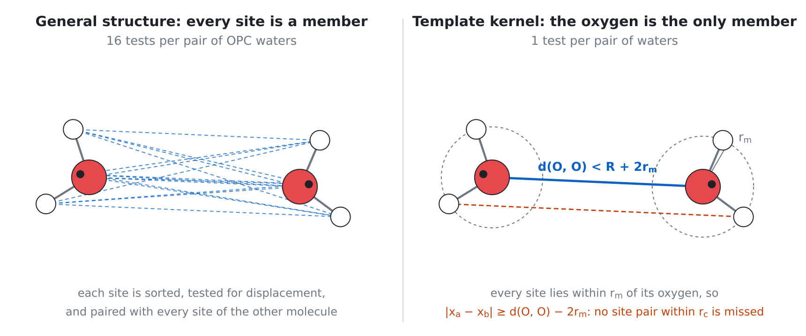
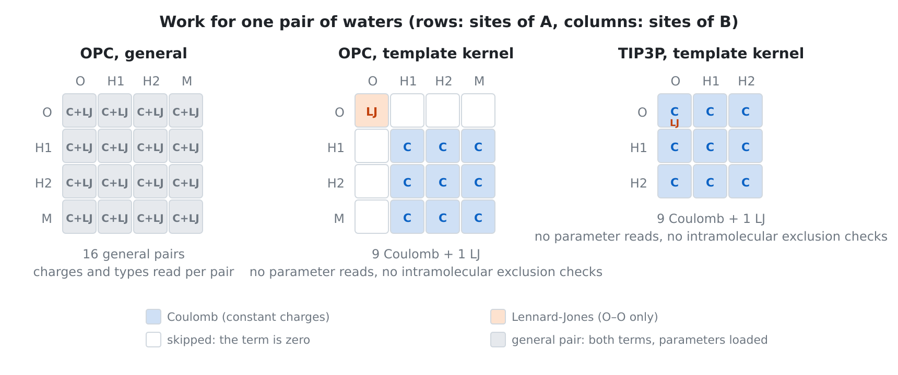
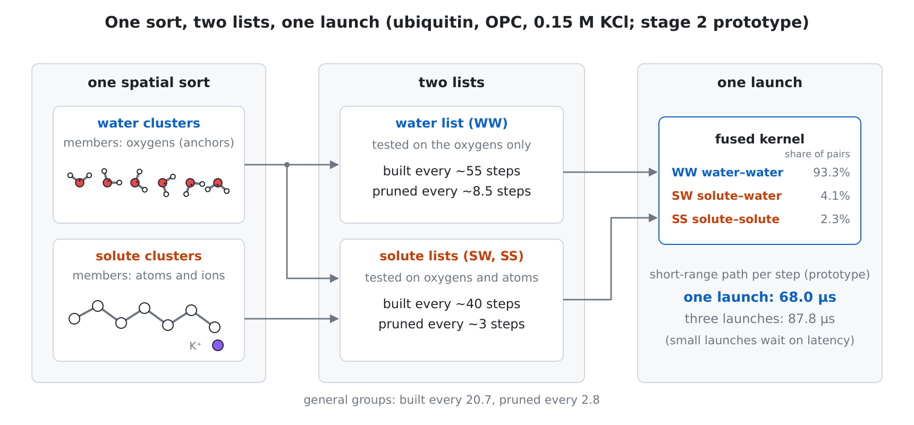

# 4. Neighbor structures

A loop over pairs needs, for every particle, the particles within the
cutoff $r_c$. MDIR keeps a *neighbor structure* that holds a superset of
those pairs, every pair within the *reach* $R = r_c + s$ at the
configuration where it was built, and rebuilds it only when a test shows
that it may no longer hold every pair within $r_c$ [[Verlet1967]](references.md#verlet1967). Three
properties distinguish MDIR's structures from the usual buffered lists:

1. **Exactness.** The test of validity is a sufficient condition, not an
   estimate: no pair within the cutoff is ever left out, whatever moves
   the particles, including a barostat that scales the cell (Section
   4.1). Buffers chosen from an estimated error rate, as in
   [[Pall2020]](references.md#pall2020), are not used.
2. **Each pair once on a device.** The loops over pairs of a large system
   run over *groups* of 16 particles that share a list, and compute each
   unordered pair once (Section 4.4).
3. **A dual list.** An inner list with a short reach is pruned from an
   outer one with a long reach whenever its own exact test asks (Section
   4.5).

The structures are built by templates written in MLIR and specialized
with the rest of the program (Section 3): `NeighborsMatrix.mlir` and
`NeighborsMatrixGPU.mlir` for the matrix, `NeighborsGroupsGPU.mlir`
(generated by `scripts/generate-groups-gpu-template.py`) for the groups,
all under `lib/Runtime/Templates/`.

**Where a structure begins.** A structure begins empty where a segment
between checkpoints begins, so that a run continued from a checkpoint
rebuilds where the first run did. The evaluation at the start of a run is a
segment of its own: the steps build their structure at the first step
rather than continue the one of the start (D218). The
test of validity compares the positions with those of the last build, so
the steps at which a structure is rebuilt, and with them the order of the
sums of forces, depend on where the structures begin. With one rule for
every program, `mdir run` with and without checkpoints and a Python
simulation in any number of parts rebuild at the same steps up to the first
checkpoint, and give the same state to the bit in the deterministic mode.

The coverage-boundary check (D357, #572) separates the
construction's cutoff, centers, and image convention from current-state
validity, which a refresh tests at run time (D80) and this check does not
prove. The compiler proves these facts through direct builds and
refreshes, every initial and yielded path of a recognized `scf.for`, and
every direct call site of a private function. The initial path is needed
even when the loop takes zero iterations; induction on a carried value
needs an established initial fact. Exact center subjects are substituted
at each boundary. Unresolved public, recursive, indirect, address-taken,
or unrecognized boundaries are refused. The neighbor type and generated
program remain unchanged, and the distributed halo-source check remains
strict. This check changes no neighbor strategy or numerical method.

## 4.1 The test of validity

**Theorem (validity under scaling, D80).** Let a structure be built at
the configuration $\mathbf x^\text{ref}$ in the orthorhombic cell of edges
$\mathbf L^\text{ref}$ with the reach $R$, so that it holds every pair
$(i,j)$ with $\lVert \mathbf x^\text{ref}_i - \mathbf x^\text{ref}_j
\rVert_\text{mi} \le R$, where $\lVert\cdot\rVert_\text{mi}$ is the
minimum-image distance. Let $\mathbf m = \mathbf L \oslash \mathbf
L^\text{ref}$ be the scale of each axis since the build, and

$$
d = \max_i \lVert \mathbf x_i - \mathbf m \odot \mathbf x^\text{ref}_i \rVert .
$$

If $2d \le \min(\mathbf m)\,R - r_c$, the structure holds every pair
within $r_c$ at $\mathbf x$ in the cell $\mathbf L$.

*Proof.* Let $(i,j)$ be a pair the structure leaves out, so that
$\lVert \mathbf x^\text{ref}_i - \mathbf x^\text{ref}_j \rVert_\text{mi} >
R$. Scaling every coordinate along axis $a$ by $m_a$ maps the lattice of
images of the old cell onto that of the new one, and stretches every
displacement by at least $\min(\mathbf m)$, so the scaled references are
more than $\min(\mathbf m) R$ apart in the minimum image of the new cell.
Each particle is within $d$ of its scaled reference, so by the triangle
inequality

$$
\lVert \mathbf x_i - \mathbf x_j \rVert_\text{mi} >
\min(\mathbf m)\,R - 2d \ge r_c . \qquad\blacksquare
$$

In the cell of the build ($\mathbf m = \mathbf 1$) the condition is the
familiar half-skin test $d \le s/2$. Under a barostat it costs only the
margin $(1-\min(\mathbf m))R$, so a structure stays valid across many
scalings; before D80, every scaling invalidated it, and a tri-alanine
example at 1 bar rebuilt every 2.5 steps instead of every 5.0. The
condition holds whatever moves the particles: the dynamics, the
constraints, or the barostat moving rigid groups with their centers of
mass.

The theorem takes $\mathbf L$ to be the cell that the positions are in. The
potential of an output (the observed terms, the energies of the other
states of a free-energy calculation) has the reach of the forces and shares
the structure of the steps; it is evaluated at the state of the step, where
its refresh would repeat that of the step, and the compiler removes that
refresh, so the output reads the structure and neither tests nor builds it
(D237). A refresh given the positions of one cell and
another cell breaks the premise: its displacements are off by
$\lvert\mu - 1\rvert\,\lVert\mathbf x_i\rVert$ for a scaling $\mu$, and
it builds the structure where the steps would not have. That happened to
the outputs at a step that scales the cell before they were given the cell
after the scaling: a run then depended on its outputs through the steps of
its builds and the order of its sums in single precision, with no pair
within the cutoff missing in 20,000 steps of a test.

The theorem is stated for an orthorhombic cell and holds unchanged for a
triclinic one (D126). The barostat scales the cell $H$ only as
$H\,\mathrm{diag}(\boldsymbol\mu)$, each tilt with its column (Section
6), and the positions with it: the lattice of the images of the old cell
maps onto that of the new one, and a displacement $\mathbf d$ becomes
$\mathbf d\,\mathrm{diag}(\boldsymbol\mu)$, at least $\min(\boldsymbol\mu)$
times as long. The proof above then goes through with $\mathbf m$ the
ratio of the diagonals $(a_x, b_y, c_z)$ of the two cells, which is what
the test takes for either kind of cell.

**Implementation.** The test is not a separate kernel. The pass
`md-exec-expose-validity` writes it as a loop over particles,

$$
\text{moved} = \bigvee_i \Big[\, \lVert \mathbf x_i - \mathbf m \odot
\mathbf x^\text{ref}_i \rVert^2 > \big(\tfrac12 \max(0, \min(\mathbf m)R -
r_c)\big)^2 \Big],
$$

a reduction of booleans, which `md-exec-fuse-loops` fuses with the loop
that writes the positions: the thread that moves a particle tests it.
On a device a thread that finds its particle too far sets a flag with a
plain store; there is no global maximum. The comparison is unordered
(`ugt`), so a displacement that is not a number fails the test, and before
the first build the reference cell is not a number, so the test fails
then too. The flag reaches the host without waiting for the stream
(Section 8.3).

## 4.2 The order of the particles

Neighbors in space should be neighbors in memory. MDIR keeps two orders.

- **The order of the state** (D44). Where a run or a segment begins, the
  particles are sorted by the cell of a grid of half the reach and, within
  a cell, by their number in the input; the members of every tuple set
  are renumbered on the host. Since D110 a particle is sorted by the
  position of its *anchor*, the heavy atom of its constraint group or,
  for a virtual site, that of the first atom that places it, so
  that the members of a group of SHAKE or a water, with its extra point,
  are contiguous
  (Section 8.2). The order does not depend on the order the particles are
  in, so a run continued from a checkpoint is exact, and the files of a
  run are written in the order of the input.
- **The order of the places** (D86). Every build sorts the particles into
  its own order of *places*, and a kernel of each step gathers the
  positions and the fields that the loops over pairs read into that
  order. The loops write the force of a particle at its own index. The
  order of the places is new with every build, so the loops over pairs
  never see a decayed order: over 40 ps of JAC the loop over pairs had
  slowed from 117 to 208 µs a step when it read the state in its decaying
  order.

The order of the state still decays between sorts; over 2 ns of JAC NVE
the rate fell by 2% and then stayed flat (Section 10), the cost to the
loops that read the state in its own order.

## 4.3 The neighbor matrix

The first structure, kept for the CPU, for kernels without an exchange
contract (Section 3.3), and as the reference of every comparison, is the
*neighbor matrix*: a row for each particle with the places of its
neighbors within the reach. A row holds both $(i,j)$ and $(j,i)$; a loop
over the matrix computes each pair twice, once for each particle, and
each thread writes only its own particle (owner computes), so no atomic
operation is needed and the order of every sum is fixed.

The build is a counting sort into cells of at least a third of the reach
[[Quentrec1973]](references.md#quentrec1973), a sort of each cell by number, and a search that tests
the particles of the cells within reach. The order of a row is the order
in which the search visits the cells and, within a cell, the order of the
indices: it does not depend on the threads, so the forces summed over a
row are the same from run to run. Rows that are too narrow make the
runtime widen them by a quarter more than needed and build again; the run
never truncates a row.

**Triclinic cells** (D123, D125, D241). The particles are
binned by their fractional coordinates $\mathbf x H^{-1}$, in as many
cells as the widths of the cell between its faces hold, and the search
goes around the torus of those cells. A loop over the matrix takes the
displacement of a pair in one pass along $\mathbf c$, $\mathbf b$, and
$\mathbf a$,

$$
\mathbf d \mathrel{-}= \mathbf c\,\mathrm{round}(d_z/c_z), \qquad
\mathbf d \mathrel{-}= \mathbf b\,\mathrm{round}(d_y/b_y), \qquad
d_x \mathrel{-}= a_x\,\mathrm{round}(d_x/a_x),
$$

which leaves it in the brick $\lvert d_x\rvert \le \tfrac12 a_x$,
$\lvert d_y\rvert \le \tfrac12 b_y$, $\lvert d_z\rvert \le \tfrac12
c_z$. Every nonzero vector of the lattice of a reduced cell is at least
$\min(a_x, b_y, c_z)$ long, so an image shorter than half of that is the
nearest one and lies in the brick: the pass is exact for every pair within
the cutoff when

$$
r_c \le \tfrac12 \min(a_x, b_y, c_z),
$$

which the run keeps (it is tested at the start and at every change of the
cell). The reach $R = r_c + s$ of the matrix may be longer than that, and
a barostat may shrink the cell until it is. The build must then not take
the image of the pass for the nearest one: a pair whose nearest image is
between $\tfrac12 c_z$ and $R$ along $z$ is moved by $\mathbf c$, tilts
and all, to an image beyond $R$, left out, and missing when it comes within
the cutoff. The build therefore asks whether *any* image of the pair is
within $R$. Because $H$ is lower triangular, the image $\mathbf d -
\mathbf n H$ has

$$
z' = d_z - n_c c_z, \qquad y' = d_y - n_c c_y - n_b b_y, \qquad
x' = d_x - n_c c_x - n_b b_x - n_a a_x ,
$$

and $\lvert z'\rvert, \lvert y'\rvert, \lvert x'\rvert < R$ bound
$n_c$ by $d_z$ alone, then $n_b$ given $n_c$, then $n_a$ given both: three
nested ranges of integers that are exactly the images in the cube $[-R,
R]^3$, and so hold every image within $R$. From the image of the pass the
ranges are that image alone while $R \le \tfrac12 \min(a_x, b_y, c_z)$,
and at most two a level, the image and the one on the other side, up to $R
= \min(a_x, b_y, c_z)$. A build in a cell wider than twice the reach is
the function that tests the image of the pass alone; in a narrower cell it
is a second function, generated from the first, which runs the ranges for
a candidate that the image of the pass leaves beyond the reach. The choice
is made once a build, not in its loops, where a branch that is never taken
cost 6% of a build on a device. A row holds a particle once: two images of a pair are at least
$\min(a_x, b_y, c_z) \ge 2 r_c$ apart, so at most one is within the
cutoff, and that one is the image of the pass. The test of validity of
Section 4.1 is unchanged, since a pair that was left out had every image
beyond $R$. A build that tested the image of the pass alone lost pairs in
9 of 79 frames of a run of 216 argon atoms whose cell a barostat took 13%
below twice the reach (Section 9).

## 4.4 Groups of 16 particles

On a device, a loop over pairs whose kernel has an exchange contract runs
over the second kind of structure, `groups` (D89): sixteen particles that
share one list of neighbors, over which the loop computes each unordered
pair once. The layout, groups of 16 that share the list of the particles
within the reach of any of them, a half list, and a warp that walks a
group's list with a mask of interactions for each entry, is the one
published by [[SalomonFerrer2013]](references.md#salomonferrer2013),
Section 3.3; the cluster pair lists of
[[Pall2013]](references.md#pall2013) have the same aim. MDIR's order of
the particles, its search, its frames, its images, its pool, and its exact
test are its own, and are derived below; `docs/neighbor-groups.md` gives
the kernels, and its Section 11 the measurements.

### 4.4.1 The structure

A build sorts the particles into an order of *places* $p$ (Section 4.2;
$\pi(p)$ is the particle at place $p$, or none for an empty place). Group
$g$ is the places $16g, \dots, 16g+15$; member $u$ of it is at place
$16g+u$. The list of group $g$ holds *entries* $(q, \mathsf b, \mathbf
e)$: the place $q$ of a candidate, a mask $\mathsf b$ of 16 bits, and the
shift $\mathbf e$ of the candidate's image (Section 4.4.4). Bit $u$ is set
when the pair of member $u$ and the particle at $q$ is within the reach at
the build, is not excluded, and, for $q$ in group $g$ itself, $q > 16g+u$.
Only candidates at places $q \ge 16g$ are taken. The build establishes:

- **I1.** Every unordered pair of distinct particles that is not excluded
  has exactly one bit for each of its images within $R$ at the build, in
  the list of the group of the earlier of its two places, as long as $R <
  \min_a L_a$ (Section 4.4.4). An excluded pair (a bond, an angle, a 1–4
  pair taken elsewhere) and an empty place have no bit, so the loop needs
  no test of exclusion.
- **I2.** The entries of a group and their order do not depend on the
  threads.
- **I3.** An empty place has no entry that names it and zero shifts.
- **I4.** Every entry is in the frame of its list's group, so the loop
  takes no minimum image.

A dual list (Section 4.5) adds two more: the inner mask of an entry is a
subset of its outer mask, computed from it (I5), and the units that the
loop takes are blocks of the structure that hold entries (I6).

**Why not tiles** (D82). The first design for the device took the cluster
pair lists of [[Pall2013]](references.md#pall2013), tiles of 8 particles
with a mask of 64 bits for each pair of tiles, under MDIR's exact test. A
standalone prototype on the loop over the pairs of JAC (Lennard–Jones and
the direct sum in f32, 1000 launches, RTX 3090) found the tiles slower
than the matrix at every reach: at 8.05 Å the matrix took 60.6 µs, tiles
of 8 × 8 with a full list 142.1, and tiles of 8 × 4 111.0, or 106.7 with a
half list added in fixed point. Only 38 to 47% of the slots of the 8 × 4
tiles held a pair of the list, against 98% of the entries of the matrix at
that reach, and the kernel was bound by the arithmetic of the pairs, so
contiguous loads did not pay for the empty slots
(`docs/neighbor-tiles.md`, Section 11). Groups of 16 that share a list of
*particles* waste no slot on the side of the list, need a sixteenth of the
entries of the matrix, and keep the bounding box of a group for the build:
on Cellulose at a reach of 9 Å the loop took 1013 to 1034 µs against 1245
to 1267 for the matrix, and the tests of candidates that the boxes of
groups avoid had taken 5.0 of the 8.0 ms of a build of the matrix.

### 4.4.2 The order and the shape of a group

The cost of a list grows with the volume within $R$ of its group (Section
4.4.3), so every group must fill a small box whatever the positions. The
build sorts the particles into a *compact order*:

1. Columns of a grid in $x$–$y$ of side $d_\text{col} = (64/\rho)^{1/3}$,
   the edge of a cube that holds 64 particles on average:
   $N_\text{col} = \lfloor L_x/d_\text{col}\rfloor\lfloor
   L_y/d_\text{col}\rfloor$ columns, each count clamped to $[1, 256]$.
2. Bins along $z$, $\max(1, \lfloor 2N/N_\text{col}\rfloor)$ a column, and a
   counting sort by column and bin; the particles of a bin are sorted by
   their number.
3. Each column cut into chunks of 64 consecutive particles, chunk $t$ at
   the places $64t$ to $64t+63$.
4. Each chunk of $n$ particles sorted by $x$ with a bitonic network and cut
   into its first $\lceil n/2\rceil$ and the rest; each half sorted by $y$
   and cut the same way. The four quarters are groups $4t$ to $4t+3$; the
   places a quarter leaves are empty.

Every sort breaks ties by the number of the particle, so the order does
not depend on the threads. A column has at most 63 empty places, in its
last chunk, and a chunk of fewer than four particles leaves whole groups
empty; the places are at most $N + 63N_\text{col}$. A chunk of 64
particles of a column of cross section $d_\text{col}^2$ is about
$d_\text{col}$ tall, so a group occupies a prism of about
$\tfrac12 d_\text{col} \times \tfrac12 d_\text{col} \times d_\text{col}$,
half-widths $\mathbf w \approx (\tfrac14, \tfrac14, \tfrac12)d_\text{col}$:
in water ($\rho = 0.1$ Å$^{-3}$), $4.3 \times 4.3 \times 8.6$ Å. The order
of the cells of the matrix gave boxes 12 Å long, and the loop over groups
was then slower than the matrix (`docs/neighbor-groups.md`, Section 11.1).

### 4.4.3 The search and the length of a list

**The box test, then the point tests.** The build computes the bounding
box of each group in f32, its members taken in the minimum image of the
first: center $\mathbf y_g$, half-widths $\mathbf w_g$, $w_{g,a} \le
\tfrac12 L_a$. The candidates come from a grid of $N_{\text{cell},a} =
\min(256, \max(3, \lfloor 2L_a/R\rfloor))$ cells along each axis, visited
over the window

$$
\Big\lfloor \tfrac{(y_{g,a} - w_{g,a} - R')N_{\text{cell},a}}{L_a}\Big\rfloor
\le k_a \le
\Big\lfloor \tfrac{(y_{g,a} + w_{g,a} + R')N_{\text{cell},a}}{L_a}\Big\rfloor
$$

modulo $N_{\text{cell},a}$ (the whole axis when it is wider), in a fixed
order, with $R' = R + \delta_R$ (Section 4.4.6). A candidate before the
group, $q < 16g$, is dropped. A lane tests a candidate against the box,
$\lVert\max(\lvert\mathbf r_q\rvert - \mathbf w_g, \mathbf 0)\rVert \le R'$
with $\mathbf r_q$ its displacement from $\mathbf y_g$ in the image nearest
to it; those that pass go to a queue of the warp in shared memory, in the
order of the lanes, and when it holds 32 each lane tests one against the
16 members (D99): a candidate beyond $R'$ of the box is beyond $R'$ of
every member, and the queue keeps every lane busy where testing in place
left two thirds of them idle. The excluded partners of a group are sorted
as keys $(\text{place} \ll 4) \mid u$ with the bitonic network of the
fewest values that hold them (64, 128, or 256; D105); a candidate outside
the range of their places skips the search (D100), and the others find the
first key at their place by a binary search and clear the bits of the keys
there. A group whose partners do not fit in the 256 places of a warp's
memory reads the rows of the excluded pairs instead (D106): exact, slower,
and rare (Cellulose, the only system of the suite where it happens, has 1
such group in 255 builds under NVE and 7 in 253 under NPT). A warp writes
its entries in the order of its cells and of its lanes (I2), into blocks of
64 entries that it takes from one pool, at most two a round with one
atomic addition; block $b$ is block `ordinals[b]` of the list of group
`units[b]`, and a block is the unit of work of the loop.

**The length of a list.** Let $\Omega_g$ be the points within $R$ of some
member of group $g$. A candidate is in the list when it is in $\Omega_g$
and after the group; in a uniform fluid half of the candidates are, so
$E_g \approx \tfrac12\rho\lvert\Omega_g\rvert$. $\Omega_g$ lies within the
points within $R$ of the box, whose volume is that of the box, of its six
faces moved out by $R$, of its twelve edges rounded by quarter cylinders,
and of its eight corners rounded by eighths of a ball:

$$
V_R(\mathbf w) = 8w_xw_yw_z + 8(w_xw_y + w_yw_z + w_zw_x)R +
2\pi(w_x + w_y + w_z)R^2 + \tfrac43\pi R^3 .
$$

The pairs within $R$ are $\tfrac12 N\bar n$, with $\bar n =
\tfrac43\pi\rho R^3$, and the loop evaluates 16 slots for each entry, so the
share of the slots that hold a pair within $R$ is

$$
\zeta_R = \frac{\tfrac12 N\bar n}{16\sum_g E_g} \approx
\frac{\tfrac43\pi R^3}{\lvert\Omega_g\rvert} \ge
\frac{\tfrac43\pi R^3}{V_R(\mathbf w_g)} ,
$$

using $N = 16 \times$ the groups, and the share within the cutoff is
$\zeta_c \approx \zeta_R (r_c/R)^3$. For the prism of Section 4.4.2 the
bound is 0.34 at STMV ($R$ = 9.5 Å) and 0.39 at JAC ($R$ = 11 Å); the
blocks that the lists took, $\sum_g E_g \le 64B$, give $\zeta_R \ge
N\bar n/(2048B)$, at least 0.42 at STMV and 0.65 at JAC (Section 4.4.7). The union of 16
balls is well inside the box widened by $R$, so the bound is loose, but its
terms show what sets the length: at these reaches the quarter cylinders,
which grow with $\sum_a w_a$, are about half of $V_R$, and a cube of the
volume of the prism would make $V_R$ about 3% smaller. Without the box test
each group would test every candidate of its window, about
$\rho\prod_a(2w_{g,a} + 2R + L_a/N_{\text{cell},a})$ particles, half of
them after the group, against the 16 members; on JAC that is about 1,800
candidates against about $\tfrac12\rho V_R \approx 700$ that pass the
box test (estimates for a uniform density and the prism).

### 4.4.4 Frames and images

**Frames** (D95). The loop takes no minimum image. The build moves every
place, and every entry, by whole cells into the *frame* of its group: the
first member where it is wrapped into the cell, and the other members at
their places relative to it. For each place $p$ it stores the integer
shift $\mathbf S_p \in \{-512, \dots, 511\}^3$, ten bits an axis, that moves
the particle as it is kept (unwrapped) into the frame of its group, and
the cells $\mathbf W_p \in \{-1, 0, 1\}^3$ from its wrapped position to
that frame. An entry's shift is

$$
\mathbf e = \mathbf W_{16g} - \mathbf W_q - \mathbf n_q, \qquad
\mathbf n_q = \mathrm{round}\big((\tilde{\mathbf x}_q - \mathbf y_g)\oslash\mathbf L\big),
$$

with $\tilde{\mathbf x}_q$ the wrapped position, the cells from the frame
of $q$'s group to that of the list's group for the image of $q$ nearest to
the center of the box. The loop computes, for member $u$ and an entry,

$$
\mathbf r_{uq} = \big(\mathbf x_{\pi(16g+u)} + \mathbf S_{16g+u}H\big)
- \big(\mathbf x_{\pi(q)} + \mathbf S_q H + \mathbf e H\big),
$$

with $H = \mathrm{diag}(\mathbf L)$ in an orthorhombic cell, where the
additions of $\mathbf S_pH$ are made in f64 on the positions as stored and
the sums converted to f32 once, by the kernel that gathers the positions
into the order of the places (D101): a position in its frame is then as
exact as one in the cell, however far the particle has gone. A frame
anchored on the first particle as it is kept, unwrapped, would let
$\mathbf e$ grow with the drift of two groups apart and overflow its bits;
anchoring on the wrapped position bounds $\mathbf e$ to $\{-4, \dots,
4\}^3$, four bits an axis in bits 16 to 27 of the mask. The template test
places particles three cells out of the cell on either side to check it.

**One entry for each image within the reach** (D115). One shift serves the
16 members of an entry, so an entry takes one image of its candidate, the
one nearest to $\mathbf y_g$. A member is within $w_{g,a}$ of $y_{g,a}$
along axis $a$, so an image of $q$ within $R$ of it is within $w_{g,a} + R$
of $y_{g,a}$, and is the nearest image if $w_{g,a} + R \le \tfrac12 L_a$.
In a narrower cell the image of a pair can be the one on the other side of
the boundary: on the argon–krypton mixture of `barostat.test` (23.2 Å, a
reach of 10 Å, groups about 9 Å wide) a list that held only the nearest
image gave the potential energy at the start as $-497.7291$ kcal/mol
against $-497.7298$ of the matrix, the virial $-1117.6307$ against
$-1117.7782$. A second kernel therefore takes the groups with $2w_{g,a} +
2R' \ge L_a$ along some axis, scans their candidates again, and adds to
each list, from the block where the first kernel left it, an entry for
each other image a cell away or none along each axis, $\mathbf r_q -
\Delta\mathbf n\odot\mathbf L$ with $\Delta\mathbf n \in \{-1, 0, 1\}^3$,
whose distance from the box is within $R'$; it queues the candidate with
the code $9(\Delta n_z + 1) + 3(\Delta n_y + 1) + (\Delta n_x + 1)$ in bits
26 to 30, and each image becomes an entry with its own mask and shift.

**Theorem (completeness of the images, D242).** The lists hold a bit for
every image of every pair within $R$ if $R < \min_a L_a$.

*Proof.* (1) The members are taken in the minimum image of the first, so
$w_{g,a} \le \tfrac12 L_a$. (2) An image within $R$ of a member is within
$R$ of the box, so its displacement $\mathbf r$ from $\mathbf y_g$ has
$\lvert r_a\rvert \le w_{g,a} + R$. (3) The nearest image has $\lvert
r_a\rvert \le \tfrac12 L_a$, and the 27 images $\Delta\mathbf n \in \{-1,
0, 1\}^3$ from it are every image with $\lvert r_a\rvert \le \tfrac32 L_a$
along each axis; the next is at least $\tfrac32 L_a$ away along some axis.
(4) Where $2(w_{g,a} + R) < L_a$ on every axis only the nearest image is
within $R$ by (2), and the first kernel takes it; elsewhere the second
kernel takes the 27. So the lists are complete where $w_{g,a} + R <
\tfrac32 L_a$ on every axis, which (1) gives for $R < \min_a L_a$.
$\blacksquare$

The bound holds for every group whatever the positions (a sparse column
makes a box as wide as the cell), and the run asks it: the builder refuses
a longer reach for the groups and the runtime stops a run whose barostat
takes the cell below it, with the factor 0.999 for $\delta_R$ (D242). Where
the edges exceed $2R'$, about $2R$, a pair has at most one image within the reach, so
the masks of the entries of a candidate are disjoint and I1 holds with one
bit for each pair; in a narrower cell a pair has a bit for each of its
images within the reach, of which the loop finds at most one within the
cutoff, the edges being at least $2 r_c$. Before D242, the kernel took the
nearest image or the one on the other side of the boundary along each
axis, which is every image only while $w_{g,a} + R \le L_a$, a condition
nothing asked: with a reach of 0.77 to 0.89 of the edge of a cube under a
barostat, 23 of 79 frames lacked pairs. In the cells of the Amber suite no
group needs the second kernel, which is then a launch of warps that return.
A first version handled both cases in the list kernel, which then needed
128 registers a thread instead of 64 and took 2259 µs a build on Cellulose
instead of 1735.

**Triclinic cells** (D126). The build of a triclinic cell wraps the
positions into the brick $[0,a_x)\times[0,b_y)\times[0,c_z)$ of the
lower-triangular cell $H$, along $\mathbf c$, $\mathbf b$, and $\mathbf
a$, which is a whole cell, and keeps the compact order and the grid of the
candidates in it. The grid is periodic along x alone: a row of the grid
$t_z$ cells beyond a face of z holds the particles of $t_z\mathbf c$ away,
x and y with them, and one $t_y$ beyond a face of y those of $t_y\mathbf
b$, so the window of y moves by $-t_z c_y$ in each row of z and that of x
by $-t_z c_x - t_y b_x$ in each row of y. The minimum image is taken in one
pass along $\mathbf c$, $\mathbf b$, and $\mathbf a$, which gives the image
in the brick (the nearest one within half of the least of $a_x$, $b_y$,
$c_z$, Section 4.3); $\mathbf S_p$, $\mathbf W_p$, and $\mathbf e$ become
lattice vectors, applied as $\mathbf S_pH$ and $\mathbf eH$ as in the
formula above, five multiply-adds once per entry and nothing per pair;
$\mathbf e + 16$ takes five bits a vector, bits 16 to 30. The images of
D115 are those a lattice vector away, $-1$, $0$, or $1$ along each of
$\mathbf c$, $\mathbf b$ (rounded again), and $\mathbf a$ (rounded again),
27 in all: every image within three halves of $c_z$, $b_y$, and $a_x$ of
the center of a box along $z$, $y$, and $x$, so that the theorem holds with
$L_a$ the diagonal of $H$, and the lists are complete for a reach below
$\min(a_x, b_y, c_z)$.

### 4.4.5 The loop

**Each pair once.** Each pair once requires the kernel's values to have an
exchange contract: the value for $j$ from the pair $(i,j)$ is $+$ or $-$
the value for $i$. Forces derived by differentiation are antisymmetric,
energies and virials symmetric; `md-differentiate` attaches the contract
and `md-check-exchange` verifies it (Section 3.3). A loop with a
destination without a contract keeps the matrix. For a kernel $k$ with
the sign $s$ of its contract, $k(j, i) = s\,k(i, j)$, so the value that the
matrix accumulates at $i$ over both orders splits by the order of the
places,

$$
a_i = \sum_{j \ne i} k(i, j) = \sum_{j > i} k(i, j) + \sum_{j < i} s\,k(j, i),
$$

and each unordered pair $\{i, j\}$, $i < j$, adds $k(i, j)$ to $a_i$ and
$s\,k(i, j)$ to $a_j$: the loop over the bits of I1 computes $k(i, j)$
once for both. A sum $S = \tfrac12\sum_i\sum_{j\ne i}k_S(i, j)$ with a
symmetric $k_S$ is $\sum_{i<j}k_S(i, j)$, twice the weight $\tfrac12$ that
the matrix gives each order.

**The schedule** (`emitGroupPairKernel`, `lib/Conversion/MDExecKernels/`).
A warp takes a block. Lanes $\ell = u$ and $\ell = u + 16$ hold member
$u$; each lane loads one entry, 32 entries at a time, and the entries turn
within each half-warp, one lane a step, for 16 steps: at step $k$ lane $u$
holds the entry loaded by lane $(u - k) \bmod 16$ of its half, so each
member meets each of the 32 entries once. The value that the kernel
computes for the entry travels with it and is added to the entry's
particle with one atomic addition when it is back at its lane; the values
of the group's members are added across the two halves by one shuffle and
once per block. The mask does not turn with the entry (D97): at each round
a ballot for each of the 16 members gives the bits of that member with
every entry of the warp; lane $u$ keeps word $u$, restricted to its
half-warp and rotated left by $15-u$, so that at step $k$ its bit 15 is bit
$(u - k) \bmod 16$ of the word, the pair with the entry it then holds, and
each step shifts the word by one. The kernel is evaluated for every slot,
and a slot whose bit is clear is given the squared distance $4r_c^2$,
beyond the cutoff, so that a single comparison, $r^2 < r_c^2$, masks it:
the loop has no divergent branch. Two coefficients of Lennard–Jones read at
the same entry of a type table are one load of 8 bytes (D96).

**Its cost.** With these, the loop is bound by the pipe of loads and
shuffles (Nsight Compute, 92% of its peak on Cellulose). A step shuffles
each component of the entry's position, of its fields, and of the values
it has received: 8 shuffles a pair on the nonbonded kernel. Its time is
then that of the slots, $16\sum_g E_g$, of which the share $\zeta_c$ holds
a pair within the cutoff (Section 4.4.3); the compact order raised that
share on Cellulose at 9 Å from 23.8% to 29.7%.

### 4.4.6 Tests in f32

The positions of the build are wrapped into the cell and tested in f32
against the reach widened by $\delta_R = 3\times 10^{-6}\,(L_x + L_y +
L_z)$; in a triclinic cell the sum also takes the magnitudes of the three
tilts.

**Lemma.** A pair within $R$ in exact arithmetic passes the test of the
build: its computed squared distance is at most $(R + \delta_R)^2$ as
rounded to f32.

*Proof.* Let $\mathsf u = 2^{-24}$. A wrapped coordinate, at most $L_a$ in
magnitude, rounds to f32 with an error of at most $\mathsf uL_a$, two
positions $2\mathsf uL_a$. The test subtracts the center $y_{g,a}$, which
lies within $\tfrac32 L_a$ of a wrapped position, from each (an error of
at most $\tfrac32\mathsf uL_a$ each), takes the minimum image of each
(the result at most about $\tfrac12 L_a$, $\tfrac12\mathsf uL_a$ each),
and subtracts the two ($\mathsf u$ of the result). The image subtracts an
integer of magnitude at most 1 times the edge rounded to f32; the product
is exact, but that edge is within $\mathsf uL_a$ of $L_a$, which adds
$\mathsf uL_a$ for each displacement, and the shift $\Delta n_a$ of the
second kernel of Section 4.4.4 times the same edge adds $\mathsf uL_a$
more. The center's own rounding cancels, since both displacements are
taken from the same value. So each component of the computed difference
is within $9\mathsf uL_a + \mathsf u\lvert d_a\rvert$ of the exact one,
the vector within $9\mathsf u\lVert\mathbf L\rVert + \mathsf uR$ near
the reach, and the sum of the squares, the rounding of $R +
\delta_R$, and that of its square add about $3\mathsf uR$ on the distance.
With $R < \min_a L_a \le \tfrac13\sum_a L_a$, the distance is computed
within

$$
9\mathsf u\lVert\mathbf L\rVert + 4\mathsf uR \le 10.4\,\mathsf u\sum_a L_a
\approx 6.2\times10^{-7}\sum_a L_a < \delta_R .
\qquad\blacksquare
$$

The box test has errors of the same order, within the same margin, and the
same bound holds for the pruning of Section 4.5. The image that is tested,
$\mathrm{round}(d_a/L_a)$ in f32, can differ from the nearest one only
where $\lvert d_a\rvert$ is within a few $\mathsf uL_a$ of $\tfrac12 L_a$;
an image within $R$ of a member there has $w_{g,a} + R \ge \tfrac12 L_a -
2\mathsf uL_a$, so $2w_{g,a} + 2R' > L_a$, and the second kernel of Section
4.4.4 takes the other image. The rounding can therefore
keep a pair a little beyond $R$ but never drop one within it;
`test/Runtime/neighbors-groups-gpu.mlir` checks the lists against every
pair computed in f64. Of the bound, the rounding of the positions alone is
at most $2\sqrt3\,\mathsf u\max_aL_a \approx 2\times10^{-7}\max_aL_a$;
$\delta_R$ is about five times the whole.

### 4.4.7 The pool, the sizes, and failures

**The size of the pool** (D331). The list of a group holds the particles
at later places within $R$ of any of its 16 members, so its length follows
the mean number of neighbors of a particle within the reach. In a fluid of
number density $\rho$ and pair distribution $g(r)$ that number is $\bar n
= 4\pi\rho\int_0^R g(r)\,r^2\,dr$, which is $\tfrac43\pi\rho R^3$ once $R$
is beyond the range of the correlations. The pool holds $B = \sum_g \lceil
E_g/64\rceil$ blocks for the lengths $E_g$ of the lists. A sum over many
groups follows the density of the whole cell. At constant $N$ and pressure
the volume fluctuates by $\delta V/V = \sqrt{k_BT\kappa_T/V}$, with
$\kappa_T$ the isothermal compressibility; for water at 300 K ($\kappa_T =
4.5\times 10^{-10}$ Pa$^{-1}$) that is $4\times10^{-4}$ at STMV and
$3\times10^{-3}$ at JAC. $B$ scales with the density, as $V^{-1}$, so the
blocks that one build takes fix the pool's need for every build of an
equilibrated state, and a margin of a quarter covers these fluctuations
many times over, and a compression to 0.8 of the volume. The structure
therefore starts with one block a group, and its first build sizes the
pool: $B_0 + \lfloor B_0/4\rfloor$ for the $B_0$ blocks that the
configuration at the start takes. Counting $B_0$ is exact, where an
estimate from $\bar n$ would need the ratio of the mean of $E_g$ to $\bar
n$, $1/(2\zeta_R)$ by Section 4.4.3, which depends on the shape of the
groups and the reach: at most 1.2 at STMV ($R$ = 9.5 Å) and 0.77 at JAC
($R$ = 11 Å), from 64 entries a block over $N/16$. STMV takes at most
433,376 of 541,603 blocks, where the pool sized from the particle with the
most neighbors held 800,328. A build of Cellulose at 9 Å takes 152,619
blocks; the pool sized from the width of a row before D331 held 280,929
(144 MB for entries and masks, against 510 MB that fixed lists of twice the
width of a row would need). An argon and krypton mixture compressed from
18,991 to 10,260 Å$^3$ grows its lists once after the first build, and
gives the matrix's energies to every printed digit. A build counts the
places and the blocks it takes even where they do not fit; when they do
not, the runtime grows its buffers to a quarter more than needed and the
build is made again, so no pair is left out.

**Failures.** A position that is not a number gets no place and is
counted, and the run then stops with a message instead of sorting every
particle into one bin (D107). So does a finite position whose wrap into
the cell does not land in it, a fraction outside $[-10^{-6}, 1 +
10^{-6}]$, which a run that has failed reaches on its way to NaN: beyond
about $10^{16}$ cells the wrap errs by more than a cell, and its cell would
index outside the tables of the build (D176). The stop says that a
position is not a number or is far outside the cell. A Python simulation
takes the stop as a failure of its part and runs the part to its end
(D196), so everything after a build must stay inside its buffers whatever
the positions and the cell are (D225): the loops over the rows of a matrix
skip a place that the build left empty, and every build takes at least one
and at most 256 cells along an axis, computed with a maximum and a minimum
that take the other operand of one that is not a number. A wider cell
costs only time, since the range of the search follows from the number of
cells; the largest system of the Amber suite takes at most 77. A barostat
whose coupling scales an edge of the cell by a factor outside $[1/2, 2]$,
or makes it not finite, fails the run: a pressure that had blown up once
took the cell from 1.7 nm to $10^{11}$ nm, within the bound of twice the
cutoff, and the builds asked for $10^{11}$ cells along each axis.

## 4.5 The dual list

**Why.** A single list trades the build against the loop over pairs: the
loop grows with the cube of the reach and the builds fall with the skin.
On Cellulose (Table 4.1, at the end of this section) their sum is flat
near 9 Å. A dual list takes the build of the long reach and the loop of
the short one.

**Structure** (D114). With `pruned_distance` the refresh keeps two lists:
the *outer* list, built with $R = r_c + s$ exactly as above, and an
*inner* list with the reach $R_\text{in} = r_c + s_\text{in} < R$, which
the loops over pairs take. The inner list keeps the pairs of the outer
list within $R_\text{in}$ at the configuration $\mathbf x^p$ and the cell
$\mathbf L^p$ of its last *pruning*.

**Theorem (validity of the dual list).** With $\mathbf m = \mathbf L
\oslash \mathbf L^\text{ref}$ and $\mathbf m^p = \mathbf L \oslash \mathbf
L^p$, the inner list holds every pair within $r_c$ if

$$
2\max_i \lVert \mathbf x_i - \mathbf m\odot\mathbf x^\text{ref}_i\rVert \le
\min(\mathbf m)\,R - r_c
\quad\text{and}\quad
2\max_i \lVert \mathbf x_i - \mathbf m^p\odot\mathbf x^p_i\rVert \le
\min(\mathbf m^p)\,R_\text{in} - r_c .
$$

*Proof.* A pair that the inner list leaves out was either left out by the
outer list, and then the first condition keeps it beyond $r_c$ by the
theorem of Section 4.1, or it is in the outer list and the pruning
dropped it because $\lVert \mathbf x^p_i - \mathbf x^p_j\rVert_\text{mi} >
R_\text{in}$; the theorem of Section 4.1 applied to the pruning, as a build
with the reach $R_\text{in}$ at $\mathbf x^p$, keeps it beyond $r_c$ by the
second condition. $\blacksquare$

A dual list is of the groups. A program may hold a neighbor matrix
beside them, for the loops without an exchange contract (Section 4.4):
the loops of the derivative in the tunables of a Python model are such
loops. That matrix has no inner list, and its refresh takes the first
condition alone, which is the theorem of Section 4.1 for it
(D245). Both front ends select the structures: the control
file with `neighbor_structure` and `pruned_distance`, the Python model
with `Execution.neighbor_structure` and `System.pruned_distance`, and
with one structure they run at one rate (JAC, 23,558 atoms, at constant
energy in mixed precision on one RTX 3090: 0.205 ms a step from
`mdir run` and 0.206 from a Python simulation with the dual list, 0.258
and 0.259 with the matrix).

Two consequences shape the implementation. First, the inner list is
always pruned from the outer list, never from the previous inner list
(I5): a pair dropped by one pruning may come within $R_\text{in}$ again and
must be able to return. The outer entries and masks are kept as the build
left them, and the inner list is written to buffers of its own:

$$
\mathsf b^\text{in}_u = \mathsf b^\text{out}_u \wedge \big[\, r_{uq}^2 \le (R_\text{in}+\delta_R)^2 \,\big]
$$

bit by bit, at the current positions. Second, the two references are
independent: a pruning sets $\mathbf x^p$ and $\mathbf L^p$ only, a build
sets $\mathbf x^\text{ref}$ and $\mathbf L^\text{ref}$ and is followed by
a pruning. Each test scales by its own cell, and a scaling has no shear:
the cell is orthorhombic, or triclinic and scaled column by column
(Section 4.1).

**The two tests** are two fused loops over particles
(`md-exec-expose-validity`): the first against `reference_positions` and
`reference_cell` of the structure, the second against the same with the
attribute `pruned`. `md_exec.refresh_neighbors` takes the results as
`moved` and `stale`; where the outer list is not valid it builds it and
prunes the inner one; where only `stale` is set it prunes again, which
reads the outer list and the positions and searches nothing. Before the
first pruning the pruned cell is not a number, so the second test fails
and the first step prunes.

**The pruning as a streaming compaction.** The pruning runs a warp per
group (`emitGroupsPrune`, `lib/Conversion/MDExecToGPU/MDExecToGPU.cpp`):

1. A kernel gathers the positions of all places into their frames, in f32
   (the same arithmetic as the loop), and copies the positions, as they
   are stored, to $\mathbf x^p$. The indices of each group's outer blocks
   in the order of its list are written once per build, not per pruning
   (D268).
2. The warp of group $g$ holds the 16 positions of the group in registers
   (loaded by lanes 0–15 and broadcast once by shuffles).
3. It reads the outer entries of the group in their order, 32 at a time,
   computes the 16 bits of each with the inner reach, and ranks the
   entries that keep a bit:

   $$
   \text{rank}_\ell = \mathrm{popc}\!\big(\mathrm{ballot}(\text{keep}) \wedge (2^\ell - 1)\big),
   $$

   for lane $\ell$, writing the entry to position $k + \text{rank}_\ell$ of
   the group's stream, where $k$ is the number kept so far (uniform over
   the warp); at the end $k = k_g$.
4. The stream fills the group's blocks in order, across their boundaries:
   if three outer blocks keep 37, 19, and 42 entries, the inner list fills
   one block with 64 and the next with 34. Each block records how many
   entries it holds.
5. The blocks that hold entries, the *active units*, the first $\lceil
   k_g/64\rceil$ of each group (I6), are listed in the order of the blocks
   with their number, which stays on the device: the pruning counts them in
   runs of 32 and 1024 blocks, and a warp for each run of 32 places its
   active blocks after those counted before it and ranks them within the
   run by a ballot. The loop over pairs takes only the active units (D268).
   After a pruning about 40% of the outer blocks are empty; before, the
   loop launched a warp for each, which loaded its group before it found
   nothing to do.

The ranks come from a ballot and a population count, so the order of the
inner list is the order of the outer list: the pruning adds no order of
its own, and the inner list fills its blocks as a list built with
$R_\text{in}$ would. This warp compaction, the scans, and the counting
sorts of the builds are one emitter each, which the lowering and the
templates of the builds share (D296; [device-primitives.md](../device-primitives.md),
Section 4). (The outer list's blocks come from an atomic pool, and the loop
adds with atomics, so the sums depend on the order of the threads as
before; the deterministic mode does not use groups.) A loop over pairs
that follows the refresh at the same positions, in f32, takes the frames
of step 1 as they are when the refresh pruned: they are its own, to the
bit. Positions in f32 can only keep a pair beyond $R_\text{in}$, never drop
one within it, by the lemma of Section 4.4.6: the reach is widened by the
same $\delta_R$. A first version pruned every block of the outer list into
the same block of the inner list, which then kept the outer layout, many
of its blocks nearly empty; the measurements are at the end of this
section.

**The pruning in the loop** (D284). A pruning reads every entry of the
outer list, gathers its position, tests its 16 bits, and stores the inner
list; the loop over pairs then reads the inner list back and does the
arithmetic of each pair. Any exact pruning does the first four, so a kernel
that prunes and computes at once can remove only the read back, a launch,
and what it hides. Where the refresh prunes, the first loop over pairs that
takes its result at the same positions and in the same cell prunes
instead, in one kernel with a warp for each group: the warp prunes its
group with the code of the pruning above, waits for the stores of its
other lanes, and computes the pairs of the entries it kept, read back as
one stream of the group in rounds of 32. The inner list is the pruning's
to the bit. On the step itself the warp computes, of the entries it kept,
the pairs within $r_c$. Since $r_c < R_\text{in}$, an entry of the outer
list with a pair within $r_c$ at $\mathbf x^p$, the configuration of the
step, keeps the bit of that pair, so these are the pairs of the loop over
the fresh inner list, and the theorem above holds for the steps that
follow. The sums differ from those of the separate pruning by the order of
their additions only.

With $t_\text{loop}$, $t_\text{prune}$, and $t_\text{fused}$ the times of
a call of the loop, of a pruning, and of the loop that prunes, a step
saves $t_\text{loop} + t_\text{prune} - t_\text{fused}$ divided by the
steps between prunings. Counting only the work removed, $t_\text{fused}
\approx t_\text{loop} + t_\text{prune}$ less the read back. On an RTX 4090
the measured $t_\text{fused}$ is instead $t_\text{loop}$ and 0 to 7% more:
on Cellulose 584.9 µs against $t_\text{loop} = 550.6$ and a main kernel
of the pruning of 228.6; on STMV 1638.4 against 1654.2 and 575.0. The
reading that fits, which no counter has measured: a warp's pruning is
bound by memory and its computation by the shuffles and the arithmetic of
the loop, and warps of the two parts share a multiprocessor, so the
pruning hides under the loop. A step takes 4 to 6% less from about 6,400
groups (Cellulose 1465 → 1376 µs, STMV at 4 fs 4710 → 4458;
`docs/neighbor-groups.md`, Section 11.7). Two costs bound the gain. The
warps are as many as the groups, where the loop has one for each active
unit, several a group: on JAC, with 1,476 to 1,664 groups (the places
over 16), they leave the
device partly idle and a step takes 1.2% more. And the kernel holds 94 to
96 registers a thread, against 72 for each of the two it replaces. The
loop therefore prunes from 4096 groups by default, which the host decides
at each pruning from the groups of the last build, the places over 16,
empty places included. On an RTX PRO 6000 Blackwell Max-Q, which ran at
its cap of 300 W, $t_\text{fused} \approx t_\text{loop} + t_\text{prune}$
(Cellulose 591.2 against 415.0 and 167.5), and the step changes by −1.1 to
+1.0% from 6,400 groups, equal from about 19,000; on such a device
(`sm_12x`) the loop prunes from 20,480 groups.

**Which structure by default** (D261). The time per step of
either structure is roughly a fixed cost plus a cost per particle.

- The groups have the larger fixed cost: more kernels a step, the
  prunings, and the boxes of the build.
- They have the smaller cost per particle: a sixteenth of the entries,
  each pair once.

The groups therefore take less time above some $N$ and more below it.
Measured against the matrix at its default reach, the groups at 3 Å and
0.6 Å beyond the cutoff take 17% more time on the dipeptide (1,168 atoms)
on an RTX 4090. They take 1.5% more on a TIP3P box of 20,931 sites, and
less from JAC (23,558 atoms, 1.3%) up to 42% less time on 103,158 sites.
On an RTX PRO 6000 Blackwell they take less from 13,899 sites. The
default, `neighbor_structure = "AUTO"`, takes the groups with these
reaches on a GPU outside the deterministic mode from 23,000 particles, the
crossover of the device where it comes later. Below that, and wherever a
loop cannot take each pair once, it takes the matrix
(`docs/neighbor-groups.md`, Sections 6.3 and 11.8). The inner skin grows
in proportion to the time step: the displacement over a fixed number of
steps roughly does, so the interval between prunings stays the same. On
STMV at 4 fs an inner reach of 9.2 Å is pruned every 2.1 steps and takes
2% less time than 8.6 Å, pruned every step. The default of D261, which a
run takes where it does not choose (below), is an outer skin of 3 Å and an
inner skin of 0.6 Å at 2 fs, in proportion to the step; the measurements
of Section 10 take both the skins that the choice below made for each
system and these defaults.

**The choice of the skins** (D281). Because the test of validity
is exact, every pair of skins $(s, s_\text{in})$ gives the same pairs
within $r_c$: the skins set the speed alone, and `"AUTO"`, the default,
lets the run choose them. Per particle a step costs

$$\frac{t_\text{step}}{N} = a + c_1\rho R_\text{in}^3 + \frac{c_2\rho R^3}{n_\text{prune}} + \frac{c_3 + c_4\rho R^3}{n_\text{build}} + \frac{L}{N n_\text{build}},$$

the loop over the inner list, the pruning of the outer one every
$n_\text{prune}$ steps, and the build every $n_\text{build}$ steps with a
fixed cost $L$ of its launches. The intervals come from the motion of the
particles: a list is renewed when the largest displacement since it was
made reaches half its skin, and in equilibrium each component of a
velocity is Gaussian with the variance $k_BT/m_i$, so the largest
displacement over the $N$ particles grows as $v_\text{max}t$ with
$v_\text{max}$ a few times $\sqrt{k_BT/m}$ of the lightest particles while
the velocities are correlated, and more slowly, toward $\sqrt{6Dt}$, once
they are not. The inner skin is crossed within a few steps, in the first
regime, $n_\text{prune} \approx s_\text{in}/(2v_\text{max}\Delta t)$; its
optimum then solves $3c_1R_\text{in}^2 = 2c_2R^3v_\text{max}\Delta t /
s_\text{in}^2$ and grows as $\sqrt{\Delta t}$ for $s_\text{in} \ll r_c$,
where the setting above grows in proportion to $\Delta t$. The outer skin
is crossed in tens of steps, between the two regimes, and on the Amber
suite $n_\text{build} \propto s^{1.57}$. The constants, fitted to 480 runs
of five systems on an RTX 4090 (a root mean square of 1.0% in the
relative residuals), only narrow the candidates, since the rate is not a
smooth function of the skins (on JAC it falls from 4 to 5 Å and rises
again to 6 Å): a long run on a device measures the setting above, the
model's two best pairs at least 1 Å apart, and a climb of 0.5 Å in $s$ and
0.1 Å in $s_\text{in}$ from the fastest, each compiled with its skins as
constants and run from the state the run begins with for six blocks of
about 0.5 s, and keeps the fastest unless it is within the noise of the
setting above. The candidates a run affords are those whose compilation
and steps fit within 2% of its time, at most seven; since the compilation
is measured, a warm compile cache can afford more, so the choice is cached
with its budget and its candidates under a key of the build, the system,
the device, the precision, the step, and the ensemble, which a
continuation shares, and a later run of the key reuses it rather than
searching again (D401).
The deterministic mode does not search: the order of a row of the matrix
follows its cells, so its sums, which agree across skins to the rounding
($1.8 \times 10^{-9}$ nm in the positions of a water box after 500 steps),
repeat to the bit only with the same skins. Table 4.3 compares the choice
with the best point of a grid; [neighbors.md](../neighbors.md),
Section 6, has the details.

**Checks.** In double precision `test/Driver/groups-gpu.test` runs a water
box with a dual list (11/9.3 Å, 37 prunings and 6 builds in 100 steps) and
the matrix, and the two give the energies of the log to every printed
digit. Under the barostat of `test/Driver/barostat.test`, which compresses
an argon–krypton mixture from $-1800$ toward $200$ atm, the dual list gives
the energies of one list to every printed digit over 1000 steps; the two
part only beyond 1400 steps, where the order of the atomic additions has
been amplified by the chaos of the dynamics.

**Related.** The dual list has the purpose of the dynamic pruning of
[[Pall2020]](references.md#pall2020): a long list built rarely and a short
one renewed often. It differs in its test: there the buffers are sized from
an estimate of the drift of the energy and the list is pruned on a
schedule, while MDIR prunes when an exact condition fails and keeps no pair
out that could be within the cutoff, and on a large system it prunes in
the loop over pairs.

**Measurements.** Table 4.1 measures Cellulose (408,609 atoms, NVE, 2 fs,
$r_c = 8$ Å) with one list of groups at four reaches.

*Table 4.1. Cellulose NVE with one list of groups (µs per step, RTX 3090,
2000 steps, nsys).*

| Reach $R$ | Loop over pairs | Builds | Steps between builds | Device total |
|---|---|---|---|---|
| 8.6 Å | 935 | 610 | 2.3 | 2923 |
| 9.0 Å | 1041 | 405 | 4.0 | 2833 |
| 10.0 Å | 1318 | 235 | 7.9 | 2931 |
| 11.0 Å | 1643 | 157 | 13.7 | 3188 |

The first pruning, which pruned every block of the outer list into the
same block of the inner list, kept 238,135 blocks on Cellulose with an
outer reach of 11 Å, against 152,619 for a list built with 9 Å; the loop
over that inner list took 1320 µs, against 1041 for a list built with the
inner reach, and a pruning that gathered the positions in f64 for every
entry took 933 µs. With the streaming compaction, a pruning of Cellulose
(11/9 Å) takes 347 µs in its main kernel (72 registers a thread) and 35 µs
to gather the positions and index the blocks, every 3.5 steps, and the
loop over the inner list takes 1060 µs, within 2% of a list built with
9 Å. With the active units and the shared frames a step of 103,292 TIP3P
waters takes 1118 µs against 1130 on an RTX 4090, and one of STMV 4737
against 4784 (`docs/neighbor-groups.md`, Section 11.6).

*Table 4.2. One list (9 Å) against the dual list (ns/day, RTX 3090 at
300 W, mixed precision, one run each; outer/inner reach in Å).*

| System | Atoms | One list | Dual list | Outer/inner | Builds every | Prunings every |
|---|---|---|---|---|---|---|
| JAC | 23,558 | 734 | 779 | 11/8.6 | 16.4 steps | 2.8 steps |
| JAC, 4 fs | 23,558 | 1352 | 1467 | 11/9.0 | 10.7 | 2.8 |
| FactorIX | 90,906 | 273 | 286 | 11/8.6 | 14.9 | 2.7 |
| Cellulose | 408,609 | 59.7 | 62.4 | 12/8.6 | 22.5 | 2.2 |
| STMV, 4 fs | 1,067,095 | 37.8 | 39.9 | 11/9.0 | 6.6 | 1.8 |

*Table 4.3. The skins of `"AUTO"` against the default of D261 and the
best point of the grid of #406 (µs per step, RTX 4090, mixed precision,
the groups, twice the suite's steps, the mean of two rounds in one job;
outer / inner reach in Å; the search, compilations included, before the
run). On JAC at 2 fs the first round follows the search on a device it
heated (1.0% slower), and the round that took the cache was within 0.2%
of the best.*

| System | Atoms | Default | Grid's best | `"AUTO"` chose | `"AUTO"` | / best | / default | Search |
|---|---|---|---|---|---|---|---|---|
| JAC NVE, 2 fs | 23,558 | 136.7 | 131.4 (14 / 8.8) | 14 / 8.8 | 133.0 | 1.012 | 0.972 | 95 s |
| JAC NVE, 4 fs | 23,558 | 146.4 | 140.5 (14 / 8.9) | 14 / 8.8 | 140.9 | 1.003 | 0.962 | 94 s |
| JAC NPT, 2 fs | 23,558 | 150.4 | | 13.5 / 8.9 | 147.1 | | 0.978 | 189 s |
| JAC NPT, 4 fs | 23,558 | 154.9 | | 13.5 / 8.7 | 151.4 | | 0.977 | 186 s |
| Factor IX NVE | 90,906 | 335.9 | 332.9 (12.5 / 8.6) | 11 / 8.6 | 335.6 | 1.008 | 0.999 | 132 s |
| Factor IX NPT | 90,906 | 358.9 | | 11 / 8.6 | 358.7 | | 0.999 | 197 s |
| Cellulose NVE | 408,609 | 1458.8 | 1448.4 (11.5 / 8.45) | 11.5 / 8.65 | 1435.8 | 0.991 | 0.984 | 229 s |
| Cellulose NPT | 408,609 | 1519.1 | | 11.5 / 8.65 | 1498.7 | | 0.987 | 286 s |
| STMV NPT, 4 fs | 1,067,095 | 4731.0 | 4565.4 (12.5 / 8.9) | 12 / 8.7 | 4535.5 | 0.993 | 0.959 | 848 s |

## 4.6 The pairs of images of a learned potential

A local learned potential, such as Allegro
[[Musaelian2023]](references.md#musaelian2023), takes its pairs as a list
of edges: every pair in both directions, every image of each, the images
of a particle itself included, and nothing beyond its cutoff,

$$
\mathcal E = \{(i, j, \mathbf n) : (j, \mathbf n) \ne (i, \mathbf 0),\
\lVert \mathbf x_j - \mathbf x_i + \mathbf n H \rVert < r_c\} .
$$

The cell may be narrower than $2r_c$, or than $r_c$: the 6.2 Å water box
of the tests is narrower than the 7 Å cutoff of the model. The model's
energy is a sum over centers of functions of their edges alone, so the
list must hold each element of $\mathcal E$ exactly once. MDIR's program
derives it from a neighborhood at the model's cutoff (`md.edges`,
D277), and the opaque call of the model (D270) takes it.

**Candidates.** A row of the matrix holds $j$ once if its nearest image is
within $R$ at the build (Section 4.3; the build of a triclinic cell tests
every image where the reach exceeds half of the least of $a_x, b_y, c_z$).
If some image of $j$ is within $R$, its nearest is, so the row holds every
$j$ with an image within $R$. For each entry, and for $i$ itself, the
images within $R$ are enumerated along $\mathbf c$, then $\mathbf b$, then
$\mathbf a$: since $H$ is lower triangular, the $z$ component of
$\mathbf d + \mathbf n H$ depends on $n_c$ alone, the $y$ component on $n_c$
and $n_b$, and the $x$ component on all three, so each range is an interval
given by the ones before. These are the candidates of $i$, $C_i$ of them,
counted and written at each build at $\mathbf x^\text{ref}$ in the cell of
the build; their prefix sums $O_i$ give each particle its slots.

**Proposition.** While the structure is valid (Section 4.1), every
element of $\mathcal E$ at $\mathbf x$ in the cell $H$ is a candidate.

*Proof.* Let $\lVert \mathbf x_j - \mathbf x_i + \mathbf n H \rVert <
r_c$. The scaling of the cell since the build maps the image $\mathbf n$ of
the old lattice onto the image $\mathbf n$ of the new one and stretches
its displacement by at least $\min(\mathbf m)$, and each particle is
within $d$ of its scaled reference, so

$$
\min(\mathbf m)\,\lVert \mathbf x^\text{ref}_j - \mathbf x^\text{ref}_i
+ \mathbf n H^\text{ref} \rVert \le
\lVert \mathbf x_j - \mathbf x_i + \mathbf n H \rVert + 2d <
r_c + \min(\mathbf m)\,R - r_c ,
$$

and the image was within $R$ at the build. $\blacksquare$

The candidates are decided once, at the build, so the count $C_i$ and the
candidates written are the same set; the test there takes $R(1 +
10^{-6})$, which covers the rounding of the test of validity.

**Each step.** One thread for each particle reads its $C_i$ candidates,
computes $\mathbf x_j - \mathbf x_i + \mathbf n H$ in f64 at the positions
and the cell of the step, and writes those within $r_c$ to the front of its
slots and the others to the back, keeping $E_i$, the number of the first,
on the device. The list is ordered by center by construction, which the
chunks of the model take (a chunk of centers is a range of it), and its
length $\sum_i C_i$ is known on the host from the build.

**Taking it without a wait.** The model's tensors are shaped on the host,
while $\sum_i E_i$ is on the device. The call either reads the counts (one
copy per call) and gathers the pairs within $r_c$ on the device, or takes
every slot: a candidate beyond $r_c$ is a pair at $r_c \le r < R$, on which
a cutoff function that vanishes from $r_c$ on, such as Allegro's
polynomial envelope, adds nothing to the energy and nothing to its
derivatives. The second costs the model about $(R/r_c)^3$ times the pairs.

**Checks.** With `MDIR_MLIP_CHECK_PAIRS` every evaluation compares the
pairs within $r_c$ with those of the plugin's search of every image (D270)
as sets. They are the same at every evaluation on the four water boxes of
the tests (the 6.2 Å cell among them), on two tilted cells narrower than
$2r_c$ (6.2 and 10.5 Å), where a pair has several images along tilted
lattice vectors, and on liquid water of 3,072 and 12,288 atoms under NVE
and under stochastic cell rescaling, through the builds that these cause
(`test/Driver/model-term-aoti-gpu.test` runs the 6.2 Å cell with the
barostat). With the exact list the step of 12,288 atoms on an RTX 4090
takes 6.10 s against 6.70 s with the search; MDIR's list costs about 1 ms a
step at every size measured (`docs/metatomic-ml1.md`, Section 12.8).

## 4.7 Rigid water as a unit

*A design, D[rigid-water-template] (#774), not yet implemented. The
measurements in this section are those of a prototype outside the
repository (RTX 4090, mixed precision, against `main` with the groups of
Section 4.4); the implementation's replace them.*

In an aqueous system most pairs within $r_c$ are pairs of water sites:
93.3% in ubiquitin with 0.15 M KCl and OPC water (25,929 atoms, 6,166
waters), against 4.1% between solute and water and 2.3% within the
solute. The structures of Sections 4.3 to 4.5 treat every site as a
particle: a molecule of OPC is four members of a list, four positions
tested for displacement, and 16 pairs of sites with every other molecule,
each reading its charges and types. When the water is rigid, its geometry
and its parameters are known when the program is compiled, and the
molecule can be the unit of the structure instead.

**The template.** A water *matches* the template of a model when its
atoms come in the model's order (O, H, H, and for four sites the extra
point), with the model's charges and Lennard-Jones types, three distance
constraints that hold it rigid, and for four sites the extra point of
Amber's definition (Section 6.1). The waters that match form the set
$\mathcal T$; every other particle, solute and ions, is in $\mathcal S$
and stays a particle of its own. In the first version only the oxygen of
a template carries Lennard-Jones; a model whose hydrogens carry it, such
as CHARMM's TIP3P, does not match and runs as today.

**The bound.** Let the anchor of a molecule $A\in\mathcal T$ be its oxygen,
$\mathbf x_{o(A)}$, and its extent
$\varrho_A = \max_{a\in A}\lVert\mathbf x_a - \mathbf x_{o(A)}\rVert$,
the extra point included. On the rigid geometry the extent is
$\max(r_\mathrm{OH}, r_{os})$, the length of the O–H constraint or the
distance of the extra point from the oxygen; the program takes
$r_\mathrm m$ as that plus a margin $\delta_\mathrm m$ for the residual of
the constraints. For OPC the hydrogens set it, $0.8724$ Å, and for TIP3P
$0.9572$ Å.

**Proposition.** Let $\varrho_A, \varrho_B \le r_\mathrm m$. For sites
$a\in A$ and $b\in B$,

$$
\lVert\mathbf x_a - \mathbf x_b\rVert_\text{mi} \;\ge\;
\lVert\mathbf x_{o(A)} - \mathbf x_{o(B)}\rVert_\text{mi} - 2r_\mathrm m ,
$$

and for a particle $i\in\mathcal S$,
$\lVert\mathbf x_i - \mathbf x_b\rVert_\text{mi} \ge
\lVert\mathbf x_i - \mathbf x_{o(B)}\rVert_\text{mi} - r_\mathrm m$.

*Proof.* Let $\mathbf n$ be the image of the pair of sites that attains
the minimum. The same image of the anchors satisfies, by the triangle
inequality,
$\lVert\mathbf x_{o(A)} - \mathbf x_{o(B)} + \mathbf nH\rVert \le
\lVert\mathbf x_a - \mathbf x_b + \mathbf nH\rVert + \varrho_A +
\varrho_B$, and the minimum image of the anchors is no longer than that
image. The second bound is the same with $\varrho_A = 0$. $\blacksquare$

Every pair of sites within $r_c$ therefore belongs to a pair of molecules
whose anchors are within $r_c + 2r_\mathrm m$. A list of the pairs of
anchors is then a structure in the sense of Section 4.1 with the cutoff
$r_c + 2r_\mathrm m$ and the reach $R + 2r_\mathrm m$, and the theorem of
Section 4.1 applies to it as it stands, with $d$ the largest displacement
of an anchor since the build:

$$
2d \le \min(\mathbf m)\,(R + 2r_\mathrm m) - (r_c + 2r_\mathrm m) .
$$

The list of pairs between $\mathcal S$ and $\mathcal T$ takes $r_c +
r_\mathrm m$ and $R + r_\mathrm m$, with $d$ over the particles of
$\mathcal S$ and the anchors; the pairs within $\mathcal S$ are the
structure of Section 4.4. The inner lists of the dual list (Section 4.5)
take $R_\text{in}$ for $R$ in each. In the cell of the build every
condition is the half-skin test $d \le s/2$; under a scaling the margin is
$(1 - \min(\mathbf m))(R + 2r_\mathrm m)$ instead of $(1 -
\min(\mathbf m))R$. The proposition needs the extents at the positions of
the step, not only at the build. The constraints keep them to their
residual, but the positions of the input are not constrained before the
first step (Section 6.2). The program therefore measures the extents at
each build, where the packing reads every molecule whole, and takes the
larger of $r_\mathrm m$ and the largest extent for that build; between
builds it tests the extent of each water in the same loop as the
displacement of its anchor, where the thread that constrains a water
holds its three atoms. The lists hold every image
of every pair within their reach while $R + 2r_\mathrm m < \min_a L_a$,
the condition of D242 with the reach of the water list.

The compiler represents that distinction with `md.sum_template_window`:
its body exposes every site displacement and energy, with a separate
cutoff on each site pair. A symbolic affine proof checks the supported
site offsets before lowering may use the covering bound. Its force and
strain programs differentiate that same arithmetic, including the
candidate image's cell contribution. Ordinary `md.sum_tuples` coordinates
retain their minimum-image semantics; they cannot substitute one anchor
image for all the images of the window.

*Figure 4.1. A pair of OPC waters to scale. Left: in the general
structure every site is a member, and all 16 pairs of sites are
candidates. Right: the oxygens are the only members; every site lies
within $r_\mathrm m$ of its oxygen, so a list of the oxygens within $R +
2r_\mathrm m$ holds every pair of sites within $R$. (From
`scripts/paper/plot-rigid-water.py`.)*

**The cutoff stays a cutoff of sites.** The structure only lists pairs of
molecules. The terms are still evaluated per pair of sites with $r < r_c$,
so the energy is that of Section 5, unchanged. Cutting by the distance of
the anchors instead would take or leave whole molecules at the boundary.
That is a molecular cutoff, a different model
[[Steinbach1994]](references.md#steinbach1994), and the structure does not
use it.

**The choice of anchor.** The oxygen is the anchor. The midpoint of the
two hydrogens gives a smaller sphere, 0.686 Å for OPC: for an obtuse
H–O–H angle the hydrogens are the ends of a diameter of the smallest
sphere that holds the molecule. Measured on the prototype, the two
anchors cost the same per step: the oxygen gives fewer builds and the
midpoint a faster kernel. The oxygen needs no derived point.

**The kernel.** The pairs of molecules run in the layout of the groups of
Section 4.4, with a molecule in place of a particle. Water clusters hold
16 molecules, and a lane holds one of them: its three atom positions, its
extra point, formed once from them (Section 6.1), and its force
accumulators. The partner molecules of a block of entries rotate through
the half-warp by shuffles, so a partner's sites are formed once per entry
and serve the 16 molecules of the cluster; the partner's forces are added
up in registers along the rotation and written once per entry, and the
cluster's once per block, with one atomic addition per atom. Because the
template is fixed when the program is compiled:

- the charge products and the Lennard-Jones coefficients are constants,
  and nothing is read from the tables of types;
- only the terms that are not zero are formed. For OPC the oxygen carries
  no charge and only the oxygen carries Lennard-Jones, so a pair of
  molecules has 9 Coulomb terms and 1 Lennard-Jones term, against 16
  general pairs of sites (Figure 4.2);
- two different molecules have no excluded pair, so no exclusion is
  tested: the check is removed by the structure. The validity of each
  entry and the cutoff of each pair of sites remain.

Water-specific kernels and water-index lists were used by
[[Ruymgaart2012]](references.md#ruymgaart2012), with one thread per molecule
and the nine pairs of three-site water unrolled. Their SI, Appendix C,
applies an oxygen–oxygen cutoff to all nine pairs: a molecular cutoff,
a different model from the site cutoff retained here. Other kernels place the extra point
of TIP4P once per molecule and store it, keeping its force per oxygen for
a second kernel to spread [[Nikolskiy2020]](references.md#nikolskiy2020).
A prototype of one thread per pair of molecules, with global atomic
additions, was 7 to 10 times slower than the loop of Section 4.4 on the
same boxes; the gain needs the reuse of the warp.

*Figure 4.2. The pairs of sites of two waters. The general loop forms
every pair and reads its parameters; the template forms only the terms
that are not zero, with constant parameters. (From
`scripts/paper/plot-rigid-water.py`.)*

**The lists.** The anchors are a quarter of OPC's particles and a third of
TIP3P's, and they move less than the hydrogens, whose librations dominate
the test of displacement. For ubiquitin with OPC the prototype built the
water lists about every 55 steps and pruned them every 8.5, where the
groups of Section 4.4 build every 20.7 steps and prune every 2.8. The
solute keeps lists of its own, tested on its particles and on the anchors,
so that its faster atoms do not set the pace of the water lists; they
were built every 38 to 43 steps and pruned every 3. In the water boxes
about 60% of the saving was in the pair kernel and 40% in the lists; in a
solvated protein the solute's lists and the packing of the waters take
part of it back.

The **class-segmented pair list** is one buffer of cluster pairs divided
into segments by class-pair tag: WW, SW and SS here. For $P$ particle
classes, $P(P+1)/2$ unordered class-pair segments, including
self-pairs, occupy ranges of one buffer, compacted by tag with offsets.
There are $C\le P$ displacement tests, one per mobility group; the number
of classes does not set the number of tests. Water anchors and atoms give
two tests even with four classes (water, solute, ions, perturbed atoms)
and ten segments. Segment $(a,b)$ refreshes at the faster participating
cadence. The spatial search and sort run once. A segment without a measured
specialization gain uses the general path in the same launch.

**One launch.** The pairs of clusters are of three classes: water–water,
solute–water, and solute–solute. The last two are few, and launched apart
their kernels are bound by latency: for ubiquitin the prototype took
87.8 µs a step for the short-range path with three launches and 68.0 µs
with one launch over the three classes, a class per warp.

*Figure 4.3. Target layout: one spatial sort into water and solute clusters,
three class-pair segments in one buffer, two displacement-test cadences,
and one launch. The pair shares within $r_c$, cadences and times are the
prototype's for ubiquitin with OPC. (From
`scripts/paper/plot-rigid-water.py`.)*

**What it gives.** Composed from the prototype's path and `main`'s other
kernels, a step of ubiquitin with OPC takes 0.907 of `main`'s time; an
OPC box of 16,329 waters 0.776, and one of 4,200 waters 0.833. TIP3P boxes
take 0.920 and 0.898, but ubiquitin with TIP3P 1.015, where the solute's
lists use up the saving of the kernel: the choice `water.template`
(Appendix A, once implemented) therefore decides per system by a declared
rule, and keeps the general path where the template does not pay. The
order of the sums differs from that of the general path, so the
deterministic mode keeps the general path.
