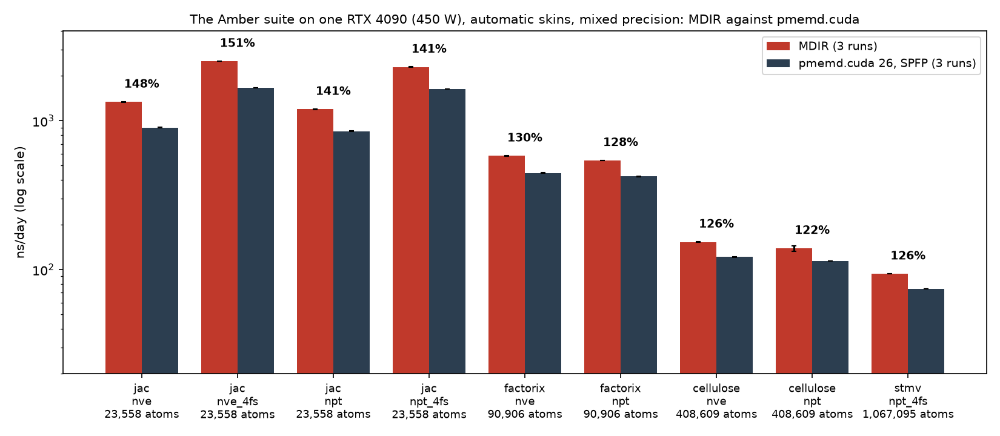

# 10. Performance

## 10.1 Conditions

*Table 10.1. What was measured, and how.*

| Item | MDIR | pmemd.cuda |
|---|---|---|
| Program | `mdir` at D285 (`main` e9c06572), built with LLVM and MLIR 23.1.2, kernels loaded as cubins (D214) | pmemd.cuda of Amber 26, SPFP [[LeGrand2013]](references.md#legrand2013), built with CUDA 13 for the RTX 4090 |
| Device | One NVIDIA RTX 4090 (450 W, driver 595.45.04) of one compute node (ada-003), on 2026-10-18, in one job of the cluster's scheduler that held the device alone (`gpu-run --idle`); other jobs ran on the node's other GPUs | The same |
| Inputs | The systems of the Amber 24 GPU benchmark suite (PME), the topologies and restart files of the suite as they are (`prmtop`, `inpcrd`; two topologies are in the format before Amber 7, D133), with the settings of `scripts/benchmarks/amber/bench.py` | The inputs of the suite as they are (`mdin.GPU`, `prmtop`, `inpcrd`) |
| Model | Cutoff 8 Å; PME with the $\beta$ of pmemd, $\mathrm{erfc}(\beta r_c)/r_c = 10^{-6}$ at constant energy and $10^{-5}$ at constant pressure (0.39467 and 0.34864 Å⁻¹), the grids of pmemd.cuda (64³; 144 × 84 × 80; 256 × 128 × 128; 224 × 224 × 240), order 4, and Amber's influence function (D134); SHAKE on the bonds of hydrogen and rigid water; the correction for the dispersion | The same, by the inputs |
| Couplings (NPT) | Stochastic velocity rescaling [[Bussi2007]](references.md#bussi2007) and stochastic cell rescaling [[Bernetti2020]](references.md#bernetti2020), every 25 steps, $\tau_T$ = 1 ps, $\tau_P$ = 2 ps | Berendsen's thermostat [[Berendsen1984]](references.md#berendsen1984), $\tau$ = 10 ps; Monte Carlo barostat every 100 steps |
| Neighbors | Neither `neighbor_structure` nor the reaches given: groups of 16 (Section 4.4) with a dual list (Section 4.5), as `AUTO` takes them from 23,000 particles (D261), and the reaches that a search of the run chose and cached for each system (`"AUTO"`, D281; Table 10.2) | Its own: a skin of 2 Å |
| Precision | Mixed (Table 7.1), `fast_math` | SPFP |
| Steps | JAC 10,000; FactorIX 4000; Cellulose 1000; STMV 500 | Those of `mdin.GPU`: JAC NVE 100,000, FactorIX NVE 20,000, Cellulose NVE 30,000, STMV 2000, … |
| Rate | Over the second half of the run, past the compilation, the set-up, and the first build | Over all steps, as pmemd.cuda reports it; its rate over the steps after the first report differs by at most 0.5% |
| Output | Energies twice; no trajectory | Energies and trajectory every 1000 or 2500 steps, as the inputs ask |

The two programs ran one after the other on the same device, MDIR over
the whole suite and then pmemd.cuda, three times, in one job
(`scripts/paper/run-suite-repeats.sh`), from a frozen copy of the
program. The benchmark script watches the device every two seconds
during each run and marks the rate as no measurement if another process
used it; no run of the repeats was marked. The ratio of a system is
taken within each repeat and then averaged; ratios from different nodes
of the cluster are not mixed, since the same program's rate differs
between them by up to 6% (pmemd.cuda on Cellulose, 117.3 and 124.5 ns/day
on two nodes, #405). The table is made by
`scripts/paper/suite-table.py` and the figure by
`scripts/paper/plot-suite.py`.

**The skins.** The rates are those a user gets without setting the
reaches of the lists. A run chooses them by measuring candidates (D281,
Section 4.5) only where it is long, from $5 \times 10^{12}$ particles times
steps, about five hours on this device; a shorter run takes the choice
that an earlier run of the same key cached, else the defaults of D261
(11 Å and an inner list at 8.6 Å, 9.2 Å at 4 fs). The suite's runs are
far shorter, so before the repeats each system ran once, untimed, with
`MDIR_SKIN_SEARCH=always`, which measured up to seven candidates and cached
the choice; every timed run took its reaches from that cache, and its log
says so. A run at the threshold affords fewer candidates, those whose
compilation and steps fit within 2% of its time (three or more, else it
keeps the defaults and caches nothing), so the cached choice is that of a
run several times longer. The search took 93 to 272 s a system, and 861 s
on STMV.

## 10.2 Rates

*Table 10.2. Rates over the Amber suite, mean ± sample standard deviation
over three repeats. "Energy changed by" is the change of the total
energy (NVE) or of the conserved energy $\tilde H$ (NPT, Section 6.5)
between the first and the last row of MDIR's log, relative to its value. The counts are the mean
number of steps between builds of the outer list and between prunings of
the inner list. "Reaches" are the outer and inner reaches that the search
chose and every timed run took from the cache. The rates, the changes of
the energy, the counts, and the times of compilation are from the same
three repeats, at D285 on one RTX 4090, with the $\beta$, the grid, and
the influence function of pmemd.cuda (Table 10.1).*

| System | Atoms | MDIR, ns/day | pmemd.cuda, ns/day | MDIR / pmemd.cuda | Energy changed by (MDIR) | Builds, prunings: every | Compiled in | Reaches, Å |
|---|---|---|---|---|---|---|---|---|
| `jac_nve` | 23,558 | 1337.6 ± 5.7 | 902.0 ± 1.2 | 148.3 ± 0.8% | 1.0e-04 to 1.1e-04 | 69.1, 4.3 | 6 s | 14 / 9 |
| `jac_nve_4fs` | 23,558 | 2511.2 ± 5.1 | 1663.3 ± 2.7 | 151.0 ± 0.2% | 3.4e-03 to 3.5e-03 | 31.0, 2.8 | 6 s | 14 / 8.8 |
| `jac_npt` | 23,558 | 1182.3 ± 3.0 | 850.0 ± 2.6 | 139.1 ± 0.3% | 4.0e-04 to 4.5e-04 | 36.7, 2.9 | 12 s | 12.5 / 8.65 |
| `jac_npt_4fs` | 23,558 | 2304.4 ± 4.7 | 1628.4 ± 3.4 | 141.5 ± 0.5% | 9.0e-04 to 9.5e-04 | 28.5, 2.8 | 12 s | 13 / 8.7 |
| `factorix_nve` | 90,906 | 580.5 ± 2.3 | 447.6 ± 0.8 | 129.7 ± 0.5% | 5.2e-06 to 1.8e-05 | 14.7, 2.7 | 6 s | 11 / 8.6 |
| `factorix_npt` | 90,906 | 540.4 ± 0.9 | 423.9 ± 1.8 | 127.5 ± 0.5% | 2.6e-04 to 2.9e-04 | 14.8, 2.7 | 12 s | 11 / 8.6 |
| `cellulose_nve` | 408,609 | 150.8 ± 0.3 | 121.1 ± 0.1 | 124.5 ± 0.3% | 3.9e-05 to 5.1e-05 | 13.4, 2.2 | 5–6 s | 11 / 8.6 |
| `cellulose_npt` | 408,609 | 142.5 ± 0.1 | 113.4 ± 0.1 | 125.6 ± 0.2% | 1.7e-04 to 1.9e-04 | 13.4, 2.2 | 11 s | 11 / 8.6 |
| `stmv_npt_4fs` | 1,067,095 | 93.7 ± 0.0 | 74.6 ± 0.5 | 125.5 ± 0.8% | 5.3e-05 to 8.1e-05 | 13.5, 1.9 | 12 s | 12.5 / 8.8 |

*Figure 10.1. The rates of Table 10.2 on a logarithmic scale, with the
ratio of the means above each pair.*

On this device MDIR's rate is 139% to 151% of pmemd.cuda's on JAC, 130%
and 127% on Factor IX at constant energy and pressure, 124% and 126% on
Cellulose, and 126% on STMV. The three repeats of each system agree
within 1%: over the second half of the runs, the time of a step of a
system differs between repeats by at most 2 µs (Cellulose NVE 1.144 to
1.148 ms). The ratio falls with the size of the system:

- **JAC** (23,558 atoms; a step of about 129 µs at 2 fs). A step of this
  size has few warps of work per kernel and many kernels, so what the
  host and the launches cost matters as much as the arithmetic. The
  integration kernel (Section 8.2) does in one launch what took three,
  the flags of the tests reach the host without waiting for the stream
  (Section 8.3), and the dual list keeps an inner list of reach 9 Å,
  pruned every 4.3 steps, under an outer list of 14 Å built every 69, so
  the loop over pairs reads the pairs within 9 Å and the builds, which
  cost a fixed time of launches each, are rare (Section 4.5). The search
  chose a long outer skin on all four JAC inputs, 1.9% to 4.0% faster
  than the defaults in its own measurement.
- **Factor IX** (90,906 atoms). No candidate gained beyond the noise of
  the search, and both runs kept the defaults, 11 / 8.6 Å.
- **Cellulose** (408,609 atoms) and **STMV** at 4 fs (1,067,095 atoms).
  The device is busy nearly the whole step (Table 8.2, measured on an
  RTX 3090), and the loop over pairs and PME take most of it. The rate
  rests on the arithmetic and the memory traffic of those kernels: each
  pair once, tables of the radial functions (Section 7.2), the tiles of
  the spreading (Section 5.3), and, from 4096 groups, the pruning inside
  the loop over pairs (D284, Section 4.5). The search chose 12.5 / 8.8 Å
  for STMV, 5.6% faster than the defaults. On Cellulose it kept the
  defaults: the fastest candidate, 11.5 / 8.45 Å at constant energy and
  11.5 / 8.65 Å at constant pressure, gained 2.0% and 0.9%, within the
  noise of 2.3% and 0.9%.

**The choice near the noise.** Where a candidate's gain is close to the
noise of the search, the choice can differ from one search to the next.
An earlier job of the same protocol, on the same node at D284, chose
11.5 / 8.45 Å for Cellulose at constant energy (1.7% faster than the
defaults, beyond a noise of 0.8%) and 13.5 / 9 Å for JAC at constant
pressure, and MDIR ran Cellulose NVE at 153.4 ns/day against 150.8 here.

**With the skins of a grid.** On D284, on another RTX 4090 node, the skins
of each system taken from the grid of #406 gave the rates of Table 10.3
(#405). With the automatic skins MDIR's rate is 0.7% to 2.3% higher on
the seven systems of JAC, Factor IX, and STMV, and 1.2% and 1.5% lower on
Cellulose at constant energy and pressure, where the search kept the
defaults; MDIR's own rate differs between RTX 4090 nodes by about 1%
(#405), so these differences are of the order of the node. The ratios
differ by up to 3 points on the seven, and by 6 on Cellulose: pmemd.cuda's
rate differs between the two nodes (Cellulose NVE 117.3 there against
121.1 ns/day here), which is why the ratios of Table 10.2 come from one
job on one node.

*Table 10.3. MDIR with the skins of the grid of #406 (another RTX 4090
node, ada-002, at D284, three repeats, #405) against the automatic skins
of Table 10.2; ns/day, and the ratio to pmemd.cuda in the same job.*

| System | Grid's skins, Å | MDIR, grid | MDIR, automatic | / pmemd.cuda, grid | / pmemd.cuda, automatic |
|---|---|---|---|---|---|
| `jac_nve` | 14 / 8.8 | 1312.8 | 1337.6 | 147.5% | 148.3% |
| `jac_nve_4fs` | 14 / 9.2 | 2455.1 | 2511.2 | 149.4% | 151.0% |
| `jac_npt` | 14 / 8.8 | 1173.7 | 1182.3 | 139.5% | 139.1% |
| `jac_npt_4fs` | 14 / 9.2 | 2277.7 | 2304.4 | 140.7% | 141.5% |
| `factorix_nve` | 12.5 / 8.6 | 574.5 | 580.5 | 126.8% | 129.7% |
| `factorix_npt` | 12.5 / 8.6 | 535.4 | 540.4 | 126.0% | 127.5% |
| `cellulose_nve` | 11.5 / 8.45 | 152.6 | 150.8 | 130.1% | 124.5% |
| `cellulose_npt` | 11.5 / 8.45 | 144.7 | 142.5 | 131.4% | 125.6% |
| `stmv_npt_4fs` | 12.5 / 8.9 | 92.4 | 93.7 | 124.2% | 125.5% |

**Earlier measurements.** At D280, on an RTX 4090 with the skins fixed at
3 Å and 0.6 Å at 2 fs for every system, the ratios were 136% to 143% on
JAC, 114% on Factor IX, 99% and 102% on Cellulose, and 98% on STMV; the
tiles of the spreading (D282), the sums of the tuple kernel by blocks
(D283), the pruning in the loop over pairs (D284), and the skins chosen
for each system (D281) are between that measurement and this one. At
D134 on an RTX 3090 capped at 300 W, with the same inputs and the fixed
skins, the ratios were 131.5% on JAC at constant
energy, 110.0% on Factor IX, 104.4% and 105.3% on Cellulose, and 111.0% on
STMV, which completed the first milestone's target of at least
pmemd.cuda's rate on every system of the suite (D114).

## 10.3 Energy in the measured runs

A rate is reported with the conservation of the run that measured it
(Section 12). The changes in Table 10.2 are over runs of 2 to 40 ps and
include the transient of the start of each restart file (Section 13);
they are not drifts. Over 2 ns, the rate of drift of JAC is 1.5
kcal/mol/ns against 5.9 for pmemd.cuda (Section 9.4).

## 10.4 Compilation

Each run compiles its program first (Section 3.6). The time is that of
the column "Compiled in" of Table 10.2: about 6 s for a system at
constant energy and about 12 s at constant pressure, whose module has
the programs of the barostat in addition, independent of the size of the
system. It is spent once per run: 4% of a run of 2 ns of JAC, which
takes 2.3 minutes, and 0.1% of a run of 100 ns.

A Python simulation can take its host object from the compile cache
(Section 3.6). For the stages of the ala3 example on a GPU in mixed
precision it removes 1 to 6 s of host code generation per stage, of 12 to
54 s of compilation, most of which is then the MLIR pipeline; the whole
example at a hundredth of its steps, in the deterministic mode, took 137 s
with a warm cache against 155 s with a cold one
([compile-cache.md](../compile-cache.md)). Within a process a `Program`
keeps the LLVM module and the host object of its first simulation, and
its later simulations link them without the pipeline (D236):
for the dipeptide in water, 0.07 s on the CPU and 0.13 s on a GPU for
each simulation after the first, instead of 5.4 s and 9.4 s.

The GPU modules of a program, 400 for the production stage of the ala3
example under `mdir run`, are serialized in parallel and loaded as
cubins (D214). The serialization was 62% of the MLIR
pipeline on a GPU, and the driver compiled every PTX serially at load.
The same example, also deterministic at a hundredth of its steps, took
147 s on main with the driver's cache of compiled PTX warm, and 189 s with
it disabled. It took 82 s once the modules were serialized in parallel,
about the same with cubins and the compile cache off, and 60 s with the
compile cache warm, even with the driver's cache disabled. The JIT part of
a stage then falls to 0.3 to 0.5 s; the MLIR passes before the
serialization are most of what remains.

A Python simulation runs its parts in one activation of its entry
(Section 3.6, D215), so a part costs its steps and a
boundary: on JAC in mixed precision a part of 10 steps takes 2.75 ms, its
steps 2.73 ms, where it took 10.3 ms when every part copied its buffers to
the device and built its structures anew; a part of one step takes 0.309
ms instead of 8.77 (`docs/python-segments.md`).

What remains outside the parts is the start of an activation, which every
update of the parameters in a fit pays. It renumbered the tuples of the
topology and built their incidence structures on the host, 1.7 to 1.8 kB
an atom, and its cost for each atom grew with the system: 0.09 µs on JAC,
0.15 µs on Factor IX, and 0.77 µs on Cellulose for the host's part. The
algorithm is linear; the memory was not free. The C library recycles
freed blocks up to 32 MiB, and a larger structure was mapped from the
system, faulted in page by page, and unmapped at every start: none of the
five structures of JAC, one of Factor IX, four of Cellulose. A simulation
now keeps the structures across its activations (Section 3.6,
D253): a start at which the particles have
not moved compares the order and the members with the kept copies (0.08,
0.24, and 1.7 ms on the three systems) and builds nothing, and a start in
a new order builds in the kept memory (2.4, 7.5, and 71 ms on the host,
where it took 2, 14, and 315 ms). On one RTX PRO 6000 Blackwell in mixed
precision, where the upload goes with the build, a start with its
evaluation at which the particles have not moved takes 2.0, 6.1, and 30
ms on the three systems where it took 5.0, 61, and 413 ms, and one in a
new order 5.1, 17, and 98 ms where it took 5.0, 58, and 387 ms. An update
of the parameters with its evaluation took 8.3, 30, and 203 ms where it
took 15, 135, and 867 ms, its two starts the smaller part of it: the rest
was a sort of the members of every tuple set, copies of the model, and
quadratures of the tails repeated for every pair of classes of particles.
Since D254 the simulation writes the values into a model that it
keeps, the sort is one pass, and a build computes each quadrature once; on
one RTX 4090 an update with its evaluation takes 5.4, 16, and 87 ms where
it took 8.4, 31, and 204 ms, and 8.1, 22, and 112 ms where it took 121,
189, and 259 ms with the tail of a pair term in the correction. The
arrays of the program that no value of a tunable enters, which a build
from the model with every tunable site set to not-a-number makes the same
to the bit, are kept since D256: an update with its
evaluation then takes 4.6, 13, and 65 ms, about its two starts. Each start
copied the state and the whole model into new memory for the arguments of
the entry, one number at a time: 0.44, 1.76, and 11.5 ms of a start of
2.0, 6.0, and 30 ms. Since D258 the compile
proves that the entry writes no buffer of the model (Section 3.6), a start
hands it the arrays of the program as they are, and the buffers of the
state are kept and written anew: the arguments take 0.06, 0.18, and 1.9
ms, a start at which the particles have not moved 1.63, 4.25, and 20.8 ms,
and an update with its evaluation 3.62, 8.92, and 42.8 ms on one RTX 4090,
with the steps unchanged.

The segments of `mdir run` begin in a new order each (Section 3.6), so
they cannot take what is kept, but they build in the kept memory
(D255). On one RTX 4090 in mixed precision, with the
settings of the Amber suite and a checkpoint every $n$ steps, the
structures cost a segment 4.6 ms on JAC, 27 ms on Factor IX, 152 ms on
Cellulose, and 465 ms on STMV, of which the build on the host in new
memory was 55% to 67% on the three larger systems and the allocation and
upload most of the rest: 3% to 8% of a segment at $n = 1000$ and 0.3% to
1% at $n = 10{,}000$. Written in the kept memory and uploaded 16 MiB at a
time they cost 4.5, 15, 78, and 238 ms; at $n = 10{,}000$ a run is 0.45%,
0.88%, and 0.81% faster on Factor IX, Cellulose, and STMV, and at
$n = 1000$ 3.5%, 5.0%, and 5.5%. The CPU target gains nothing that a run
can see, since a step there costs 40 to 720 ms on these systems; what
remained on a GPU was the build on the host and the upload.

On a device that build is now three kernels, a scatter and two gathers
from the structure in the order of the files (Section 3.6,
D257), and the order is compared there, so that a start in a
new order copies 4 bytes between the host and the device. On the same
device a start in a new order of a Python simulation with its evaluation
takes 1.98 ms on JAC, 5.67 ms on Factor IX, and 26.2 ms on Cellulose
where it took 5.29, 18.1, and 96.9 ms, and the functions of the store,
the comparison and the launches included, 0.07, 0.17, and 1.8 ms of it;
`mdir run` with a checkpoint every 1,000 steps is 2.3% to 4.5% faster on
the four systems, and a run of the suite as it is, one segment, keeps its
rate. The device held the members and an index of each tuple set
besides, 6% to 10% of the incidence structures. Since the structures are
ragged rows built from the members on the device (D314),
the index is gone and the structures are 9 times smaller on STMV; a
start in a new order takes 0.1 ms more on JAC, for the launches of the
build, and the same on Factor IX and Cellulose.

## 10.5 Over long runs

Over 2 ns of JAC at constant energy before the dual list (D112), the rate
fell from 726 to 722 ns/day, most of it in the first 0.5 ns, and then
stayed flat; an earlier build fell by 1.8% in the same way. The loops over
pairs read the particles in the order of the last build (D86) and do not
slow; what slows is the loops that read the state in its own order, which
is sorted only where a run begins (Section 4.2).

## 10.6 Against GROMACS on a protein in OPC

The target of the milestone was the rate of pmemd.cuda; GROMACS 2026.3
[[Pall2020]](references.md#pall2020), built with CUDA and run on the same
device, is the stronger reference on a small system. The system is
ubiquitin (1UBQ) in 5700 OPC waters with amber19sb.ff, 24,031 particles
in a triclinic cell, prepared and equilibrated by GROMACS
(`scripts/validation/protein/run.py`); its energy terms agree with
GROMACS's (Section 9.1). Both run 60,000 steps of 2 fs from the
equilibrated state in mixed precision, timed over the second half, with a
cutoff of 9 Å, PME with $\mathrm{erfc}(\beta r_c) = 10^{-5}$, SHAKE
on the bonds of hydrogen and rigid water, and at constant pressure the
same couplings every 25 steps. MDIR uses groups and the dual list with
reaches of 12 and 9.6 Å, within 0.4% of the best of 11 to 12 Å and 9.4 to
9.8 Å; GROMACS its own list, its nonbonded terms and PME on the GPU, and
its update on the CPU, which virtual sites need.

*Table 10.3. Ubiquitin in OPC, RTX 3090 at 300 W, at D118, mean ± sample
standard deviation over three repeats, each program after the other on
the device, with nothing else on the host. GROMACS at constant energy over
two of them: the third gave 789.6 ns/day, having spent 0.45 s writing its
output against 0.04 s in the other two ("Write traj." of its accounting of
cycles, a stall of the shared file system). "Energy changed by" as in
Table 10.2, over 120 ps, the range of the three. At constant pressure MDIR
counts the work of the barostat from the virial of the groups (D116); with
the count before it, $-228$ kcal/mol/ns (Section 13). The other settings
of GROMACS are from one run each, before D118.*

| Ensemble | MDIR, ns/day | GROMACS, ns/day | MDIR / GROMACS | Energy changed by: MDIR | GROMACS |
|---|---|---|---|---|---|
| NVE | 605.2 ± 0.4 | 842.9 ± 2.9 (nstlist 80; 689.7 with the nstlist of 10 that it keeps at constant energy) | 71.8 ± 0.2% | $2.4\times10^{-5}$ to $4.4\times10^{-5}$ | $1.7\times10^{-4}$ to $2.0\times10^{-4}$ |
| NPT | 571.5 ± 0.7 | 865.5 ± 4.4 (771.8 with `verlet-buffer-tolerance` $5\times10^{-5}$) | 66.0 ± 0.4% | $1.6\times10^{-6}$ to $1.2\times10^{-4}$ | $6.7\times10^{-3}$ to $7.1\times10^{-3}$ |

*Table 10.4. The device time of a step, NVE, from nsys: MDIR over 20,000
steps before D118, GROMACS over the 3528 steps that the profile captured.
MDIR's kernels are sorted by their kind. D118 changed none of them; it
took the time the device stood idle in a step from 49 to 29 µs.*

| Part | MDIR, µs | GROMACS, µs |
|---|---|---|
| Loops over pairs | 91.6 (the inner list of 9.6 Å) | 87.7 (one kernel; a list of 10.7 Å built every 80 steps) |
| PME | 47.3 | 76.7, on a second stream beside the nonbonded kernel |
| Loops over particles: the drift, the kicks, and the other loops over particles | 48.9 | The update on the host |
| Loops over tuples: bonded terms and excluded pairs 22.5, SETTLE 11.8, placement of the sites 4.9 | 39.3 | Bonded terms, SETTLE, and sites on the host; excluded pairs in the nonbonded kernel |
| Builds and prunings of the lists | 34.6 | In the nonbonded kernel, every 80 steps |
| Layout and reductions | | 18.3 |
| On the device | 261.8, one stream | 182.8, two streams |
| Wall time of a step | 310 | 214 |

The loop over pairs costs the same in both programs, and MDIR's PME is
faster. GROMACS runs beside that loop what MDIR runs after it: PME on a
second stream of the device, and the bonded terms, the update, and the
constraints on the 64 threads of the host. MDIR runs every part on one
stream; its loops over particles and over tuples and its builds and
prunings take 123 µs of the device in a step, and the host's time between
its launches 48 µs of the 310. Its own second stream for the reciprocal
sum (D81, D87), tried on this system, gives 597 ns/day against 609
without (D118). On JAC, with three sites per water and a cutoff of 8 Å, the same
structure is 25% faster than pmemd.cuda (Table 10.2); on this system its
rate is 66% to 72% of GROMACS's, and the measurements place the
difference outside the loop over pairs. Most of it is the policy of the
lists rather than the kernels, as the matched comparison below shows. GROMACS's conserved energy at
constant pressure changed by $5\times10^{-3}$ to $7\times10^{-3}$ at every
tolerance of its buffer that was tried ($5\times10^{-3}$, $5\times10^{-4}$,
and $5\times10^{-5}$ kJ/mol/ps per atom). Its thermostat alone, without
the barostat, moves it by $+370$ to $+610$ kcal/mol/ns (`nsttcouple` 1 or
25, $\tau_T$ 1 or 10 ps, `nstcalcenergy` 1 or 100), against $-70$ for its
total energy at constant energy; that was not investigated further.

**The policy of the lists, matched.** GROMACS's rate in Table 10.3 is that
of its default policy. Its buffer is set from a tolerance on the energy
error of missed pairs (`verlet-buffer-tolerance`). With a thermostat and
the update on the device, GROMACS also searches every 50 steps instead of
10 and prunes a rolling inner list every 4 steps. MDIR's default misses
no pair: its lists are rebuilt when a displacement could bring a pair
within reach (Section 4). Table 10.5 compares the two programs on JAC with
the ensemble and the policy matched. RTX 3090 at 300 W (GPU 0), 50,000
steps of 2 fs, cutoff 8 Å, PME on a grid of $64^3$, the bonds of hydrogen
constrained, mixed precision, MDIR at 264b6d7 with groups and the dual
list (11 and 8.6 Å), GROMACS 2026.3 with its nonbonded terms, PME, bonded
terms, and update on the device.

*Table 10.5. JAC, ms per step (one or two runs each; the second, where
there is one, agreed within 0.001), and the drift of the conserved energy
in kJ/mol/ps per atom (MDIR: end minus start over 100 ps; GROMACS: its
"Conserved energy drift").*

| Ensemble and list policy | MDIR | GROMACS | MDIR / GROMACS, time | Drift: MDIR | GROMACS |
|---|---|---|---|---|---|
| NVE (GROMACS keeps a search every 10 steps) | 0.213 | 0.216 | 0.99 | $-1.0\times10^{-5}$ | $-1.7\times10^{-4}$ |
| NVE, GROMACS with an exact buffer (rlist 1.1 nm) | 0.213 | 0.261 | 0.82 | $-1.0\times10^{-5}$ | $-7.8\times10^{-5}$ |
| V-rescale, GROMACS searching every 10 steps | 0.215 | 0.225 | 0.96 | $-8.9\times10^{-6}$ | $-1.2\times10^{-4}$ |
| V-rescale, GROMACS default (search every 50, rolling prune every 4) | 0.215 | 0.147 | 1.46 | $-8.9\times10^{-6}$ | $-1.6\times10^{-4}$ |

With the same ensemble and the same list policy, the two programs run at
the same rate. MDIR's conserved energy drifts 15 to 40 times less than
GROMACS's at its default tolerance. GROMACS's 0.147 ms is its search every
50 steps: its accounting of cycles shows 801 searches instead of 4001
over the run, 67 µs a step, which is the whole difference. It allows that
search only with a thermostat and the update on the device. MDIR rebuilds
its lists every 16.4 steps on average and prunes every 2.8. A smaller
skin makes it slower (pairlist 10 Å: 0.220 ms; 9.5 Å: 0.226 ms), so the
3 Å skin of D114 stays. MDIR's rate below 0.21 ms on this system would
need a list that lives longer, through a buffer set from a tolerance as
GROMACS's is. That is not the default, since a missed pair is not allowed
by default, and it would be an option.

