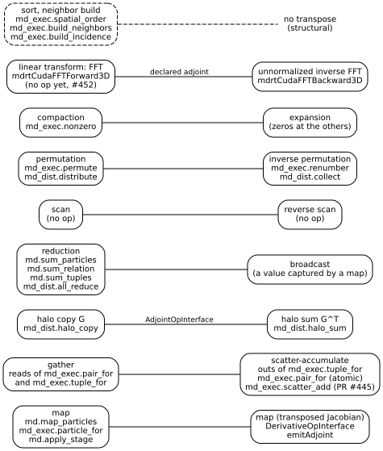

# MDIR in primitives: the set, its transposes, and the map of the parts

This document writes every part of MDIR as a composition of a small set of
data-parallel primitives, and states for each part which primitives it
uses, which properties of them it relies on, how it is lowered today, and
whether that code is shared, hand-written, or missing (issue #450). It
describes the current state by topic (#390); the history is in
[decisions.md](decisions.md) and the [CHANGELOG](../CHANGELOG.md).

The aim is a set that is **closed under transposition**: the adjoint of
each primitive is again a primitive of the set, so that the derivative of
any composition is a composition of the same primitives
([principles.md](principles.md), Section 9). The strategies by which a
device implements a primitive (privatization, tiles, tables, warp forms)
are in [device-primitives.md](device-primitives.md); this document says
where each primitive occurs.

The [execution contract](execution-contracts.md) (#574) checks whether a
composition may run or be transformed for its stated sets, effects, state,
and numerical order. It is shared by the primitive sites in this map and
does not add a mathematical primitive.

## 1. The primitive set

Here $x$ is a field of $n$ elements, $\mathrm{idx}$ an array of indices,
and $\oplus$ a combiner. A transpose is taken with the plain inner product
of the fields (of the owned rows, for the transfers of domains).

| Primitive | What it computes | Transpose | Forms in the IR and the lowerings today |
|---|---|---|---|
| **map** | $y_i = f(x_i, c)$, an element at a time, with captured values $c$ | map: $\bar x_i = J_f(x_i)^\mathsf T\,\bar y_i$ | `md.map_particles`, `md_exec.particle_for`, the kernels of every loop, `md.apply_stage` in a map (D288) |
| **gather** | $y_k = x_{\mathrm{idx}(k)}$ | scatter-accumulate: $\bar x_i \mathrel{+}= \sum_{k : \mathrm{idx}(k) = i} \bar y_k$ | the reads of the members of a tuple and of the neighbor of a pair in every loop; the reads of the grid in PME's gathering |
| **scatter-accumulate** | $a_i \mathrel{+}= \sum_{k : \mathrm{idx}(k) = i} v_k$ | gather | the `outs` of `md_exec.tuple_for` and of `md_exec.pair_for` with the conflict `atomic`; the spreading of PME; `md_dist.halo_sum`; `md_exec.scatter_add` (D291, PR #445) |
| **halo copy** $G$ | $(G a)_g = a_{s(g)}$ (plus a whole period of the cell for positions: affine) | halo sum $G^\mathsf T$: $a_s \mathrel{+}= \sum_{g : s(g) = s} b_g$ | `md_dist.halo_copy`, `md_dist.halo_sum`, declared adjoints (D275, D276; `lib/Dialect/MD/Transforms/Adjoints.cpp`) |
| **reduction** | $s = \bigoplus_i x_i$ | broadcast (for $\oplus = +$): $\bar x_i = \bar s$ | `md.sum_particles`, `md.sum_relation`, `md.sum_tuples`; the `reduce` of the `md_exec` loops; `md_dist.all_reduce`; maxima and flags |
| **broadcast** | $y_i = s$ | reduction | no op: a number that a map captures (`scaleField` in `Differentiate.cpp`; the factors of thermostats and barostats); the transpose of `md_dist.all_reduce` gives each domain's partial the cotangent once (`AllReduceAdjoint`) |
| **scan** | $y_i = \sum_{k < i} x_k$ (exclusive) | reverse scan: $\bar x_k = \sum_{i > k} \bar y_i$ | no op; the shared emitters of warp, block, and device scans (`CompactionEmitter.h`, D296), including the single-pass device strategy (D321) available for the groups' counting sorts through an opt-in compiler pass option; the matrix and `lowerNonzero` retain their specialized scans |
| **permutation** | $y_k = x_{\pi(k)}$ | inverse permutation | `md_exec.permute`; the members relabeled by `md_exec.renumber`; the host writing a frame by the numbers of the particles; `md_dist.distribute` and `md_dist.collect`, declared transposes of each other |
| **compaction** | the elements with $p(i)$, packed: $y_{r(i)} = x_i$ | expansion: $\bar x_i = \bar y_{r(i)}$ where $p(i)$, else 0 | `md_exec.nonzero` (D262); the pruning, the active units, and the builds, through the shared warp compaction (`CompactionEmitter.h`, D296) |
| **linear transform** (the FFT first) | $\hat x = F x$, the unnormalized discrete Fourier transform | the unnormalized inverse transform under the Hermitian-weighted real inner product of the half-complex values | `md.linear_transform` carries pure grid and half-spectrum values with a declared transpose (D319); `md_exec.linear_transform` has explicit buffers and the same adjoint and pairing declarations (D306). D[fft-value-buffer] (#526) bridges the two forms. cuFFT (`mdrtCudaFFTForward3D`, `runtime/mdrt_cuda.c`) and pocketfft (`runtime/mdrt_fft.c`) remain the execution strategies; the reciprocal composition is #452 |
| **sort, neighbor build** | a permutation, or a relation, from the positions | none: structural, piecewise constant, not differentiated | `md_exec.spatial_order`, `md_exec.build_neighbors`, `refresh_neighbors`, `build_incidence`, `build_edges`, `build_triplets`; `md_dist.partition`, `md_dist.halo` |

Two members are special cases kept apart. A halo copy is a gather whose
indices cross domains, and a halo sum a scatter-accumulate that does; they
stay separate because their transport is another (a call of the
transport's ABI, `runtime/mdrt_dist.c`), not a loop. A permutation is a
gather whose transpose is again a gather (by $\pi^{-1}$), with no
accumulation. The linear transform is a member because a sum over all
pairs of the periodic system, PME's reciprocal sum, is spread, transform,
map, inverse transform, gather (Section 3.3), and with the transform's
adjoint declared, that chain is closed: read backward, it is its own
transpose in the charges, since the spreading and the gathering are
transposes and the influence function is a real diagonal map.

### 1.1 Properties

Each primitive states the properties that its lowerings may rely on. They
decide whether an order may change (privatization, atomics, a tree), what
the deterministic mode (D84) accepts, and whether a sum can be split over
domains (#422, D285).

| Property | Meaning here |
|---|---|
| Associative, commutative | Of the combiner $\oplus$: the terms may be grouped and ordered otherwise. Real addition is; floating-point addition is not associative, so reordering changes the rounding |
| Exact | The result is the same to the bit in any order: no combining (data movement), integers and fixed point (D70), maximum, minimum, and logical or |
| Stable | Equal keys keep their order (sorts, compaction, partition) |
| Ordered | The lowering fixes the order of the combination, independent of the threads: the block trees of D150 (the order depends on the count alone), the fixed chunks of D171 on the CPU, the order of the domains in `md_dist` |

| Primitive | Associative, commutative | Exact | Stable | Ordered | Where the properties are relied on |
|---|---|---|---|---|---|
| map | — | yes (no combining) | — | — | Every lowering: any element to any thread |
| gather | — | yes | — | — | Any order of the reads |
| scatter-accumulate | yes ($+$) | integers and fixed point only | — | only in the pull form (Section 1.2) or a fixed-order runtime | `checkReorder` (`include/mdir/Dialect/MDExec/Scatter.h`): floating-point values are privatized only where the stated algebra is `any_order` (D285, D301); atomics in floating point are refused where it is `fixed_order` (`lowerGroupPairFor`, `lowerPairFor` in `MDExecToGPU.cpp`) |
| halo copy $G$ | — | yes | — | — | — |
| halo sum $G^\mathsf T$ | yes | no (f64) | — | yes: domains, then rows (`_mlir_ciface_mdrtDistHaloSum`) | Results to the bit for a given grid (D275) |
| reduction | yes for $+$, max, or | max, min, or, integers | — | yes, in both modes: block trees (`emitReductions`, D150), fixed chunks (D171), the domains in order (`lowerAllReduce`) | The energies, the virial, and the tests of validity are the same to the bit for a given count of particles |
| broadcast | — | yes | — | — | — |
| scan | yes | integers: yes | — | — | Offsets of counting sorts, slots, lists |
| permutation | — | yes | — | — | The state put in order (D44, D86) |
| compaction | — | yes | when stated: `md_exec.nonzero` (ascending), the pruning (the outer list's order) | — | The inner list in the outer list's order, so that the loop over pairs is deterministic (#432, site 1) |
| linear transform | — (no combiner: a fixed linear map) | no (f32, f64); the same bits for any number of threads on the host (D271) | — | yes: a library's fixed algorithm for a given size | The reciprocal sum's results to the bit for a given grid on the host (D271) |
| sort | — | yes | the order by cell and number (D44) | — | A run continued from a checkpoint is exact (D44) |

The algebra of every sum is stated in the IR (D301, #422
step 1; [device-primitives.md](device-primitives.md), Section 5):
`md_exec.algebra` gives each value that an op reduces a licence on its
order of evaluation, `any_order_exact`, `any_order`, or `fixed_order`
(the deterministic mode, met by a fixed order or by fixed point). The
chooser of strategies and the lowerings read it where they read the mode
before, and refuse a sum that states none; `--md-exec-check-algebra`
refuses one anywhere. `#md_exec.scatter` states a strategy, which the
algebra must allow. The other properties (stable, the exactness of a
gather or a map) stay in the code of each site and in the documents.

### 1.2 Gather over a relation, scatter over a relation: pull and push

MDIR's `md` dialect names its ops by the field they produce, not by the
primitive: `md.gather_relation` and `md.gather_tuples` give a field of the
particles, each particle the sum of a kernel over the pairs or the tuples
it belongs to. In the primitives, that is a gather of the inputs at the
ends of each pair, a map (the kernel), and a scatter-accumulate of the
values to their particle. The same sum has two forms:

- **Pull:** each particle reduces its own row of the relation (a segmented
  reduction). No two threads write one element, so no atomics, and the
  order is that of the row: exact up to the order of the row, ordered.
- **Push:** each pair or tuple adds to its particles (a scatter-accumulate),
  with atomics or a privatized copy.

The transpose of a gather at the far end $k$ of each pair is a
scatter-accumulate to $k$. Over a relation $R$, a scatter-accumulate in
pull form is a gather over the transposed relation $R^\mathsf T$. The
relations of pairs that MDIR differentiates are symmetric: the directed
expansion $D$ of an unordered relation has $D^\mathsf T = D$. So the
transpose of a gather over $D$ is again a gather over $D$, which is what
`md-differentiate` emits: the force of a pair sum is an
`md.gather_relation` with the contract `antisymmetric` (`buildForces` in
`lib/Dialect/MD/Transforms/Differentiate.cpp`; paper, Section 3.3), and
the adjoint of a field gathered over a relation is a gather that
evaluates the kernel from both ends of each pair (`emitGatherTerm`; for a
neural stage, `getStageTerms`, D288). The exchange contract is what
licenses the push form in the lowering: a loop over groups evaluates each
pair once and adds $\pm$ its value at both ends (D89), and D290's
`(directed, atomic)` adds the value at the center and $\sigma$ times it at
the neighbor. A kernel without a proven contract has the pull form only;
a kernel that yields both ends' values (#391) would give every kernel the
push form.

For tuples the relation is not symmetric: the transpose of the gather of
the members is a scatter to the members. The default lowering pushes (each
tuple once, with atomics or a table, D84, D283); the deterministic mode
and the CPU pull, through the incidence structure, the inverse of the
member relation (`launchRows` with `emitTupleKernel` in `MDExecToGPU.cpp`;
`lowerTupleFor` in `MDExecToLoops.cpp`).

### 1.3 What the derivative uses, and how it is declared

`md-differentiate` (D182, D183) takes the transposes from the ops,
through `AdjointOpInterface`
(`include/mdir/Dialect/MD/Transforms/AdjointInterface.td`, models in
`lib/Dialect/MD/Transforms/Adjoints.cpp`; D276, D295), in two
forms:

- **The transpose of an op linear in some operands**, the op that is its
  transpose: the transfers of `md_dist`, $G \leftrightarrow G^\mathsf T$,
  `distribute` $\leftrightarrow$ `collect`, and `all_reduce` to a
  broadcast (D276); `md_exec.scatter_add` in its destination, the
  identity. Its transpose in the values, a gather by the indices, is
  refused until `md_exec` has that op.
- **The transpose of the structure of an op with a kernel.** A sum or
  gather over a relation or tuples, or a sum or map over particles, is a
  gather, a map (the kernel), and a reduction, linear except in the
  kernel. The op declares the op of the transpose of its structure: of a
  sum over pairs, a gather over the same relation (Section 1.2); of a
  gather over pairs, a gather over it that evaluates the kernel from both
  ends of each pair; of a sum over tuples, a gather over the tuples to
  their members; of a sum or a map over particles, a map. The transpose of
  the reduction to a number is a broadcast, the weight that the kernel
  captures (`getWeight`). The pass fills the kernel of the new op with the
  reverse derivative of the source kernel by the scalar rules of D183
  (`DerivativeOpInterface`), whose reverse method `emitAdjoint` the neural
  stage implements by its product (D288).

`--md-check-transposes` refuses an op of the structure of a potential
without a declared transpose, and `test/Integration/transposes.mlir` checks
the adjoint identity of each pair numerically, on one domain and on
domains (`dist-transposes.test`). The loops of `md_dist` (`sum_pairs`,
`gather_pairs`, `sum_particles`, `map_particles`) declare theirs as those
of `md` do, with the adjoint of a field read at both ends of each pair as
its owned rows and their copy to the ghosts (D297); the
premises of each form on domains (the traversal, the coverage, the
contract) stay in the pass. Without one today: `md.gather_tuples`, through
which no derivative passes. The reciprocal sum is one op to the derivative
(Section 1.4).

### 1.4 What the set does not contain

The set had no linear transform until the maintainer's ruling on #452
(2026-10-19), which adds one with a declared adjoint, the fast Fourier
transform first: the adjoint of the unnormalized forward transform is the
unnormalized backward transform (for the real form, with the weights of
the Hermitian symmetry). Both transform forms are now in the IR, while the
composition and differentiation through the reciprocal chain are missing:
`md.reciprocal` is one op whose forces are a result (Section 3.3), so the
derivative uses the closed form, spreading and gathering with the slopes
of the splines. D306 gives `md_exec.linear_transform` an
inspectable FFT adjoint declaration and independent lowerings;
D319 gives `md.linear_transform` a pure value form
and declared transpose. D[fft-value-buffer] (#526) connects a value to a
distinct packed execution buffer: the half-spectrum is row-major with
interleaved real and imaginary components, and backward input is copied
before an execution transform that may overwrite it. Tensor bufferization
and ownership-based deallocation run before optional device placement, so
the target boundary adds only local allocation, copies, and dependent waits.
`md-differentiate` still treats `md.reciprocal`
as one op. #452 writes the reciprocal sum as spread, FFT,
the influence map, inverse FFT, and gather. The adjoint identity holds on
the valid Hermitian half-spectrum of a real grid: its last-axis zero and,
when present, Nyquist planes have Hermitian symmetry across the other two
axes. An arbitrary packed complex buffer does not meet this contract.

Two things that MDIR computes are not primitives of the set:

- **An opaque model** (the model term of ML1, D270, D273): one call for the
  whole system, whose derivative comes from automatic differentiation
  inside the model. It is the baseline of ML4 by design (#377).
- **Run-time choices by measurement**, such as the skins of D281: they
  choose among compiled programs, and compute nothing that the step uses.

## 2. Reading the map

Each row is one part of MDIR, with five columns:

- **Primitives** used, and, where the part is differentiated, the
  transposes that the derivative uses (marked "Derivative:"). "Not
  differentiated" means that no derivative passes through the part:
  structure, dynamics, or output.
- **Properties relied on**, of Section 1.1.
- **Strategies today**, with the measurement behind each choice, including
  the strategies measured and not taken. Numbers are cited from the
  decision or the issue that measured them; none is new here.
- **State** of the code: *shared* (one function or emitter that every site
  calls), *hand-written* (the file and the function), *missing*, or *does
  not fit* (with the reason).
- **Gaps**: the issues that would change the row.

Device code is in `lib/Conversion/MDExecToGPU/MDExecToGPU.cpp` (written
`ToGPU` below), `lib/Conversion/MDExecKernels/MDExecKernels.cpp`
(`Kernels`), and the runtime templates of `lib/Runtime/Templates`, which
the scripts `scripts/generate-*-template.py` write. Host code is in
`lib/Conversion/MDExecToLoops/MDExecToLoops.cpp` (`ToLoops`) and
`runtime/`. On `main`, the shared pieces of the device lowering are
`emitReductions`, for every global sum and maximum, the set of
preconditions of the privatized scatter-accumulate (`Scatter.h`, D285),
and the emitter of its table, `BlockHashTable` in
`include/mdir/Conversion/ScatterEmitter.h` (D291), which the tuples' table
and the switchable tables of the loops over pairs call; and the emitters
of compaction, scans, and counting sorts, `CompactionEmitter.h`
(D296), which the pruning and the templates of the
builds call (the templates by name, `func.call @mdir.primitive.<name>`).
Every other primitive is written at its site.

## 3. The map

### 3.1 Neighbor structures

| Part | Primitives | Properties | Strategies today, and measurements | State | Gaps |
|---|---|---|---|---|---|
| Spatial order (D44, D86) | sort by cell, then by number (counting sort: histogram, scan, scatter); permutation of every field; members relabeled. Not differentiated | stable (the order by number within a cell, so the order does not depend on the input's) | Device: `mdrt_gpu_spatial_order` (`NeighborsMatrixGPU.mlir`); host: `@mdrt.spatial_order` (`NeighborsMatrix.mlir`). Done where a run or segment begins, and the loops then run in the order of the cells of the last build instead of reordering the state: JAC's loop over pairs went from 117 to 208 µs over 40 ps without it (D86) | shared: the chunked scan, the scatter, and the insertion sort of `mdrt_gpu_spatial_order` (`CompactionEmitter.h`, D296); hand-written: `lowerPermute` (`ToGPU`), `emitReorder` (`lib/Driver/Builder.cpp`); `md_exec.renumber` on the host (`lowerRenumber`) | #421 |
| Cells and the matrix (D85, D107, D290) | binning (counting sort), compaction of each row (a warp a row: `ballot` + `popc`), a maximum of the row lengths on overflow. Not differentiated | rows ordered; bounded width, rebuilt wider on overflow | `mdrt_gpu_matrix_sort` and `mdrt_gpu_build_neighbors_matrix` (`NeighborsMatrixGPU.mlir`); with `centers` (D290) every row searched on a device. Not on the Amber suite's path (#432, site 7) | shared: the warp compaction of the rows and the chunked scan, the scatter, and the stable rank of the binning (`CompactionEmitter.h`, called by name from the template, D296) | #420 |
| Groups and their build (D89, D106) | counting sorts by column and z-bin key and by cell (histogram with a device atomic an element, a three-kernel scan, a scatter with an atomic cursor, an insertion sort of each bin); a bitonic sort of chunks of 64 in a warp; bounding boxes (a reduction, min and max); entries by compaction (`ballot` + `popc` into a queue in block memory, an atomic a 64-entry block); excluded partners by prefix sums in a warp. Not differentiated | stable after the insertion sort; bounded capacity, rebuilt larger | `scan`, `block_scan`, `sort_bins`, `bitonic`, `lists_body`, `reduce_box` (`scripts/generate-groups-gpu-template.py`). Measured on #432: the counting sorts 11.7 µs/step on Cellulose (0.98% of the kernel time), 52.0 on STMV (1.29%); of that, the scatter and the insertion sorts 0.50% and 0.60%; the search kernel 4.5% and 6.4%, its compaction not separable | shared: the warp compaction of the entries, the warp scan of the excluded partners, the device scan (three kernels, a block scan within), the scatter, and the insertion sort (`CompactionEmitter.h`, called by name from the template, D296); hand-written: the bitonic sort, the boxes | #421, #420 |
| Dual list: pruning (D114, D268, D284) | stable compaction of the outer list into the inner one (a warp a group); the active units (compaction of the blocks with entries). Not differentiated | stable: the inner list keeps the outer list's order, so the loop is deterministic | Fused into the first loop over pairs (D284, the default): about 9 µs/step on Cellulose (0.8%); in the refresh (`MDIR_FUSED_PRUNE=off`) 6.9% of the unfused step. Active units 0.15% and 0.07% (#432, sites 1 and 2). A block scan across a group's blocks was considered and not taken (D284) | shared: the warp compaction of `emitPruneGroup` and `emitActiveUnits` (`CompactionEmitter.h`, D296) | — |
| Validity of a structure (D80, D113, D114) | map (squared displacement), reduction by maximum; a flag to the host. Not differentiated | exact (maximum) | `finishBuild` (`ToGPU`) through `emitReductions` with `isSum=false`; the flag read without waiting for later work (D113, D118) | hand-written in the lowering; the reduction shared with every global sum (`emitReductions`) | — |
| Skins (D281) | none: a choice among compiled programs by measured time | — | The defaults, a cached choice, or candidates measured on the system; kept unless within the noise of the defaults. #440: the choice is unstable near the noise | does not fit: a choice of the run, not a computation of the step | #440 |
| Pair list of a model term (`md.edges`, D277) | compaction into fixed slots a particle at a build (candidates of every image), then at each step a stable compaction within the slots (within the cutoff first) | stable within a particle's slots; bounded by the slots of the build | `lowerBuildEdges`, `emitEdgeSlots` (`ToGPU`) | hand-written in the lowering | #420, #432 |
| Triplets (D160) | from the rows of the matrix: compaction of pairs within $r_3$ into a buffer of members | the CPU loops over tuples run on it unchanged | CPU only: `lowerBuildTriplets` (`ToLoops`). A device form is PR #108 (#17), open | missing on a device | #17 |
| Incidence of tuples (D84, D103, D314) | the inverse of the member relation, as ragged rows (CSR; a counting sort by member: histogram, scan, scatter, a sort of each row); renumbered with the particles | ordered by the number of the tuple within a row, whatever order the atomics took | Built on the host and copied (`lowerBuildIncidence`); on the device for an entry that `takeOnDevice` takes (`buildOnDevice`). Ragged rows took STMV's structures from 2,096 MiB, padded to the longest row, to the size of their entries (D314) | shared: the ragged rows and their accessor (`RaggedRows.h`), built with the device scan, the scatter, and the insertion sort (`CompactionEmitter.h`, D296); the host's build hand-written (`emitBuildIncidence`, `mdrt_tuples.h`) | #420, #421 |

### 3.2 Short range

| Part | Primitives | Properties | Strategies today, and measurements | State | Gaps |
|---|---|---|---|---|---|
| Pair loop over the matrix, `(directed, owner_only)` | gather of the neighbor's data, map (the kernel), segmented reduction per row (pull); global sums by reduction. Derivative: the force of a pair sum is a gather over the same, symmetric, relation (Section 1.2) | ordered per row, no atomics; the deterministic mode's form of every loop over pairs | Lanes a row (`launchRows`), the order of the cells of the last build (D86). Measured against groups: D89 | hand-written in the lowering: `lowerPairFor` (`ToGPU`), `emitPairKernel` (`Kernels`); host `lowerPairFor` (`ToLoops`); the transpose of the pair sum declared (D295) | #419 |
| Pair loop over groups, `(unique, atomic)` (D89) | gather of the $j$ data, map, scatter-accumulate at both ends (push), licensed by the exchange contract (V8, `md-check-exchange`). Derivative: as above, lowered in push form | associative and commutative (floating-point atomics, default mode only: refused in the deterministic mode, `lowerGroupPairFor`) | Each pair once, the $i$ sums by the half-warps' shuffles and ballots (D97). The table of the privatized scatter (`pair-hash`) measured slower, 1.18 to 1.32 times the step on JAC, Factor IX, and Cellulose (#445): the $j$ values of a block name distinct particles, so no atomics merge. Kept off | hand-written in the lowering: `lowerGroupPairFor` (`ToGPU`), `emitGroupPairKernel` (`Kernels`); the table, off by default, through the shared `BlockHashTable` (`ScatterEmitter.h`, D291) | #418, #419, #391, #416 step 2, #422, #445 |
| Tuples: bonded terms, 1-4 pairs, excluded pairs of PME | gather of the members, map, scatter-accumulate to the members. Derivative: the forces of a sum over tuples are a gather over the tuples to their members (`buildForces`), the transpose of the gather of the members | default: associative and commutative; deterministic: ordered (rows); disjoint sets: exact (no conflicts) | Evaluated once with atomics (D84), or with a table in block memory from 100,000 tuples (D283, `hash`): Cellulose 0.907 and STMV 0.973 of the step on an RTX 4090, JAC 1.5% slower without the bound. The deterministic mode and the CPU pull through the incidence rows (D84). Global sums by rows, a thread a particle (D103); sums of a term over centers in the kernel of the later loop (D194) | hand-written in the lowering: `lowerTupleFor`, `launchTupleBlocks`, `lowerOnceRun` (`ToGPU`); preconditions shared (`Scatter.h`); the table's emitter shared (`BlockHashTable`, `ScatterEmitter.h`, D291); the transpose of the sum over tuples declared (D295) | #416 step 2, #417, #418, #421, #422, #445 |
| Exclusions | a predicate of the builds' compaction (masks of the groups, the excluded partners of a matrix row); the excluded pairs of the reciprocal sum as a set of tuples (the row above) | — | Masks and partners in the build (D89, D106; `mdrt_gpu_excluded_partner`); a group with more than 256 partners takes its excluded pairs from rows (D106) | hand-written: templates | — |
| Fields computed from the positions: EAM (D279), the Born radii of GB/OBC | gather over pairs (the field), map, sum. Derivative: the adjoint of the field through the map is a map; through the gather, a gather that evaluates the kernel from both ends (`emitGatherTerm`) | as the pair loops | Over groups: the table measured slower, EAM on 262,144 particles 1.49 times in mixed and 1.05 in double precision (#445) | hand-written in the lowering (the pair loops); the transposes of the gather and the map declared (D295) | #391, #422, #445, #416 step 2 |
| Tables: `md.lookup`, `md.chebyshev`, CMAP, folded tables | gather from a table at an index computed from the data. Derivative in the positions: the slope of the table. Derivative in the table's entries: a scatter-accumulate into the table, which no lowering has (Section 3.6) | — | `md-exec-fold-tables` | hand-written in the lowering; the transpose missing | #454, #445, #451 |

### 3.3 Long range

| Part | Primitives | Properties | Strategies today, and measurements | State | Gaps |
|---|---|---|---|---|---|
| PME: spreading | map (the splines of each particle), scatter-accumulate into the grid. Its transpose in the charges is the gathering with weights (D231) | default: associative and commutative; deterministic and host: exact (fixed point, D70) | Device: tiles of $8^3$ in block memory for grids in f32 of at least 500,000 points (D282: 0.947 of the step on Cellulose, 0.943 on STMV on an RTX 4090; JAC 1.007, not chosen); bricks for order 4 in f32 (D85, D108); floating-point atomics; fixed point with integer atomics in the deterministic mode (D70, D84). Host: fixed point, parallel, the same bits for any number of threads (D271) | hand-written: templates (`spread`, `weights_kernels`, `tile_kernel` in `scripts/generate-pme-gpu-template.py`; `PME.mlir`); the choice and preconditions shared (`md-exec-choose-scatter`, `Scatter.h`, D285) | #416 step 2, #417, #418, #422, #452 |
| PME: binning for tiles (D282) | warp-aggregated scatter of counts (`match.any.sync`, one atomic a key), compaction into runs, an overflow list | unordered by design (the deterministic mode does not bin) | 0.71% of the kernel time on Cellulose, 0.59% on STMV (#432, site 5) | hand-written: template (`bin_kernels`) | #420 (an exact scan in place of the overflow list) |
| PME: the transforms | linear transform: FFT forward and backward, each the other's adjoint under the Hermitian-weighted pairing (unnormalized) | the same bits for any number of threads on the host (D271) | cuFFT on the device (`mdrtCudaFFTForward3D` and the F32 forms, `runtime/mdrt_cuda.c`); pocketfft on the host by lines, the same for any number of threads (`runtime/mdrt_fft.c`, D271) | `md_exec.linear_transform` and its declared adjoint are built (D306); `md.linear_transform` gives a typed semantic value and transpose (D319); D[fft-value-buffer] bridges semantic values to owned execution buffers on the host and device; the composed reciprocal chain remains | #452 |
| PME: the convolution | map (the product with the influence function, from factors along the edges, D104), reductions of the energy and the virial | ordered: block trees whose order depends on the size of the grid alone (D104) | `convolve` and `scale` (`generate-pme-gpu-template.py`); `scale` alone where the energy and virial are not needed | hand-written: template | #422, #452 |
| PME: gathering | gather from the grid, map (splines and slopes), reduction a particle (shuffles). It is the transpose of the spreading: with the slopes, the forces; with the weights, the potential at the particles, $\partial E/\partial q_i$ (D231) | exact (no accumulation across particles) | A thread for each particle and point along z (`gather`); the places from the weights (D102); the listed particles, or every particle with `gather_all` (D262). Tiled gathering at orders 6 and 8 is #411 | shared: wrapped z axis and scalar grid read (`GatherEmitter.h`, D325) in both Gaussian gathers; the spline and reduction remain in their templates | #419, #411, #452 |
| PME: listed particles (D262) | stable partition (`md_exec.nonzero`); the gathering over a list writes zero at the others, the expansion | stable, exact | Made again where the particles take a new order, not each step: 58 and 69 µs a call on 127k and 413k particles (D262) | shared: the serial scan of the chunk counts (`emitSerialScan`, D296); hand-written: the counts and the partition of `lowerNonzero` (`ToGPU`), `lowerNonzero` (`ToLoops`) | #420 |
| LJ-PME (D162) | as PME, with the coefficients $c_i$ and an influence function of its own | as PME | The same kernels with `_dispersion` instances; tiles apply (D282) | hand-written: templates | as PME, #452 |
| The prolate kernel (D266) | as PME, with the window of the prolate function | as PME | Kernels of its own (`lowerProlate`, `scripts/generate-pme-prolate-gpu-template.py`); bricks, fixed point, or tiles: at 27 to 112 bins the tiles took 1.98 and 1.17 times the bricks (D282) | shared: wrapped z axis and masked scalar grid read (`GatherEmitter.h`, D325); its window, spline sums, and other kernels remain in the template | as PME, #392, #452 |
| Derivative of a reciprocal sum | none in the IR: `md.reciprocal` yields its forces, and `md-differentiate` scales them by the weight of the energy (`buildForces`); the charge derivative is the fourth result (D231) | — | — | missing: the op is one unit to the derivative, so its forces and the potential at the particles are written in the templates, and its other parameters are differentiated by hand or refused; with the chain of #452 they would be derived | #452, #451 |

### 3.4 Constraints and dynamics

None of these parts is differentiated. They are written by the driver
(`lib/Driver/Builder.cpp`) as `md` ops and lowered by the generic loops.

| Part | Primitives | Properties | Strategies today, and measurements | State | Gaps |
|---|---|---|---|---|---|
| Integrators: velocity Verlet, leapfrog, g-BAOAB, Brownian | maps over particles; the noise from Philox 4x32-10 in a map (counter-based, so independent of the threads); reductions of kinetic energy; host arithmetic and broadcasts | exact maps; ordered reductions | One kernel for a loop over particles with the tuples of a disjoint union that read it (D110), `lowerIntegration` (`ToGPU`). g-BAOAB with constraints costs 18–20% more on JAC (#356); leapfrog's separate sum of the forces 2.7% (#298) | hand-written: `emitHalfStepKinetic`, `emitLangevin`, `emitNoise`, `emitBrownianVelocity` (`Builder.cpp`); lowered by the generic loops | #356, #298 |
| Thermostats (Langevin, Nose-Hoover chains, rescaling) | reduction (kinetic energy), host arithmetic, broadcast (a factor captured by a map) | ordered reductions | As the integrators | hand-written: `Builder.cpp`; generic loops | — |
| Barostats (Monte Carlo, Berendsen, stochastic cell rescaling, anisotropic, D163) | reductions of the virial and the kinetic energy; for molecular scaling, a segmented reduction a molecule (its center) and a broadcast to its members inside a loop over the molecules, then a map | ordered reductions; molecules disjoint, so their writes are exact | `emitGroupKinetic`, `emitGroupScaling`, `emitStrain`, `emitCoupling` (`Builder.cpp`) | hand-written: `Builder.cpp`; generic loops | — |
| Constraints: SETTLE, M-SHAKE, SHAKE, RATTLE (D112) | gather of a cluster's members, map with a fixed number of sweeps inside the kernel, writes to the members (a disjoint set: no conflicts); the constraint virial a reduction over tuples; the test of failure an or-reduction (D278) | disjoint (`md.disjoint_union`, principle 1); exact writes | M-SHAKE below double precision (D112); the thread of the first member evaluates a disjoint set's tuple (`lowerTupleFor`) | hand-written: `emitSettlePositions`, `emitBondConstraints`, `emitShakeVelocities` (`Builder.cpp`); generic loops | — |
| Virtual sites | placement: gather of the parents, map, write to the site; spreading of the force: gather of the site's force, map, scatter-accumulate to the parents; for Amber's sites a correction of the virial (a reduction over tuples). The spreading is the transpose of the placement's Jacobian | sets of sites ordered by dependency | `emitPlaceSites`, `emitSpreadSites` (`Builder.cpp`): two kernels written by hand, the second the transpose of the first; with `MDIR_SITE_SPREAD=derived` the spreading is derived by `md-differentiate` from a potential of the placement, which shares the placement's kernel (D298): the same forces to the rounding, the same time in NVE and 0.9% more in NPT on 16,329 OPC waters (RTX 4090), so the default stays written | derived behind a switch; the default is the written transpose | — |
| Minimization (D259) | maps, reductions (norms, the largest force), host line search | ordered reductions | `emitDescend`, `emitMinimization` (`Builder.cpp`) | hand-written: `Builder.cpp`; generic loops | — |

### 3.5 Reductions and output

| Part | Primitives | Properties | Strategies today, and measurements | State | Gaps |
|---|---|---|---|---|---|
| Energies and the virial | reduction: contributions a particle or a row, a block tree on the device, a copy to the host | ordered in both modes (the order depends on the count alone, D150; on the CPU fixed chunks, D171) | `emitReductions`, `finishSums` (`ToGPU`); readbacks deferred to where the host needs them (D87); the sums of rows of a loop over tuples (D103) | shared: one function, `emitReductions`, for every global sum and maximum, through the block reduction of `ReductionEmitter.h` (D301); host `createReduction` and `fixed-order-reductions` (`ToLoops`). The algebra stated: `any_order` by default, `fixed_order` in the deterministic mode, both met by the tree | #422, #409 |
| Flags: positions that are not numbers, constraint failures (D107, D278) | or-reduction and counts | exact | Mapped memory of the host for each loop's flag (D118) | hand-written in the lowering | — |
| Frames and checkpoints | copy to the host; inverse permutation by the numbers of the particles | exact | Synchronous today; the host writes each particle at its number (`_mlir_ciface_mdrtWriteFrameForces`, `lib/Driver/Output.cpp`; `Checkpoint.cpp`) | hand-written: host | #113 |
| Observables of frames (the radial distribution function, #320) | reductions over particles; a histogram of pair distances is a scatter-accumulate of integer counts into bins | exact (integer counts) | The histogram is not built (#320) | missing | #320 |

### 3.6 The Python front end (M2)

| Part | Primitives | Properties | Strategies today, and measurements | State | Gaps |
|---|---|---|---|---|---|
| Tunables and their gradient (D213, D230, D231) | the derivative in a field of the particles (`md-differentiate`); the derivative in a table by types or a field of tuples is the transpose of a lookup, a scatter-accumulate into bins | the host's sums by type | No lowering has the scatter into bins, so each site derivative leaves the program as a field of particles through a *seed* added where the kernel reads the parameter; seeds are compressed by groups of columns that share no row [[CurtisPowellReid1974]](references.md#curtispowellreid1974), and the host adds over the particles of each type ([python-gradient.md](python-gradient.md)) | hand-written: seeds in `Builder.cpp` (`emitTunableGradientOutput`), sums on the host (`lib/Driver/Tunables.cpp`); the scatter into bins missing | #454, #445, #451 |
| Reweighting and the frame evaluator (#318, #319, [python-frames.md](python-frames.md)) | energies of stored frames by the compiled program; weights by a reduction over frames (a log-sum-exp) | — | On the host, in NumPy or PyTorch (`python/mdir/_frames.py`) | does not fit the device lowering: reductions over frames on the host, outside the step | — |

### 3.7 Learned potentials

| Part | Primitives | Properties | Strategies today, and measurements | State | Gaps |
|---|---|---|---|---|---|
| The opaque model term (ML1, D270, D273) | one call for the whole system; MDIR gives the pair list (Section 3.1) and the positions, and takes the energy, forces, and virial | — | The baseline and switch of every comparison of ML4 (#377); 61 kB a pair of device memory for PaiNN (#447) | does not fit: the model's structure is not in the IR, by design | — |
| Neural stages (D288) | a stage is a map of one element; its transpose is the declared vector-Jacobian product (`emitAdjoint`). A stage in a gather: gather, map, segmented reduction; its derivative is one `md.gather_relation` of several results, the product evaluated from both ends of each pair (two evaluations a directed pair, where three separate ops took six, D288) | exact maps; the pull form of the gathers | Bodies inlined into the kernels (step 3). Batched bodies from tiles (#447, open): pack (a gather into row buffers), the body (a map over the tile), unpack (a center's rows summed in one thread, so the gather stays a gather, no atomics). In a body: products of the shape of a GEMM, batched ones included, as calls of cuBLAS (D302); sums of rows of 32 terms or more as a warp a row through `emitWarpReduce` (D303), and short sums as an ordered register chain through the same reduction emitter (D318). The short-row strategy can fuse a pure adjacent pointwise map and a proved disjoint duplicate output write while keeping the same primitives. The shared matcher accepts read-only loads and rejects accumulator-dependent, writing, or unknown-effect terms | the transpose of the gather declared (D295); its kernel, the products of the stage, in the pass: `getStageTerms`, `emitStageGatherTerm` (`Differentiate.cpp`); the tiles in PR #447 | #377 step 4b, #391 |
| Sums from edges to nodes, and the two-ended scatter | the sum of edge values at the center: a gather over the relation in pull form today; the push form (one evaluation a pair, both ends) is a two-ended scatter-accumulate | pull: no atomics; push: associative and commutative | The two-ended scatter is step 4b of #377. #445 measured the table at a two-ended loop over a matrix 2.06 times slower than atomics in mixed and 1.68 in double precision, so it should keep the device atomics unless they contend | missing (push form) | #391, #377, #422, #445, #451 |
| Fields of features (D289) | data layout of the gathered and mapped values; the per-edge gather of node features | — | The layout in the type (`mul_ir`, `ir_mul`) | shared by the type | #419 (site 3) |

### 3.8 Distribution (ML2)

| Part | Primitives | Properties | Strategies today, and measurements | State | Gaps |
|---|---|---|---|---|---|
| Decomposition and layout (D275) | partition of the particles by domain (a histogram, a scan, a stable scatter), owned rows then ghosts; `distribute` and `collect` as permutations, declared transposes of each other | stable (the rows of a domain in the order of the set) | `_mlir_ciface_mdrtDistPartition`, `mdrtDistLayoutRows` (`runtime/mdrt_dist.c`), on the host, in one process | hand-written: host runtime | #38 |
| Halo copy $G$ and halo sum $G^\mathsf T$ (D275, D276, D279) | gather and scatter-accumulate across domains; declared adjoints of each other | $G$ exact; $G^\mathsf T$ ordered (domains, then rows) | The in-process transport: `_mlir_ciface_mdrtDistHaloCopy`, `_mlir_ciface_mdrtDistHaloSum`; both executors keep it (D290) | hand-written: host runtime; on a device missing. `halo_sum` is the first planned site of `md_exec.scatter_add` (D291), the packing of messages a gather (#419) | #445, #419, #35, #422, #416 step 2 |
| Loops of a domain (D290, D328) | as the pair loops; `(directed, atomic)` adds at the center and at the neighbor (two-ended scatter); the unique traversal as the directed list with the value taken where the center's identity is the lesser; a proved interior or boundary center set selects disjoint parts of either traversal | atomics: default mode only (refused in the deterministic mode); the center set must be a direct partition result for the exact relation | The table measured slower at the two-ended loop, 2.06 and 1.68 times (#445). Rows with explicit images are 2.1 to 5.5 times as long as needed (D290). The interior physical loop rejects ghost candidates before reading their data; the immediate halo wait still precedes classification. | hand-written in the lowering: `lowerPairFor` (`ToGPU`), `--convert-md-dist-to-md-exec` (`lib/Conversion/MDDistToLoops/MDDistToLoops.cpp`); their transposes in the derivative declared (D297) | #391, #416 step 2, #422, #445, #536 |
| Migration (D313, #494) | partition positions by destination (counts and a stable scatter in global-identity order); `redistribute` gathers each complete owned field by global identity | exact identity bijection; stable rows set the order of later sums; old and new ownership epochs are distinct SSA values | In-process host `mdrtDistMigrate` and `mdrtDistRedistribute`; the former validates every identity once, and the latter copies a field to a fresh buffer | semantic `md_dist` ops and host lowering built; device histogram/scan/stable rank and message packing, and production step state, remain #38 | #38, #432 |
| All-reduce (D276) | reduction across domains; its transpose a broadcast (each partial takes the cotangent once) | `fixed_order`, stated (D301): the domains in order (`lowerAllReduce`), the same bits on every run for a given decomposition and build; the sum depends on the decomposition | Host, one process | hand-written: host; a transport between processes missing | #409, #422, #31 |

## 4. Gaps

The gaps are the issues that the map names in its last column, counted
by the rows they change and ordered by that count. A gap that no issue
covered has a new issue. The order is that in which the primitive work
pays across the most parts, not a ruling on priority.

| Order | Gap | Issue | Rows | Parts it changes |
|---:|---|---|---:|---|
| 1 | The algebra of each reduction and scatter as a fact of the IR (step 1 built, D301: stated on every sum of `md_exec` and `md_dist`, read by the chooser and the lowerings, the same PTX; the strategies it licenses are later steps) | #422 | 10 | Pair loop over groups, `(unique, atomic)`; Tuples: bonded terms, 1-4 pairs, excluded pairs of PME; Fields computed from the positions: EAM; PME: spreading; PME: the convolution; Energies and the virial; Sums from edges to nodes, and the two-ended scatter; Halo copy $G$ and halo sum $G^\mathsf T$; Loops of a domain; All-reduce |
| 2 | Sites of the scatter op and the shared emitter of the table, merged as D291 (PR #445): the form the work at these rows takes | #445 | 8 | Pair loop over groups, `(unique, atomic)`; Tuples: bonded terms, 1-4 pairs, excluded pairs of PME; Fields computed from the positions: EAM; Tables: `md.lookup`, `md.chebyshev`, CMAP, folded tables; Tunables and their gradient; Sums from edges to nodes, and the two-ended scatter; Halo copy $G$ and halo sum $G^\mathsf T$; Loops of a domain |
| 3 | The reciprocal sum in primitives: spread, FFT, influence map, inverse FFT, gather, with the FFT's adjoint declared (new; ruled 2026-10-19) | #452 | 7 | PME: spreading; PME: the transforms; PME: the convolution; PME: gathering; LJ-PME; The prolate kernel; Derivative of a reciprocal sum |
| 4 | Fixed-point privatization in the deterministic mode | #416 step 2 | 6 | Pair loop over groups, `(unique, atomic)`; Tuples: bonded terms, 1-4 pairs, excluded pairs of PME; Fields computed from the positions: EAM; PME: spreading; Halo copy $G$ and halo sum $G^\mathsf T$; Loops of a domain |
| 5 | Compaction, scans, and counting sorts as shared emitters (built, D296: the sites of the builds, the pruning, and `lowerNonzero` moved with the same PTX; the pair list of a model term has no shared pattern and stays; migration takes them with #38) | #432 | 6 | Cells and the matrix; Groups and their build; Dual list: pruning; Pair list of a model term; PME: listed particles; Migration |
| 6 | A pair kernel evaluated at both ends | #391 | 5 | Pair loop over groups, `(unique, atomic)`; Fields computed from the positions: EAM; Neural stages; Sums from edges to nodes, and the two-ended scatter; Loops of a domain |
| 7 | Gathers by vectorized and transposed loads | #419 | 5 | Pair loop over the matrix, `(directed, owner_only)`; Pair loop over groups, `(unique, atomic)`; PME: gathering; Fields of features; Halo copy $G$ and halo sum $G^\mathsf T$ |
| 8 | Single-pass prefix sums | #420 | 5 | Groups and their build; Pair list of a model term; Incidence of tuples; PME: binning for tiles; PME: listed particles |
| 9 | Radix sorts | #421 | 4 | Spatial order; Groups and their build; Incidence of tuples; Tuples: bonded terms, 1-4 pairs, excluded pairs of PME |
| 10 | Transposes of the `md` ops declared through `AdjointOpInterface`: done for the sums, gathers, and maps of `md` (D295); left: the parts in the last column, whose transposes are still missing | #451 | 4 | Tables: `md.lookup`, `md.chebyshev`, CMAP, folded tables; Derivative of a reciprocal sum; Tunables and their gradient; Sums from edges to nodes, and the two-ended scatter |
| 11 | Warp-aggregated atomics | #418 | 3 | Pair loop over groups, `(unique, atomic)`; Tuples: bonded terms, 1-4 pairs, excluded pairs of PME; PME: spreading |
| 12 | Partition and migration on domains | #38 | 2 | Decomposition and layout; Migration |
| 13 | ML4 step 4b: the two-ended scatter | #377 | 2 | Neural stages; Sums from edges to nodes, and the two-ended scatter |
| 14 | Deterministic sums independent of the reach and the decomposition | #409 | 2 | Energies and the virial; All-reduce |
| 15 | Sorted scatter without atomics | #417 | 2 | Tuples: bonded terms, 1-4 pairs, excluded pairs of PME; PME: spreading |
| 16 | Derivatives into tables by a scatter into bins (new) | #454 | 2 | Tables: `md.lookup`, `md.chebyshev`, CMAP, folded tables; Tunables and their gradient |
| 17 | Virtual sites: the spreading derived; done behind `MDIR_SITE_SPREAD=derived` (D298), the default written, which is not slower | #453 | 0 | — |

Ties are ordered by the issue's number. #445 is merged (D291) and is no
gap of its own: the rows it changes are those where its op,
`md_exec.scatter_add`, and its emitter, `BlockHashTable`, are the form
that the next work takes.
Issues that change one row and are not primitive work stay in the last
column of the map and are not ranked here: triplets on a device (#17), a
transport between processes (#31, #35), asynchronous output (#113), the
kernels of the integrators (#298, #356), the prolate window on the host
(#392), tiled gathering (#411), the stability of the skins (#440), and
the histogram of the radial distribution function (#320), which is a
scatter-accumulate of integer counts, exact in any order.

## 5. Not fitting, and why

The FFT and the derivative of a reciprocal sum were here until the
ruling on #452 added the linear transform to the set; they are now
missing (Section 3.3), not unfitting.

| Part | Why it does not fit |
|---|---|
| The opaque model term | The model's structure is outside the IR by design; ML4 replaces it by stages, and it stays as the baseline |
| Skins and other choices by measurement | A choice among programs, not a computation |
| Reweighting | Reductions over frames on the host, outside the step and its lowering |
